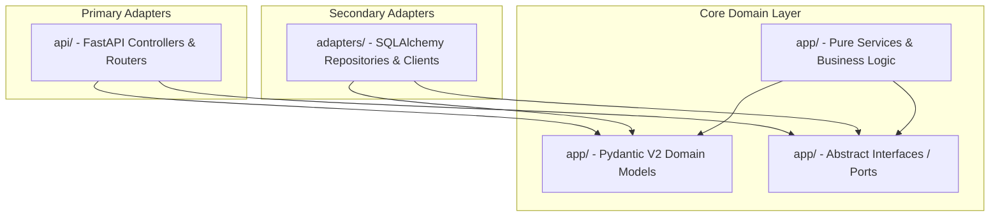

# 🏛️ Monorepo Architectural Guide

This document defines the architectural guidelines, dependency rules, and sub-agent ownership limits for the **Inventory Audit & Stock Control Platform** monorepo.

---

## 1. Hexagonal Architecture & Dependency Flow

The backend follows a strict **Hexagonal Architecture (Ports and Adapters)** pattern. The core principle is that **dependencies only point inward**.

### Dependency Rules:
1. **The Domain is Pure**: The code inside `backend/app/` represents the Domain and Application layers. It must have **zero** dependencies on databases (SQLAlchemy, Alembic), web frameworks (FastAPI, Starlette), or any other external delivery mechanism.
2. **Adapters depend on the Domain**: Infrastructure adapters (`backend/adapters/`) and interfaces (`backend/api/`) import and use the models and ports from the domain layer.
3. **Abstract Contracts (Ports)**: If the domain needs to read/write from a database or call an external service, it defines an abstract interface (Port) inside `backend/app/[module]/ports.py`. The adapters implement this port inside `backend/adapters/`.

---

## 2. Monorepo Directory Structure & Folder Roles

- **`backend/`**: Contains the Python FastAPI core service, Alembic database migrations, and seeding scripts.
  - `backend/app/`: Domain and Application Layer (Pydantic V2 Domain Models, Pure Services, Abstract Ports). **Jules (Core Backend Agent) Target**.
  - `backend/adapters/`: Infrastructure Layer / Secondary Adapters (SQLAlchemy concrete repositories, database session setup, external clients).
  - `backend/api/`: Presentation Layer / Primary Adapters (FastAPI controllers, routers, authentication middleware, error handlers).
  - `backend/migrations/`: Database schema versioning scripts (Alembic). **DBA Agent Target**.
  - `backend/scripts/`: Seeding and setup script factory. **DBA Agent Target**.
- **`frontend-mobile/`**: React Native / Expo mobile application. Used by Field Auditors for scanning barcodes and conducting real-time physical audits. **Mobile Dev Agent Target**.
- **`frontend-web/`**: Next.js analytical web application. Used by Managers and Supervisors to view dashboards, reports, and expiration alerts. **Web Analytics Agent Target**.
- **`docs/`**: Global system design files and Single Source of Truth specifications.

---

## 3. Sub-Agent File Ownership & Conflict Boundaries

To prevent multi-agent git conflicts and race conditions, the following strict file ownership rules apply:

| Agent Role | Target Directory / File Pattern | Ownership Policy |
|:---|:---|:---|
| **Jules** (Core Backend) | `backend/app/`   `backend/api/`   `backend/adapters/repositories/*_repository.py` | Has full write access. Owns business logic, routes, and query execution logic. |
| **DBA Specialist** | `backend/adapters/repositories/models.py`   `backend/migrations/`   `backend/scripts/` | **Sole owner** of the database schema mapping and migrations. Jules must NEVER edit `models.py` or create migration scripts. |
| **Mobile Dev Agent** | `frontend-mobile/` | Owns React Native views, offline sync logic, and barcode scanning controllers. |
| **Web Analytics Agent** | `frontend-web/` | Owns Next.js analytics dashboards, Tremor reports, and web routing. |

> [!IMPORTANT]
> If **Jules** needs a database schema change (e.g., adding a new column to a table), they must describe the required changes in their output so the **DBA Specialist** agent can modify `models.py` and generate the Alembic migrations.

---

## 4. Architectural Rules Checklist
- [ ] No imports of `sqlalchemy`, `alembic`, `fastapi`, `starlette`, or `requests` in `backend/app/`.
- [ ] No direct database calls or SQL execution inside FastAPI routers. All database interactions must use injected repositories.
- [ ] All prices, costs, and balances must use `decimal.Decimal` (never `float`).
- [ ] Role-Based Access Control (RBAC) must check roles server-side and structurally mask sensitive data (like `pcio_com_siva`).
