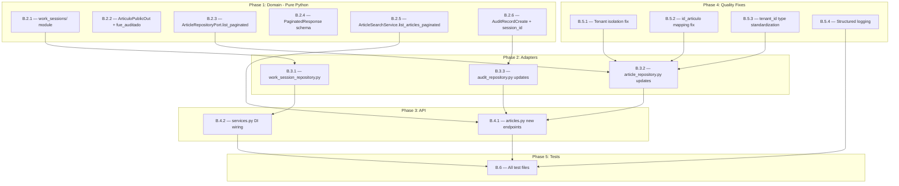

# Plan: WorkSession & Dynamic Article Audit Status + Backend Quality Improvements

> **Author:** Jules (Backend Engineer)  
> **Date:** 2026-08-07  
> **Status:** AWAITING APPROVAL  
> **Task Source:** [`work_session_and_article_audit_status.md`](file:///home/fede/Proyectos/SaaSStockDepositControl/backend/tasks/work_session_and_article_audit_status.md)

---

## Part A — Backend Codebase Audit & Quality Assessment

### A.1 What's Done Well ✅

| Area | Evidence | Grade |
|:-----|:---------|:------|
| **Hexagonal Architecture** | Clean 3-layer separation: `app/` (domain), `adapters/` (secondary), `api/` (primary). Domain layer has zero infrastructure imports. | ⭐⭐⭐⭐⭐ |
| **Domain Purity** | All domain models use `pydantic.BaseModel` with `Decimal` for financials. No SQLAlchemy, FastAPI, or HTTP code leaks into `app/`. | ⭐⭐⭐⭐⭐ |
| **Ports & Adapters** | Abstract ports (`abc.ABC`) in `app/*/ports.py` and `app/ports/`. Concrete repos implement these contracts. | ⭐⭐⭐⭐⭐ |
| **Field-Level RBAC** | Structural enforcement via `ArticuloPublicOut` / `ArticuloAdminOut` — `pcio_com_siva` never leaks to non-admin roles. Same pattern in stock schemas. | ⭐⭐⭐⭐⭐ |
| **Multi-Tenant Context** | `ContextVar`-based tenant isolation bound in middleware, read in repositories. | ⭐⭐⭐⭐ |
| **Multi-Database Architecture** | Three separate engine pools (`db_articles`, `db_users`, `db_analytics`) with per-repository session injection. | ⭐⭐⭐⭐ |
| **JWT Terminology** | Correct usage throughout: "decode and verify", never "decrypt". | ⭐⭐⭐⭐⭐ |
| **Decimal Precision** | All financial fields (`pcio_com_siva`, `valorized_amount`, etc.) use `decimal.Decimal`. Float→Decimal conversion in adapters. | ⭐⭐⭐⭐⭐ |
| **Domain Exceptions** | Clean hierarchy (`DomainException` → `EntityNotFoundException`, `BusinessRuleViolationException`) with centralized FastAPI exception handlers. | ⭐⭐⭐⭐⭐ |
| **Test Coverage Breadth** | 1,792 lines across domain, API, adapter, and DB test directories. Unit tests mock ports correctly. | ⭐⭐⭐⭐ |

### A.2 Issues & Improvement Opportunities 🔧

#### A.2.1 CRITICAL — Tenant Isolation Gap in Repositories

| File | Issue | Severity |
|:-----|:------|:---------|
| [`article_repository.py`](file:///home/fede/Proyectos/SaaSStockDepositControl/backend/adapters/repositories/article_repository.py) | `get_by_id()`, `get_by_barcode()`, and `search()` do **NOT** filter by `tenant_id` / `id_empresa`. The `get_tenant_id()` import exists but is never used. Per ARCHITECTURE.md Rule §4.2: *"Every query MUST include tenant_id filtering."* This is a **data isolation vulnerability** — any tenant can query any other tenant's articles. | 🔴 CRITICAL |
| [`audit_repository.py`](file:///home/fede/Proyectos/SaaSStockDepositControl/backend/adapters/repositories/audit_repository.py) | `exists_by_client_uuid()` does not filter by `tenant_id` despite receiving it as a parameter. | 🟡 MEDIUM |

#### A.2.2 HIGH — Connection Pool Singleton Duplication

| File | Issue |
|:-----|:------|
| [`connection.py`](file:///home/fede/Proyectos/SaaSStockDepositControl/backend/adapters/database/connection.py) | `SQLAlchemyConnectionProvider.__init__()` creates a **fourth** engine/session factory (lines 34–54) in addition to the three module-level singletons (`_articles_engine`, `_users_engine`, `_analytics_engine`). The `dispose()` method tries to clean up all four, but the `ConnectionProvider` instance engine may leak. The URL construction logic is duplicated 4× with identical env-var fallback chains (DRY violation). |

**Recommended fix:** Extract a `_build_database_url(env_key, fallback_db_name)` helper. Make `SQLAlchemyConnectionProvider` reuse `get_articles_session_factory()` instead of creating a parallel pool.

#### A.2.3 HIGH — Missing Pagination in Article Search

| File | Issue |
|:-----|:------|
| [`article_repository.py`](file:///home/fede/Proyectos/SaaSStockDepositControl/backend/adapters/repositories/article_repository.py#L84-L116) | `search()` returns up to 100 results with a hardcoded `.limit(100)`, no `OFFSET`, no total count. No `page`/`limit` parameters. The task spec requires standardized pagination for `GET /api/v1/articles`. |
| [`ArticleRepositoryPort`](file:///home/fede/Proyectos/SaaSStockDepositControl/backend/app/articles/ports.py) | Port does not declare any paginated listing method — only `get_by_id`, `get_by_barcode`, `search`. |

#### A.2.4 MEDIUM — Domain Model Missing `id_articulo` in `_to_domain()`

| File | Issue |
|:-----|:------|
| [`article_repository.py`](file:///home/fede/Proyectos/SaaSStockDepositControl/backend/adapters/repositories/article_repository.py#L27-L46) | `_to_domain()` constructs `Articulo(...)` but **never sets `id_articulo`** from `art_orm.id_articulo`. The Pydantic model requires it (it's in `ArticuloBase`), so this either crashes or defaults incorrectly. |

#### A.2.5 MEDIUM — Inconsistent `tenant_id` Type

| Layer | Type Used | Expected |
|:------|:----------|:---------|
| Domain models (`AuditRecordBase`) | `int` | `int` ✅ |
| Domain ports (`StockRepositoryPort`, `AuditRepositoryPort`) | `str` | Should be `int` |
| Adapters | Constantly casting `int(tenant_id)` with try/except fallback to `1` | Unnecessary if type is consistent |
| Middleware (`tenant_auth.py`) | Sets as `str(tenant_id)` | Inconsistent |

**Root cause:** `tenant_id` enters the system as a JWT claim (JSON number → Python `int`), gets stored as `str` in the ContextVar, then every consumer reconverts to `int`. This causes noisy `try/except` blocks in 4+ locations.

**Recommended fix:** Store `tenant_id` as `int` in the `ContextVar` and in all Port method signatures. One single conversion point in the middleware.

#### A.2.6 MEDIUM — No Structured Logging

No structured logging framework is configured anywhere. All error handling silently swallows exceptions (`except ValueError: pass` in middleware, `except Exception: return False` in health check). In production, this makes debugging multi-tenant issues nearly impossible.

#### A.2.7 LOW — `sys.path.insert` Hack in `main.py`

[`main.py` line 9](file:///home/fede/Proyectos/SaaSStockDepositControl/backend/api/main.py#L9): `sys.path.insert(0, ...)` is a fragile path manipulation. This should be replaced with a proper `pyproject.toml` package definition or `PYTHONPATH` configuration.

#### A.2.8 LOW — `datetime.utcnow` Deprecation

Multiple ORM models use `datetime.utcnow` (deprecated since Python 3.12). Should use `datetime.now(timezone.utc)` instead.

> [!NOTE]
> This is inside `adapters/repositories/models/` (DBA-Agent territory). Documenting here for the DBA-Agent to address.

#### A.2.9 LOW — Missing `__init__.py` Consistency

`backend/api/v1/__init__.py` is missing. Some subdirectories lack `__init__.py` (e.g., `tests/`, `tests/domain/`, `tests/api/`, `tests/adapters/`, `tests/db/`).

---

## Part B — Implementation Plan: WorkSession & Dynamic `fue_auditado`

### B.0 Scope and Ownership Boundaries

| Checklist Item | Owner | This Plan? |
|:---------------|:------|:-----------|
| ORM Models (`WorkSession`, `AuditRecord.session_id`) | ⛔ DBA-Agent | **NO** — documented as requirement |
| Alembic Migration | ⛔ DBA-Agent | **NO** — documented as requirement |
| Domain Ports, Models, Services | ✅ Jules | **YES** |
| Repository Adapters (`*_repository.py`) | ✅ Jules | **YES** |
| API Routers, Schemas, Dependencies | ✅ Jules | **YES** |
| Unit Tests | ✅ Jules | **YES** |

### B.1 DBA-Agent Requirements (Documented, Not Implemented)

> [!IMPORTANT]
> The following schema changes are required from the DBA-Agent before this plan can be fully executed:
>
> 1. **New table `work_sessions`** in `db_analytics` with columns: `session_id` (BigInteger PK), `tenant_id` (FK→`record_tenants.tenant_id`), `branch_id` (Integer), `opened_at` (DateTime), `closed_at` (DateTime), `status` (String(20), default "OPEN"), `created_at` (DateTime).
> 2. **New column `session_id`** (BigInteger, FK→`work_sessions.session_id`) on `audit_records`.
> 3. **New indexes**: `idx_work_sessions_lookup`, `idx_work_sessions_status`, `idx_audit_session_article`.
> 4. **ORM model update** in `analytics.py`: Add `WorkSession` class, add `session_id` + relationship to `AuditRecord`.
> 5. **Alembic migration** in `migrations/versions_analytics/`.

### B.2 Phase 1 — Domain Layer Changes (`backend/app/`)

#### B.2.1 New Module: `app/work_sessions/`

Create a new domain module for work session lifecycle management.

**Files to create:**

| File | Contents |
|:-----|:---------|
| `app/work_sessions/__init__.py` | Empty module init |
| `app/work_sessions/models.py` | Pydantic V2 schemas: `WorkSessionBase`, `WorkSessionCreate`, `WorkSession`, `WorkSessionStatus` (Enum: `OPEN`, `CLOSED`) |
| `app/work_sessions/ports.py` | `WorkSessionRepositoryPort(ABC)` with methods: `get_active_session()`, `create_session()` |
| `app/work_sessions/services.py` | `WorkSessionService` with method `get_or_create_active_session(tenant_id: int, branch_id: int, current_dt: Optional[datetime]) → WorkSession` implementing the daily session bounds logic (00:00:00 → 23:59:59) |

```python
# app/work_sessions/models.py — Design Preview
class WorkSessionStatus(str, Enum):
    OPEN = "OPEN"
    CLOSED = "CLOSED"

class WorkSession(BaseModel):
    session_id: int
    tenant_id: int
    branch_id: int
    opened_at: datetime
    closed_at: Optional[datetime] = None
    status: WorkSessionStatus = WorkSessionStatus.OPEN
    created_at: datetime

    model_config = ConfigDict(from_attributes=True)
```

```python
# app/work_sessions/ports.py — Design Preview
class WorkSessionRepositoryPort(ABC):
    @abstractmethod
    async def get_active_session(
        self, tenant_id: int, branch_id: int, at_datetime: datetime
    ) -> Optional[WorkSession]: ...

    @abstractmethod
    async def create_session(self, session: WorkSessionCreate) -> WorkSession: ...
```

```python
# app/work_sessions/services.py — Design Preview
class WorkSessionService:
    def __init__(self, session_repository: WorkSessionRepositoryPort):
        self.session_repository = session_repository

    async def get_or_create_active_session(
        self, tenant_id: int, branch_id: int, current_dt: Optional[datetime] = None
    ) -> WorkSession:
        now = current_dt or datetime.now(timezone.utc)
        start_of_day = now.replace(hour=0, minute=0, second=0, microsecond=0)
        end_of_day = now.replace(hour=23, minute=59, second=59, microsecond=999999)

        existing = await self.session_repository.get_active_session(tenant_id, branch_id, now)
        if existing:
            return existing

        new_session = WorkSessionCreate(
            tenant_id=tenant_id,
            branch_id=branch_id,
            opened_at=start_of_day,
            closed_at=end_of_day,
            status=WorkSessionStatus.OPEN,
        )
        return await self.session_repository.create_session(new_session)
```

#### B.2.2 Update `app/articles/models.py` — Add `fue_auditado` to Response DTOs

Add the dynamic audit status field to article response schemas:

```diff
 class ArticuloPublicOut(BaseModel):
     id_articulo: str
     presentacion: Optional[str] = None
     des_articulo: str
     id_marca: Optional[int] = None
     des_marca: Optional[str] = None
     id_familia: Optional[str] = None
     des_familia: Optional[str] = None
     id_grupo: Optional[str] = None
     des_grupo: Optional[str] = None
+    fue_auditado: bool = False

     model_config = ConfigDict(from_attributes=True)
```

#### B.2.3 Update `app/articles/ports.py` — Add Paginated Listing Method

Extend `ArticleRepositoryPort` with a new paginated method:

```python
# New method on ArticleRepositoryPort
@abstractmethod
async def list_paginated(
    self,
    tenant_id: int,
    page: int = 1,
    limit: int = 50,
    search: Optional[str] = None,
    id_familia: Optional[str] = None,
    id_grupo: Optional[str] = None,
) -> Tuple[List[Articulo], int]:
    """
    Returns (items, total_count) for paginated article listing.
    """
    pass
```

#### B.2.4 New: `app/articles/schemas.py` — Pagination Response Schema

Create a generic paginated response container:

```python
# app/articles/schemas.py
from typing import Generic, TypeVar, List
from pydantic import BaseModel

T = TypeVar("T")

class PaginatedResponse(BaseModel, Generic[T]):
    items: List[T]
    total: int
    page: int
    limit: int
    pages: int
```

#### B.2.5 Update `app/articles/services.py` — Add Paginated Listing

```python
# New method on ArticleSearchService
async def list_articles_paginated(
    self,
    tenant_id: int,
    page: int = 1,
    limit: int = 50,
    search: Optional[str] = None,
    id_familia: Optional[str] = None,
    id_grupo: Optional[str] = None,
) -> Tuple[List[Articulo], int]:
    if page < 1:
        page = 1
    if limit < 1 or limit > 200:
        limit = 50

    return await self.article_repository.list_paginated(
        tenant_id=tenant_id,
        page=page,
        limit=limit,
        search=search,
        id_familia=id_familia,
        id_grupo=id_grupo,
    )
```

#### B.2.6 Update `app/movements/domain.py` — Add `session_id` to `AuditRecordCreate`

```diff
 class AuditRecordBase(BaseModel):
     tenant_id: int
     branch_id: int
     warehouse_id: int
+    session_id: Optional[int] = None
     article_code: str
     ...
```

### B.3 Phase 2 — Repository Adapter Changes (`backend/adapters/repositories/`)

#### B.3.1 New: `adapters/repositories/work_session_repository.py`

Implements `WorkSessionRepositoryPort` against `db_analytics`:

- Uses `get_analytics_session_factory()`
- `get_active_session()`: Queries `work_sessions` WHERE `tenant_id = ? AND branch_id = ? AND opened_at <= ? AND closed_at >= ?`
- `create_session()`: Inserts new `WorkSession` row

#### B.3.2 Update `adapters/repositories/article_repository.py`

1. **Fix `_to_domain()`** — add missing `id_articulo` field mapping
2. **Fix tenant isolation** — add `id_empresa` filtering to all query methods using `get_tenant_id()`
3. **Implement `list_paginated()`** — Paginated query with LIMIT/OFFSET and a separate `count()` for total

> [!WARNING]
> Cross-database subquery: Since `articulos` is in `db_articles` and `audit_records` is in `db_analytics`, a single SQLAlchemy session cannot join both. Implementation approach:
>
> **Two-query approach** (recommended for portability): Fetch paginated articles from `db_articles`, then batch-check `session_id + article_code` existence in `db_analytics` via `AuditRepositoryPort`. This keeps each repository scoped to its own database.

#### B.3.3 Update `adapters/repositories/audit_repository.py`

- Add new method to check audit existence by session + article codes (batch):
  ```python
  async def get_audited_article_codes(
      self, session_id: int, article_codes: List[str]
  ) -> Set[str]:
      """Returns the subset of article_codes that have at least one audit_record for the given session_id."""
  ```
- This is a new method on `AuditRepositoryPort` (port extension in domain layer)
- Fix `exists_by_client_uuid` to filter by `tenant_id`

### B.4 Phase 3 — API Layer Changes (`backend/api/`)

#### B.4.1 Update `api/v1/articles.py` — New Paginated Endpoints

Add two new endpoints:

```python
# GET /api/v1/articles — Paginated article listing with fue_auditado
@router.get("/", response_model=PaginatedResponse)
async def list_articles(
    page: int = Query(1, ge=1),
    limit: int = Query(50, ge=1, le=200),
    search: Optional[str] = Query(None),
    id_familia: Optional[str] = Query(None),
    id_grupo: Optional[str] = Query(None),
    fue_auditado: Optional[bool] = Query(None),
    claims: dict = Depends(get_current_user_claims),
    search_service: ArticleSearchService = Depends(get_article_search_service),
    session_service: WorkSessionService = Depends(get_work_session_service),
):
    tenant_id = int(claims.get("tenant_id", 1))
    branch_id = int(claims.get("branch_id") or tenant_id)

    # Resolve active daily work session
    active_session = await session_service.get_or_create_active_session(tenant_id, branch_id)

    items, total = await search_service.list_articles_paginated(
        tenant_id=tenant_id,
        page=page, limit=limit,
        search=search, id_familia=id_familia, id_grupo=id_grupo,
    )

    # Enrich with fue_auditado from audit_records
    article_codes = [art.id_articulo for art in items]
    audited_codes = await audit_repo.get_audited_article_codes(active_session.session_id, article_codes)
    
    # RBAC schema selection
    is_admin = claims.get("role", "").lower() == "administrador"
    OutputSchema = ArticuloAdminOut if is_admin else ArticuloPublicOut
    
    serialized = []
    for art in items:
        out = OutputSchema.model_validate(art)
        out.fue_auditado = art.id_articulo in audited_codes
        serialized.append(out)

    # Optional fue_auditado filter (post-enrichment)
    if fue_auditado is not None:
        serialized = [s for s in serialized if s.fue_auditado == fue_auditado]

    pages = math.ceil(total / limit) if total > 0 else 0
    return PaginatedResponse(items=serialized, total=total, page=page, limit=limit, pages=pages)


# GET /api/v1/articles/{id_articulo} — Single article with fue_auditado
@router.get("/{id_articulo}", response_model=Union[ArticuloAdminOut, ArticuloPublicOut])
async def get_single_article(id_articulo: str, ...): ...
```

#### B.4.2 Update `api/dependencies/services.py` — Wire WorkSession Dependencies

```python
def get_work_session_service() -> WorkSessionService:
    from backend.app.work_sessions.services import WorkSessionService
    from backend.adapters.repositories.work_session_repository import SQLAlchemyWorkSessionRepository

    repo = SQLAlchemyWorkSessionRepository()
    return WorkSessionService(session_repository=repo)
```

### B.5 Phase 4 — Quality Improvements (Bundled)

These improvements address the issues found in Part A and are essential for the new feature to work correctly.

#### B.5.1 Fix Tenant Isolation in `article_repository.py`

Add `id_empresa` filtering using `get_tenant_id()` to:
- `get_by_id()`
- `get_by_barcode()`
- `search()`

#### B.5.2 Fix Missing `id_articulo` in `_to_domain()`

Add `id_articulo=str(art_orm.id_articulo).strip()` to the `Articulo(...)` constructor call.

#### B.5.3 Standardize `tenant_id` Type to `int`

Across all Port method signatures, change `tenant_id: str` → `tenant_id: int`:
- `StockRepositoryPort.get_stock_position()`
- `StockRepositoryPort.get_article_cost_info()`
- `AuditRepositoryPort.exists_by_client_uuid()`
- `AuditRepositoryPort.get_latest_audit_record()`
- `AuditService.register_single_audit()`
- `AuditService.register_batch_audit()`
- `StockLookupService.get_effective_stock()`

Update the middleware to set `tenant_id_context` as `int` instead of `str`.

Remove all `try: int(tenant_id) except` blocks in adapters.

#### B.5.4 Add Structured Logging Foundation

Add `import logging` with a module-level logger in:
- `api/middlewares/tenant_auth.py` (log decode failures)
- `adapters/repositories/` (log query errors)
- `app/*/services.py` (log business rule violations)

### B.6 Phase 5 — Unit Tests (`backend/tests/`)

| Test File | Coverage Target |
|:----------|:----------------|
| `tests/domain/test_work_session_service.py` | `WorkSessionService.get_or_create_active_session()` — existing session reuse, new session creation, day boundary edge cases |
| `tests/domain/test_article_pagination_service.py` | `ArticleSearchService.list_articles_paginated()` — pagination math, filter application, `fue_auditado` enrichment |
| `tests/domain/test_audit_session_integration.py` | `AuditService.register_single_audit()` with `session_id` propagation |
| `tests/api/test_articles_pagination_routes.py` | `GET /api/v1/articles` — pagination params, RBAC schema selection, `fue_auditado` filter |
| `tests/api/test_articles_single_route.py` | `GET /api/v1/articles/{id_articulo}` — single article with audit status |

All tests will mock ports using `unittest.mock.AsyncMock` — no real database connections needed.

---

## Part C — Execution Order & Dependencies



### Execution Sequence (Linear)

1. **B.5.2** — Fix `id_articulo` mapping (prerequisite for everything)
2. **B.5.3** — Standardize `tenant_id` type (reduces noise in all adapters)
3. **B.5.1** — Fix tenant isolation (security-critical)
4. **B.2.1** — Create `work_sessions/` domain module
5. **B.2.6** — Add `session_id` to `AuditRecordCreate`
6. **B.2.2** — Add `fue_auditado` to article DTOs
7. **B.2.3** — Extend `ArticleRepositoryPort` with `list_paginated()`
8. **B.2.4** — Create `PaginatedResponse` schema
9. **B.2.5** — Add paginated listing to `ArticleSearchService`
10. **B.3.1** — Implement `SQLAlchemyWorkSessionRepository`
11. **B.3.3** — Update audit repository (batch check + session support)
12. **B.3.2** — Update article repository (paginated listing + tenant fix)
13. **B.4.2** — Wire DI dependencies
14. **B.4.1** — Implement new API endpoints
15. **B.5.4** — Add structured logging
16. **B.6** — Write all unit tests

### Files to Create (New)

| # | Path | Description |
|:--|:-----|:------------|
| 1 | `backend/app/work_sessions/__init__.py` | Module init |
| 2 | `backend/app/work_sessions/models.py` | WorkSession Pydantic schemas |
| 3 | `backend/app/work_sessions/ports.py` | WorkSessionRepositoryPort |
| 4 | `backend/app/work_sessions/services.py` | WorkSessionService |
| 5 | `backend/app/articles/schemas.py` | PaginatedResponse generic |
| 6 | `backend/adapters/repositories/work_session_repository.py` | SQLAlchemy impl |
| 7 | `backend/tests/domain/test_work_session_service.py` | Service tests |
| 8 | `backend/tests/domain/test_article_pagination_service.py` | Pagination tests |
| 9 | `backend/tests/domain/test_audit_session_integration.py` | Audit+session tests |
| 10 | `backend/tests/api/test_articles_pagination_routes.py` | API pagination tests |
| 11 | `backend/tests/api/test_articles_single_route.py` | Single article tests |

### Files to Modify (Existing)

| # | Path | Changes |
|:--|:-----|:--------|
| 1 | `backend/app/articles/models.py` | Add `fue_auditado: bool = False` to `ArticuloPublicOut` |
| 2 | `backend/app/articles/ports.py` | Add `list_paginated()` abstract method |
| 3 | `backend/app/articles/services.py` | Add `list_articles_paginated()` method |
| 4 | `backend/app/movements/domain.py` | Add `session_id: Optional[int]` to `AuditRecordBase` |
| 5 | `backend/app/movements/ports.py` | Add `get_audited_article_codes()` to `AuditRepositoryPort`, standardize `tenant_id` type |
| 6 | `backend/app/movements/services.py` | Update `tenant_id` type from `str` → `int` |
| 7 | `backend/adapters/repositories/article_repository.py` | Fix `_to_domain()`, add tenant isolation, implement `list_paginated()` |
| 8 | `backend/adapters/repositories/audit_repository.py` | Add `get_audited_article_codes()`, fix `exists_by_client_uuid` tenant filter, update `tenant_id` type |
| 9 | `backend/adapters/repositories/stock_repository.py` | Update `tenant_id` type from `str` → `int` |
| 10 | `backend/adapters/database/multi_tenant.py` | Change `tenant_id_context` type from `Optional[str]` → `Optional[int]` |
| 11 | `backend/api/middlewares/tenant_auth.py` | Set `tenant_id` as `int`, add logging |
| 12 | `backend/api/v1/articles.py` | Add paginated listing + single article endpoints |
| 13 | `backend/api/dependencies/services.py` | Add `get_work_session_service()`, update `get_article_search_service()` |

---

> [!CAUTION]
> This plan **cannot** be fully executed until the DBA-Agent delivers the `WorkSession` ORM model and `audit_records.session_id` column migration (Section B.1). However, all domain, service, and test code can be developed now using mocked ports. The repository adapter for work sessions will need the ORM model to compile.
