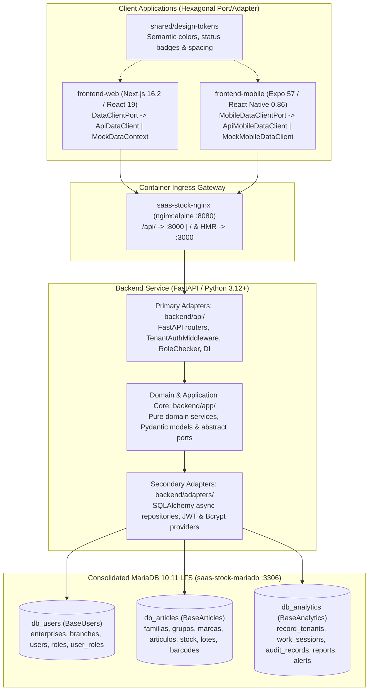

# 🏛️ ARCHITECTURE.md — Full-Stack & Multi-Database Hexagonal Architecture

This document reflects the current implementation across the **SaaS Stock Deposit Control** monorepo and serves as the authoritative architecture reference for the backend service (`backend/`), web platform (`frontend-web/`), mobile field application (`frontend-mobile/`), shared design tokens (`shared/design-tokens/`), and containerized infrastructure (`docker-compose.yml`).

---

## 1. System Architecture Overview

The entire platform is built around **Hexagonal Architecture (Ports & Adapters)**, enforcing strict separation between pure domain logic, application ports, and external infrastructure or UI adapters across both the backend and client applications.

### Core Architectural Invariants

1. **Pure Domain Layer**: Domain code in `backend/app/` and `frontend-mobile/src/services/domain/` must never import HTTP frameworks (`fastapi`), ORM libraries (`sqlalchemy`), or storage drivers.
2. **Port-Driven Contracts**: Every repository and client data source implements an explicit abstract port (`backend/app/*/ports.py`, `DataClientPort`, `MobileDataClientPort`).
3. **Multi-Database & Multi-Tenant Isolation**: Persistence is split across three logical databases (`db_users`, `db_articles`, `db_analytics`) with tenant context extracted from verified JWT claims (`tenant_id`, `branch_id`, `id_usuario`).
4. **Structural Financial Masking**: Purchase cost (`pcio_com_siva`) and valorized audit metrics (`monto_valorizado`, `applied_unit_cost`) are structurally omitted for non-administrator roles (`supervisor`, `auditor`) at both the backend response schema layer and client adapters.
5. **Exact Monetary Arithmetic**: All backend financial and VAT calculations use `Decimal` rather than floating-point numbers.

---

## 2. Multi-Database Topology & Schema Ownership

The persistence layer consolidates three logical databases inside a single MariaDB 10.11 LTS instance (`saas-stock-mariadb`), managed in `backend/adapters/database/connection.py` through three independent async SQLAlchemy engines and session factories:

| Logical Database | Declarative Base | Session Factory | Owned Tables | Concrete Repositories (`backend/adapters/repositories/`) |
|:-----------------|:-----------------|:----------------|:-------------|:---------------------------------------------------------|
| **`db_users`** | `BaseUsers` (`models/users.py`) | `get_users_session_factory()` | `enterprises`, `branches`, `users`, `roles`, `user_roles` | `SQLAlchemyUserRepository` (`user_repository.py`) `SQLAlchemyEnterpriseRepository` (`enterprise_repository.py`) `SQLAlchemyBranchRepository` (`branch_repository.py`) |
| **`db_articles`** | `BaseArticles` (`models/articles.py`) | `get_articles_session_factory()` | `familias`, `grupos`, `marcas`, `articulos`, `stock_por_deposito`, `lotes_por_deposito`, `codigos_barra_articulo`, plus legacy catalog-side `empresas`, `sucursales`, `depositos` | `SQLAlchemyArticleRepository` (`article_repository.py`) `SQLAlchemyStockRepository` (`stock_repository.py`) |
| **`db_analytics`** | `BaseAnalytics` (`models/analytics.py`) | `get_analytics_session_factory()` | `record_tenants`, `work_sessions`, `audit_records`, `daily_reports`, `critical_shrinkage_alerts` | `SQLAlchemyAuditRepository` (`audit_repository.py`) `SQLAlchemyWorkSessionRepository` (`work_session_repository.py`) `SQLAlchemyReportRepository` (`report_repository.py`) |

> [!IMPORTANT]
> **Enterprise & Branch Database Ownership**: Operational tenant identity (`Enterprise` and `Branch` domain models managed by `EnterpriseRepository` and `BranchRepository`) resides in **`db_users` (`BaseUsers`)** via `get_users_session_factory()`. Meanwhile, `db_articles` (`BaseArticles`) retains legacy catalog-side tables (`empresas`, `sucursales`, `depositos`) solely for catalog and warehouse stock foreign-key integrity.

### Multi-Database Alembic Migrations

`backend/migrations/env.py` dynamically inspects `DB_TARGET` (`articles`, `users`, or `analytics`) or the `-c` config filename to bind the appropriate metadata (`BaseArticles.metadata`, `BaseUsers.metadata`, or `BaseAnalytics.metadata`), database URL, and revision directory:

- `backend/migrations/alembic.ini` $\rightarrow$ `versions/` (`db_articles`)
- `backend/migrations/alembic_users.ini` $\rightarrow$ `versions_users/` (`db_users`)
- `backend/migrations/alembic_analytics.ini` $\rightarrow$ `versions_analytics/` (`db_analytics`)

---

## 3. Tenant Binding & Request Context

Tenant context is established on every request by `TenantAuthMiddleware` in `backend/api/middlewares/tenant_auth.py`:

1. Extracts the Bearer token from the `Authorization` header.
2. Verifies the signature and expiration via `TokenProvider` (`backend/adapters/security/jwt_provider.py`).
3. Binds `tenant_id`, `branch_id`, and `user_id` (`id_usuario`) into a request-scoped `ContextVar` defined in `backend/adapters/database/multi_tenant.py` (`set_current_tenant_context`).
4. Guarantees cleanup via `reset_tenant_context(token)` inside a `finally` block so async worker coroutines never leak tenant state across requests.

> [!NOTE]
> JWT tokens are signed (`HS256`) and verified for authenticity and integrity; they are not encrypted payloads.

---

## 4. Backend Layer Responsibilities (`backend/`)

### 4.1 Primary Adapters / API Layer (`backend/api/`)

Exposes REST endpoints under `/api/v1`, enforces RBAC via `RoleChecker` (`backend/api/dependencies/auth.py`), and wires domain services in `backend/api/dependencies/services.py`:

- `backend/api/main.py`: FastAPI initialization, CORS configuration, `TenantAuthMiddleware`, and router registration.
- `backend/api/v1/health.py`: `GET /api/v1/health` database connectivity probe.
- `backend/api/v1/auth.py`: `POST /api/v1/auth/login` credential verification and JWT issuance.
- `backend/api/v1/users.py`: Administrator-only user management endpoints (`GET /api/v1/users`, `PATCH /api/v1/users/{user_id}/status`, `PUT /api/v1/users/{user_id}/roles`).
- `backend/api/v1/articles.py`: Catalog pagination (`GET /api/v1/articles`), quick search (`GET /api/v1/articles/search`), and detail lookup (`GET /api/v1/articles/{id_articulo}`) with role-conditional output schemas (`ArticuloAdminOut` vs `ArticuloPublicOut`).
- `backend/api/v1/stock.py`: Single audit registration (`POST /api/v1/stock/audit`), offline batch sync (`POST /api/v1/stock/audit/batch`), stock position lookup (`GET /api/v1/stock/position`), and aggregated dashboard KPIs (`GET /api/v1/stock/kpis`).
- `backend/api/v1/enterprises.py`: Administrator-only enterprise CRUD routes.
- `backend/api/v1/branches.py`: Administrator-only branch CRUD routes.
- `backend/api/v1/reports.py`: Administrator-only financial report routes (`/shrinkage`, `/goods-received`, `/inventory-balance`).

### 4.2 Domain & Application Layer (`backend/app/`)

Contains pure business rules, domain entities, Pydantic schemas, and abstract port interfaces:

- `app/users/`:
  - `AuthService` (`services.py`): Authenticates active users and issues tenant-bound JWTs.
  - `UserService` (`services.py`): Manages organization users within a tenant, enforcing **self-lockout protection** (administrators cannot deactivate their own account), **single-role assignment constraint**, and **self-demotion protection** (administrators cannot remove `administrador` from themselves).
- `app/movements/`:
  - `AuditService` (`services.py`): Orchestrates physical stock counts, computes theoretical discrepancies via `DeltaCalculator`, applies VAT rates via `VatClassifier` (`0%` for `Medicamentos`, `21%` standard), updates stock positions, and records immutable entries in `db_analytics`.
  - `StockLookupService` (`services.py`): Resolves effective theoretical stock with fallback rules.
  - `StockKPIService` (`services.py`): Computes database-aggregated dashboard KPIs (`total_articulos`, `auditados`, `pendientes`, `porcentaje_avance`, `discrepancias_alta`, `discrepancias_baja`, `sin_accion`, `out_of_stock_count`), conditionally attaching valorized currency totals (`monto_valorizado_alta`, `monto_valorizado_baja`) only for `administrador`.
- `app/articles/`: `ArticleSearchService` for multi-barcode, SKU, description, family, and FEFO lot queries.
- `app/work_sessions/`: `WorkSessionService` managing active branch audit sessions (`WorkSession`).
- `app/reports/`: `ReportService` and pure financial calculators (`domain.py`) for shrinkage, goods-received, and daily inventory balance reports.
- `app/enterprises/` & `app/branches/`: Domain services and ports for tenant hierarchy management.
- `app/ports/`: Shared infrastructure contracts (`database.py`, `security.py`).

### 4.3 Secondary Adapters Layer (`backend/adapters/`)

Concrete infrastructure implementations:

- `adapters/database/connection.py`: `SQLAlchemyConnectionProvider` and the three session factories (`get_articles_session_factory`, `get_users_session_factory`, `get_analytics_session_factory`).
- `adapters/security/jwt_provider.py` & `password_hasher.py`: `PyJWT` token provider and `BcryptPasswordHasher`.
- `adapters/repositories/`: Concrete SQLAlchemy repositories translating between ORM models (`adapters/repositories/models/`) and pure domain models.

---

## 5. Frontend Web Architecture (`frontend-web/`)

The Next.js 16.2 (App Router, React 19, TypeScript 5, Tailwind CSS v4) web application follows a client-side Hexagonal Port/Adapter pattern so UI components remain agnostic of whether data comes from the live FastAPI backend or in-memory seed state.

### 5.1 Port & Adapters (`frontend-web/lib/`)

- **Port Contract (`lib/ports/DataClientPort.ts`)**: Defines `DataClientPort` for authentication (`login`, `logout`, `getCurrentUser`), catalog queries (`getArticulos`, `getArticuloByBarcode`, `searchArticulos`), audit registration (`registerAudit`, `getAuditLog`), dashboard metrics (`getKPIs`), and user administration (`getUsers`, `updateUserStatus`, `updateUserRole`).
- **Live API Adapter (`lib/adapters/ApiDataClient.ts` & `httpClient.ts`)**: Implements `DataClientPort` over REST calls to `/api/v1/*`, attaches Bearer JWT tokens from `localStorage`, validates token expiration via `parseJwt`, and maps responses through `lib/adapters/mappers.ts`.
- **Mock Adapter (`lib/mocks/MockDataContext.tsx`)**: Implements `DataClientPort` in memory using `seed-data.ts`, replicating backend RBAC financial projection (`projectArticleForRole`), VAT valuation, and self-lockout/self-demotion guards.
- **Provider Injection (`app/providers.tsx`)**: Inspects `NEXT_PUBLIC_DATA_SOURCE` (`api` by default, or `mock`) to mount either `ApiDataProvider` (`lib/context/ApiDataContext.tsx`) or `MockDataProvider`.

### 5.2 App Router Views (`frontend-web/app/`)

| Route | Responsibility |
|:------|:---------------|
| `/login` | Email/password authentication view with JWT session initialization |
| `/dashboard` | Real-time operational KPIs (`/api/v1/stock/kpis`) and role-gated financial variance cards |
| `/catalog` | Paginated article explorer with barcode/SKU search, FEFO lot badges, and admin-only unit cost column |
| `/audit` | Interactive physical stock count terminal with camera/USB barcode scanner (`html5-qrcode`) |
| `/reports` | Administrator-only financial reports (`Shrinkage`, `Goods Received`, `Inventory Balance`) |
| `/users` | Administrator-only user management table (active status toggle and role selector) |
| `/debug` | Diagnostic inspector for active data source adapter, JWT claims, and session state |

---

## 6. Frontend Mobile Architecture (`frontend-mobile/`)

The Expo SDK 57 / React Native 0.86 mobile application is purpose-built for warehouse floor operators (`auditor` and `supervisor`) with high-contrast surfaces and 48dp minimum touch targets.

### 6.1 Port & Adapters (`frontend-mobile/src/`)

- **Port Contract (`src/ports/MobileDataClientPort.ts`)**: Defines `MobileDataClientPort` (`login`, `logout`, `restoreSession`, `getDailyProgress`, `searchArticles`, `getArticleCatalog`, `getArticleStockPosition`, `registerAudit`).
- **Live API Adapter (`src/adapters/apiMobileDataClient.ts`)**:
  - Communicates with `/api/v1/*` using `EXPO_PUBLIC_API_URL`.
  - **Strict Field-Role Guard**: During `login()`, decodes JWT claims and explicitly rejects any role other than `auditor` or `supervisor` (blocking `administrador` or unknown roles from mobile field sessions).
  - **Defensive Financial Sanitizer (`stripFinancialFields`)**: Recursively strips `pcio_com_siva`, `monto_valorizado`, and `applied_unit_cost` from all incoming JSON payloads before state hydration.
  - **Tenant-Isolated Session Storage**: Persists active sessions in `AsyncStorage` under `audit_global:session:{tenantId}:{branchId}` and validates `expiresAtMs` on session restore.
- **Mock Adapter (`src/adapters/mockMobileDataClient.ts`)**: Offline-capable mock implementation switched via `EXPO_PUBLIC_USE_MOCK=true` in `src/context/DataContext.tsx`.

### 6.2 Pure Mobile Domain Services (`frontend-mobile/src/services/domain/`)

- `AuditValidator.ts`: Validates non-negative integer physical counts, mandatory discrepancy motives when `delta !== 0`, and 255-character observation limits.
- `DeltaCalculator.ts`: Pure computation of `deltaStock`, `affectedQuantity`, `actionType` (`Alta`, `Baja`, `Sin Acción`), and `requiresMotive`.
- `FefoEvaluator.ts`: Evaluates lot expiration dates (`YYYY-MM-DD` or `DD/MM/YYYY`) into `EXPIRED` (`VENCIDO`), `PROXIMO` (`PRÓXIMO`, $\le 90$ days), `SAFE`, or `NONE`.

---

## 7. Shared Design System & Container Infrastructure

### 7.1 Shared Design Tokens (`shared/design-tokens/`)

Provides a single source of visual truth across Web (`frontend-web/app/globals.css`) and Mobile (`frontend-mobile/src/utils/designTokens.ts`), standardizing semantic colors for stock movements (`Alta` emerald, `Baja` crimson, `Sin Acción` slate), FEFO expiration alerts (`VENCIDO`, `PRÓXIMO`, `NORMAL`), role badges, and touch target sizing.

### 7.2 Container & Ingress Gateway (`docker-compose.yml`)

Orchestrated via `./scripts/devops/deploy.sh`:

1. **`saas-stock-mariadb` (`mariadb:10.11`)**:
   - Hosts `db_articles`, `db_users`, and `db_analytics` on a shared InnoDB buffer pool.
   - Auto-initializes databases and scoped `app_user` privileges on first boot via `docker/mariadb/init-dbs.sql`.
   - Persists data in the `mariadb_data` Docker volume and runs `mariadb-admin ping` health checks.
2. **`saas-stock-nginx` (`nginx:alpine`)**:
   - Exposes a unified ingress gateway on `NGINX_PORT` (default `8080`) configured by `docker/nginx/nginx.conf`.
   - Routes `/api/` to FastAPI (`host.docker.internal:8000`), `/_next/webpack-hmr` (with WebSocket `Upgrade` headers) and `/` to Next.js (`host.docker.internal:3000`), and `/nginx-health` for container health probes.

---

## 8. File Ownership & Boundaries

| Area | Responsibility & Ownership |
|:-----|:---------------------------|
| `backend/app/**` | Pure backend domain services, models, schemas, and abstract ports |
| `backend/api/**` | FastAPI routers, `TenantAuthMiddleware`, `RoleChecker`, and DI wiring |
| `backend/adapters/repositories/*.py` | Concrete SQLAlchemy repository implementations |
| `backend/adapters/database/*.py` | Async engines, session factories, and `ContextVar` tenant state |
| `backend/adapters/security/**` | JWT signing/verification and Bcrypt password hashing |
| `backend/adapters/repositories/models/**` | Declarative ORM mappings (`BaseUsers`, `BaseArticles`, `BaseAnalytics`) |
| `backend/migrations/**` | Multi-database Alembic configurations (`env.py`, `.ini` files, `versions*/`) |
| `backend/scripts/seed.py` | Idempotent multi-database data seeder |
| `frontend-web/**` | Next.js 16.2 web dashboard, `DataClientPort`, and web adapters |
| `frontend-mobile/**` | Expo SDK 57 mobile field client, `MobileDataClientPort`, and mobile domain services |
| `shared/design-tokens/**` | Cross-platform semantic design tokens |
| `docker/**` & `scripts/devops/**` | MariaDB initialization SQL, NGINX gateway config, and `deploy.sh` automation |

---

## 9. Relevant Project References

- [Root README (`../README.md`)](../README.md)
- [REST API Documentation (`API_DOCUMENTATION.md`)](API_DOCUMENTATION.md)
- [OpenAPI 3.1.0 Specification (`openapi.json`)](openapi.json)
- [Container & NGINX Deployment Runbook (`deploy/README.md`)](deploy/README.md)
- [Backend Guide (`../backend/README.md`)](../backend/README.md)
- [Web Frontend Guide (`../frontend-web/README.md`)](../frontend-web/README.md)
