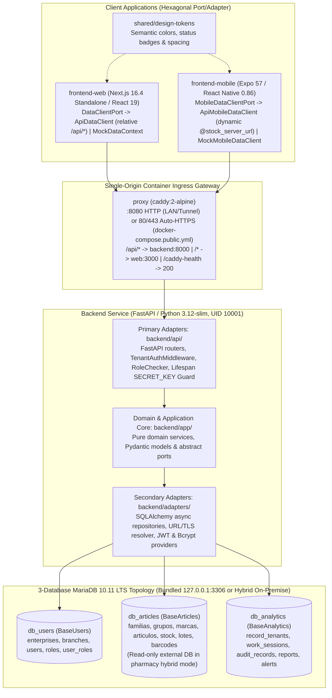

# 🏛️ ARCHITECTURE.md — Full-Stack & Multi-Database Hexagonal Architecture

This document reflects the current implementation across the **SaaS Stock Deposit Control** monorepo and serves as the authoritative architecture reference for the backend service (`backend/`), web platform (`frontend-web/`), mobile field application (`frontend-mobile/`), shared design tokens (`shared/design-tokens/`), containerized multi-profile infrastructure (`docker-compose.yml`), and CI/CD pipelines (`.github/workflows/`).

---

## 1. System Architecture Overview

The entire platform is built around **Hexagonal Architecture (Ports & Adapters)**, enforcing strict separation between pure domain logic, application ports, and external infrastructure or UI adapters across both the backend and client applications.

### Core Architectural Invariants

1. **Pure Domain Layer**: Domain code in `backend/app/` and `frontend-mobile/src/services/domain/` must never import HTTP frameworks (`fastapi`), ORM libraries (`sqlalchemy`), or storage drivers.
2. **Port-Driven Contracts**: Every repository and client data source implements an explicit abstract port (`backend/app/*/ports.py`, `DataClientPort`, `MobileDataClientPort`).
3. **Multi-Database & Multi-Tenant Isolation**: Persistence is split across three logical databases (`db_users`, `db_articles`, `db_analytics`) with tenant context extracted from verified JWT claims (`tenant_id`, `branch_id`, `id_usuario`).
4. **Structural Financial Masking**: Purchase cost (`pcio_com_siva`) and valorized audit metrics (`monto_valorizado`, `applied_unit_cost`) are structurally omitted for non-administrator roles (`supervisor`, `auditor`) at both the backend response schema layer and client adapters.
5. **Exact Monetary Arithmetic**: All backend financial and VAT calculations use `Decimal` rather than floating-point numbers.
6. **Single-Origin & Least-Privilege Runtime**: Web and API traffic share a single origin behind Caddy (`NEXT_PUBLIC_API_URL=""`), containers run as non-root users (`10001` backend, `1001` web), bundled MariaDB binds exclusively to `127.0.0.1`, and `ENVIRONMENT=production` enforces a $\ge 32$-character non-trivial `SECRET_KEY` at startup.

---

## 2. Multi-Database Topology, URL Precedence & Schema Ownership

The persistence layer manages three logical databases (`backend/adapters/database/connection.py`) through three independent async SQLAlchemy engines and session factories:

| Logical Database | Declarative Base | Session Factory | Owned Tables | Concrete Repositories (`backend/adapters/repositories/`) |
|:-----------------|:-----------------|:----------------|:-------------|:---------------------------------------------------------|
| **`db_users`** | `BaseUsers` (`models/users.py`) | `get_users_session_factory()` | `enterprises`, `branches`, `users`, `roles`, `user_roles` | `SQLAlchemyUserRepository` (`user_repository.py`) `SQLAlchemyEnterpriseRepository` (`enterprise_repository.py`) `SQLAlchemyBranchRepository` (`branch_repository.py`) |
| **`db_articles`** | `BaseArticles` (`models/articles.py`) | `get_articles_session_factory()` | `familias`, `grupos`, `marcas`, `articulos`, `stock_por_deposito`, `lotes_por_deposito`, `codigos_barra_articulo`, plus legacy catalog-side `empresas`, `sucursales`, `depositos` | `SQLAlchemyArticleRepository` (`article_repository.py`) `SQLAlchemyStockRepository` (`stock_repository.py`) |
| **`db_analytics`** | `BaseAnalytics` (`models/analytics.py`) | `get_analytics_session_factory()` | `record_tenants`, `work_sessions`, `audit_records`, `daily_reports`, `critical_shrinkage_alerts` | `SQLAlchemyAuditRepository` (`audit_repository.py`) `SQLAlchemyWorkSessionRepository` (`work_session_repository.py`) `SQLAlchemyReportRepository` (`report_repository.py`) |

> [!IMPORTANT]
> **Enterprise & Branch Database Ownership**: Operational tenant identity (`Enterprise` and `Branch` domain models managed by `EnterpriseRepository` and `BranchRepository`) resides in **`db_users` (`BaseUsers`)** via `get_users_session_factory()`. Meanwhile, `db_articles` (`BaseArticles`) retains legacy catalog-side tables (`empresas`, `sucursales`, `depositos`) solely for catalog and warehouse stock foreign-key integrity.

### Deterministic Database URL Precedence & TLS (`connection.py` & `url_config.py`)

Both the runtime engines (`resolve_database_url(target)` in `backend/adapters/database/connection.py`) and Alembic (`resolve_alembic_url(target)` in `backend/migrations/url_config.py`) enforce a single uniform resolution order per target (`articles`, `users`, `analytics`):

1. **Target-Specific Full URL**: `ARTICLES_DATABASE_URL`, `USERS_DATABASE_URL`, or `ANALYTICS_DATABASE_URL`.
2. **Base URL Fallback**: `DATABASE_URL` with the database path component swapped to `DB_NAME_<TARGET>`.
3. **Individual Components**: `DB_HOST`, `DB_PORT`, `DB_USER`, `DB_PASSWORD` (URL-encoded via `urllib.parse.quote(..., safe="")`), and `DB_NAME_<TARGET>`.

Database TLS is controlled via `build_ssl_connect_args()`:
- `DB_SSL_MODE=disable` (default for internal Compose networks)
- `DB_SSL_MODE=require` (encrypted connection without certificate verification)
- `DB_SSL_MODE=verify-ca` (validates server certificate chain against `DB_SSL_CA` or system trust store)

### Multi-Database Alembic Migrations & Hybrid On-Premise Switches

`backend/migrations/env.py` wires `url_config.py` (`escape_for_configparser` to escape `%` characters for `configparser` interpolation) across three dedicated configurations:

- `backend/migrations/alembic.ini` $\rightarrow$ `versions/` (`db_articles`)
- `backend/migrations/alembic_users.ini` $\rightarrow$ `versions_users/` (`db_users`)
- `backend/migrations/alembic_analytics.ini` $\rightarrow$ `versions_analytics/` (`db_analytics`)

In containerized deployments, `backend/docker-entrypoint.sh` checks both the global `RUN_MIGRATIONS` flag and granular per-database switches (`RUN_MIGRATIONS_ARTICLES`, `RUN_MIGRATIONS_USERS`, `RUN_MIGRATIONS_ANALYTICS`). In **Pharmacy Hybrid On-Premise Topology** ([`docs/deploy/local-onpremise-runbook.md`](deploy/local-onpremise-runbook.md)), `ARTICLES_DATABASE_URL` points at the pharmacy's existing MariaDB server using a `SELECT`-only account (`ro_user`) and `RUN_MIGRATIONS_ARTICLES=false` prevents Alembic from touching the pharmacy schema, while `db_users` and `db_analytics` run inside the bundled MariaDB container (`DB_HOST=mariadb`).

---

## 3. Tenant Binding & Request Context

Tenant context is established on every request by `TenantAuthMiddleware` in `backend/api/middlewares/tenant_auth.py`:

1. Extracts the Bearer token from the `Authorization` header.
2. Verifies the signature and expiration via `TokenProvider` (`backend/adapters/security/jwt_provider.py`).
3. Binds `tenant_id`, `branch_id`, and `user_id` (`id_usuario`) into a request-scoped `ContextVar` defined in `backend/adapters/database/multi_tenant.py` (`set_current_tenant_context`).
4. Guarantees cleanup via `reset_tenant_context(token)` inside a `finally` block so async worker coroutines never leak tenant state across requests.

---

## 4. Backend Layer Responsibilities (`backend/`)

### 4.1 Primary Adapters / API Layer (`backend/api/`)

Exposes REST endpoints under `/api/v1`, enforces RBAC via `RoleChecker` (`backend/api/dependencies/auth.py`), and wires domain services in `backend/api/dependencies/services.py`:

- `backend/api/main.py`: FastAPI initialization, `validate_production_secret_key()` lifespan check (refuses startup in `ENVIRONMENT=production` if `SECRET_KEY` is `< 32` characters or matches `changeme`/`secret`), safe CORS setup (defaults `CORS_ORIGINS` to `""` rather than `"*"` plus RFC1918 LAN regex), `TenantAuthMiddleware`, and router registration.
- `backend/api/v1/health.py`: `GET /health` and `GET /api/v1/health` multi-database connectivity probe (`ConnectionProvider.check_databases()`), returning HTTP `200` only when `articles`, `users`, and `analytics` all answer `SELECT 1`.
- `backend/api/v1/auth.py`: `POST /api/v1/auth/login` credential verification and JWT issuance.
- `backend/api/v1/users.py`: Administrator-only user management endpoints (`GET /api/v1/users`, `PATCH /api/v1/users/{user_id}/status`, `PUT /api/v1/users/{user_id}/roles`).
- `backend/api/v1/articles.py`: Catalog pagination (`GET /api/v1/articles`), quick search (`GET /api/v1/articles/search`), and detail lookup (`GET /api/v1/articles/{id_articulo}`) with role-conditional output schemas (`ArticuloAdminOut` vs `ArticuloPublicOut`).
- `backend/api/v1/stock.py`: Single audit registration (`POST /api/v1/stock/audit`), offline batch sync (`POST /api/v1/stock/audit/batch`), stock position lookup (`GET /api/v1/stock/position`), and aggregated dashboard KPIs (`GET /api/v1/stock/kpis`).
- `backend/api/v1/enterprises.py` & `backend/api/v1/branches.py`: Tenant enterprise and branch CRUD routes.
- `backend/api/v1/reports.py`: Administrator-only financial report routes (`/shrinkage`, `/goods-received`, `/inventory-balance`).

### 4.2 Domain & Application Layer (`backend/app/`)

Contains pure business rules, domain entities, Pydantic schemas, and abstract port interfaces:

- `app/users/`: `AuthService` and `UserService` (enforcing **self-lockout protection**, **single-role assignment constraint**, and **self-demotion protection**).
- `app/movements/`: `AuditService`, `DeltaCalculator`, `VatClassifier` (`0%` for `Medicamentos`, `21%` standard), `StockLookupService`, and `StockKPIService` (database-aggregated KPIs with admin-only valorized totals).
- `app/articles/`: `ArticleSearchService` and `ArticleCatalogOrchestrator`.
- `app/work_sessions/`: `WorkSessionService` managing active branch audit sessions (`WorkSession`).
- `app/reports/`: `ShrinkageReportService`, `GoodsReceivedReportService`, and `DailyInventoryBalanceReportService`.
- `app/enterprises/` & `app/branches/`: Domain services and ports for tenant hierarchy management.
- `app/ports/`: Shared infrastructure contracts (`database.py` with `check_connectivity` and `check_databases`, `security.py`).

### 4.3 Secondary Adapters Layer (`backend/adapters/`)

- `adapters/database/connection.py`: `SQLAlchemyConnectionProvider`, `resolve_database_url`, `build_ssl_connect_args`, and the three session factories.
- `adapters/security/jwt_provider.py` & `password_hasher.py`: `PyJWT` token provider and `BcryptPasswordHasher`.
- `adapters/repositories/`: Concrete SQLAlchemy repositories translating between ORM models (`adapters/repositories/models/`) and pure domain models.

---

## 5. Frontend Web Architecture (`frontend-web/`)

The Next.js 16.4 (App Router, `output: "standalone"`, React 19, TypeScript 5, Tailwind CSS v4) web application follows a client-side Hexagonal Port/Adapter pattern.

### 5.1 Port, Adapters & Camera Scanner Lifecycle (`frontend-web/lib/`)

- **Port Contract (`lib/ports/DataClientPort.ts`)**: Defines `DataClientPort` for authentication, catalog queries, audit registration, dashboard KPIs, and user administration.
- **Live API Adapter (`lib/adapters/ApiDataClient.ts` & `httpClient.ts`)**: Defaults `NEXT_PUBLIC_API_URL` to `""` so browser requests use relative `/api/v1/*` paths routed through Caddy on the same origin. Attaches Bearer JWT tokens from `localStorage` and enforces role-based field projection via `lib/adapters/mappers.ts`.
- **Mock Adapter (`lib/mocks/MockDataContext.tsx`)**: Stateful in-memory implementation backed by `seed-data.ts`.
- **Camera Scanner Stability (`lib/hooks/useCameraPermissions.ts` & `useBarcodeScanner.ts`)**:
  - `useCameraPermissions`: Uses `navigator.permissions.query({ name: "camera" })` fast-path to skip redundant `getUserMedia` probes when already granted, uses `facingMode: { ideal: "environment" }`, and enforces a `150ms` hardware abstraction layer (HAL) release delay after stopping tracks.
  - `useBarcodeScanner`: Enables native `BarcodeDetector` when supported, restricts formats to retail/logistics codes (`EAN_13`, `EAN_8`, `CODE_128`, `QR_CODE`), guards `computeQrbox` against small viewports, and serializes scanner lifecycle transitions through a start/stop promise mutex (`startPromiseRef` / `stopPromiseRef`).

### 5.2 App Router Views (`frontend-web/app/`)

| Route | Responsibility |
|:------|:---------------|
| `/login` | Email/password authentication view with JWT session initialization |
| `/dashboard` | Real-time operational KPIs (`/api/v1/stock/kpis`) and role-gated financial variance cards |
| `/catalog` | Paginated article explorer with barcode/SKU search, FEFO lot badges, and admin-only unit cost column |
| `/audit` | Interactive physical stock count terminal with camera/USB barcode scanner (`BarcodeScannerModal`) |
| `/reports` | Administrator-only financial reports (`Shrinkage`, `Goods Received`, `Inventory Balance`) |
| `/users` | Administrator-only user management table (active status toggle and role selector) |
| `/debug` | Diagnostic inspector for active data source adapter, JWT claims, and session state |

---

## 6. Frontend Mobile Architecture (`frontend-mobile/`)

The Expo SDK 57 / React Native 0.86 mobile application is purpose-built for warehouse floor operators (`auditor` and `supervisor`) with high-contrast surfaces and 48dp minimum touch targets.

### 6.1 Port, Adapters & Dynamic Server Discovery (`frontend-mobile/src/`)

- **Port Contract (`src/ports/MobileDataClientPort.ts`)**: Defines `MobileDataClientPort` (`login`, `logout`, `restoreSession`, `getDailyProgress`, `searchArticles`, `getArticleCatalog`, `getArticleStockPosition`, `registerAudit`).
- **Dynamic Runtime Server Configuration (`src/utils/serverUrl.ts` & `src/components/ServerSettingsModal.tsx`)**:
  - Resolves the API base URL per request in order: in-memory cache $\rightarrow$ `AsyncStorage` (`@stock_server_url`) $\rightarrow$ `EXPO_PUBLIC_API_URL` $\rightarrow$ `http://localhost:8000`.
  - Operators configure the server URL from the Login screen (**Configuración del Servidor**), test connectivity via **Probar Conexión** (`GET <url>/api/v1/health` with an 8s timeout), and can only save (**Guardar**) after a `200 OK` health response.
  - Changing the server URL automatically purges stored JWT and session keys from `AsyncStorage` so credentials are never sent to a different server.
  - `app.json` configures `expo-build-properties` (`android.usesCleartextTraffic: true` and `ios.infoPlist.NSAppTransportSecurity.NSAllowsArbitraryLoads: true`) so devices can connect to plain-HTTP on-premise LAN servers (`http://<lan-ip>:8080`) while still using native camera permissions.
- **Live API Adapter (`src/adapters/apiMobileDataClient.ts`)**:
  - **Strict Field-Role Guard**: Rejects any role other than `auditor` or `supervisor` at login.
  - **Defensive Financial Sanitizer (`stripFinancialFields`)**: Recursively strips `pcio_com_siva`, `monto_valorizado`, and `applied_unit_cost` from all incoming JSON responses.
  - **Tenant-Isolated Session Storage**: Persists sessions under `audit_global:session:{tenantId}:{branchId}`.

### 6.2 Pure Mobile Domain Services (`frontend-mobile/src/services/domain/`)

- `AuditValidator.ts`: Validates non-negative integer physical counts, mandatory discrepancy motives when `delta !== 0`, and 255-character observation limits.
- `DeltaCalculator.ts`: Pure computation of `deltaStock`, `affectedQuantity`, `actionType` (`Alta`, `Baja`, `Sin Acción`), and `requiresMotive`.
- `FefoEvaluator.ts`: Evaluates lot expiration dates (`YYYY-MM-DD` or `DD/MM/YYYY`) into `EXPIRED` (`VENCIDO`), `PROXIMO` (`PRÓXIMO`, $\le 90$ days), `SAFE`, or `NONE`.

---

## 7. Shared Design System, Container Infrastructure & CI/CD

### 7.1 Shared Design Tokens (`shared/design-tokens/`)

Provides a single source of visual truth across Web (`frontend-web/app/globals.css`) and Mobile (`frontend-mobile/src/utils/designTokens.ts`), standardizing semantic colors for stock movements (`Alta` emerald, `Baja` crimson, `Sin Acción` slate), FEFO expiration alerts (`VENCIDO`, `PRÓXIMO`, `NORMAL`), role badges, and touch target sizing.

### 7.2 Multi-Profile Container Stack (`docker-compose.yml`)

Operated via `./scripts/devops/deploy.sh` and verified via `./scripts/devops/verify-local-package.sh`:

1. **`proxy` (`docker/caddy/Dockerfile` — `caddy:2-alpine`)**:
   - Publishes `${HTTP_PORT:-8080}:8080` by default (avoiding port `80`/`443` collisions on existing client servers).
   - Opt-in `docker-compose.public.yml` (`COMPOSE_FILE=docker-compose.yml:docker-compose.public.yml`) publishes `80`/`443` when `SERVER_NAME` is a public domain for automatic Let's Encrypt HTTPS.
   - Routes `/caddy-health` (`200 healthy`), `/api/*` (`backend:8000`), and `/*` (`web:3000`).
2. **`backend` (`backend/Dockerfile` — `python:3.12-slim`, UID `10001`)**:
   - `docker-entrypoint.sh` runs Alembic migrations across enabled databases (`RUN_MIGRATIONS*`) before starting `uvicorn`.
3. **`web` (`frontend-web/Dockerfile` — `node:20-alpine` standalone runner, UID `1001`)**:
   - Serves the compiled Next.js standalone server on internal port `3000`.
4. **`mariadb` (`mariadb:10.11`, profile `with-db`)**:
   - Bound strictly to `127.0.0.1:${MARIADB_PORT:-3306}:3306`.
   - Initializes `db_articles`, `db_users`, `db_analytics` (`utf8mb4_unicode_ci`) and `DB_USER` grants via `docker/mariadb/01-init-dbs.sh`.
5. **`seed` (profile `demo`) & `cloudflared` (profile `tunnel`)**:
   - One-shot demo data seeder and optional zero-open-port Cloudflare Zero Trust tunnel.

### 7.3 CI/CD Pipelines (`.github/workflows/`)

- **`ci.yml`**: Path-filtered quality gates (`changes`), backend pytest + Ruff + `pip-audit`, MariaDB 10.11 migration reversibility (`downgrade` to parent + re-`upgrade head`) + seed smoke test (`migrations-smoke`), web Vitest + `tsc` + standalone build + `npm audit`, mobile `tsc` + `expo-doctor`, Docker multi-stage build + Hadolint, and Trivy + Gitleaks security scans (`ci-success` gate).
- **`cd.yml`**: Triggered on successful `main` CI runs, `v*.*.*` tags, or manual `workflow_dispatch` (`DEPLOY-PRODUCTION`). Builds multi-arch (`linux/amd64`, `linux/arm64`) images to GHCR and deploys over SSH with `StrictHostKeyChecking=yes` using `./scripts/devops/deploy.sh update <tag>` (automatic rollback via `.previous_tag` if `/api/v1/health` fails within `HEALTH_TIMEOUT`).
- **`mobile-release.yml`**: Builds Android APK preview/release artifacts on mobile tag pushes.

---

## 8. File Ownership & Boundaries

| Area | Responsibility & Ownership |
|:-----|:---------------------------|
| `backend/app/**` | Pure backend domain services, models, schemas, and abstract ports |
| `backend/api/**` | FastAPI routers, `TenantAuthMiddleware`, `RoleChecker`, lifespan secret guard, and DI wiring |
| `backend/adapters/repositories/*.py` | Concrete SQLAlchemy repository implementations |
| `backend/adapters/database/*.py` | Async engines, URL/TLS resolution, session factories, and `ContextVar` tenant state |
| `backend/adapters/security/**` | JWT signing/verification and Bcrypt password hashing |
| `backend/adapters/repositories/models/**` | Declarative ORM mappings (`BaseUsers`, `BaseArticles`, `BaseAnalytics`) |
| `backend/migrations/**` | Multi-database Alembic configurations (`env.py`, `url_config.py`, `.ini` files, `versions*/`) |
| `backend/scripts/seed.py` | Idempotent multi-database data seeder |
| `frontend-web/**` | Next.js 16.4 web dashboard, `DataClientPort`, camera scanner hooks, and web adapters |
| `frontend-mobile/**` | Expo SDK 57 mobile field client, `MobileDataClientPort`, `ServerSettingsModal`, and mobile domain services |
| `shared/design-tokens/**` | Cross-platform semantic design tokens |
| `docker/**`, `scripts/devops/**`, `.github/workflows/**` | Caddy proxy, MariaDB init script, `deploy.sh`, `verify-local-package.sh`, and GitHub Actions CI/CD |

---

## 9. Relevant Project References

- [Root README (`../README.md`)](../README.md)
- [Manual Testing, Production Readiness & Live Demo Guide (`MANUAL_TESTING_AND_DEMO_GUIDE.md`)](MANUAL_TESTING_AND_DEMO_GUIDE.md)
- [REST API Documentation (`API_DOCUMENTATION.md`)](API_DOCUMENTATION.md)
- [OpenAPI 3.1.0 Specification (`openapi.json`)](openapi.json)
- [Deployment Runbooks (`deploy/README.md`)](deploy/README.md)
- [Pharmacy Hybrid On-Premise Runbook (`deploy/local-onpremise-runbook.md`)](deploy/local-onpremise-runbook.md)
- [Backend Guide (`../backend/README.md`)](../backend/README.md)
- [Web Frontend Guide (`../frontend-web/README.md`)](../frontend-web/README.md)
- [Mobile Frontend Guide (`../frontend-mobile/README.md`)](../frontend-mobile/README.md)
