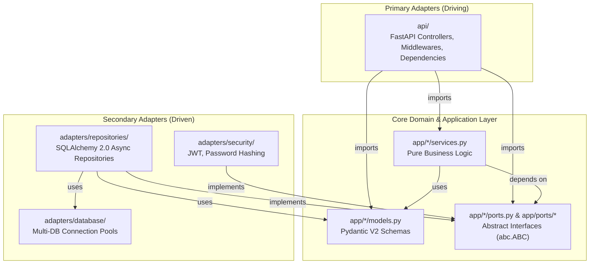

# 🏛️ ARCHITECTURE.md — Single Source of Truth (SSoT)

> **Inventory Audit & Stock Control Platform** · Global Medica / Farmanor  


This document is the **definitive architectural reference** for the backend service. Every agent, developer, and reviewer MUST treat it as the Single Source of Truth when making design decisions, implementing features, or reviewing pull requests.

---

## 1. Hexagonal Architecture — Dependency Flow

The backend follows a strict **Hexagonal Architecture (Ports & Adapters)** pattern. The fundamental invariant is that **dependencies only point inward** toward the pure domain.



### 1.1 The Three Absolute Dependency Rules

| Rule | Statement |
|:-----|:----------|
| **R1 — Domain Purity** | Code inside `backend/app/` MUST have **zero** imports from `sqlalchemy`, `alembic`, `fastapi`, `starlette`, `requests`, or any other infrastructure/framework library. Only Python stdlib and **Pydantic V2** are permitted. |
| **R2 — Adapters Depend on Domain** | Concrete adapters (`backend/adapters/`) and primary interfaces (`backend/api/`) import domain models and implement domain ports. **Never the reverse.** |
| **R3 — Contracts via Ports** | When the domain needs I/O (database, external API, messaging), it declares an abstract interface (Port) using `abc.ABC` inside `backend/app/`. The adapter layer provides a concrete class that implements that Port. |

---

## 2. Multi-Database Architecture (Multi-DB Strategy)

The system connects to **three separate and independent databases**. The domain layer remains 100% agnostic to this physical division — it interacts exclusively through abstract Ports.

### 2.1 Database Topology

| Database | Engine | Content | Used By (Repositories) |
|:---------|:-------|:--------|:-----------------------|
| **Operational (Main)** | MariaDB | `articulos`, `familias`, `grupos`, `marcas`, `stock_por_deposito`, `lotes_por_deposito` | `ArticleRepository`, `StockRepository`, `MovementRepository` |
| **Users & Authentication** | MariaDB / PostgreSQL | `usuarios`, credentials, roles, branch assignments | `UserRepository` → implements `UserRepositoryPort` |
| **Reports & Historical Audits** | MariaDB / ClickHouse / PostgreSQL | `auditorias_registro`, historical valued movements, loss metrics, consolidated metrics | `ReportRepository`, `AuditLedgerRepository` → implements `AuditLedgerRepositoryPort` |

### 2.2 Multi-DB Adapter Rule

In `backend/adapters/database/connection.py`, define **separate** `AsyncEngine` instances and `async_sessionmaker` pools for each database:

```text
engine_main    → async_session_main    → Operational DB
engine_users   → async_session_users   → Users & Auth DB
engine_reports → async_session_reports  → Reports & Audit DB
```

Each concrete repository in `backend/adapters/repositories/` receives **only the session factory corresponding to its target database** through constructor injection. A repository MUST NEVER hold references to sessions from a database it does not own.

### 2.3 Multi-Tenant Context Binding

The file `backend/adapters/database/multi_tenant.py` defines the `ContextVar`-based mechanism to bind `tenant_id` per async request context. The tenant middleware (`api/middlewares/tenant_auth.py`) extracts `tenant_id` from the decoded JWT and sets it. Repositories read this context variable to automatically append tenant-scoped filters to every query.

---

## 3. Detailed Physical Directory Structure

The following tree represents the **exact composition** that the backend directory MUST have. Every file listed is either already implemented or is a planned contract that must be created.

```text
backend/
├── app/                            # DOMAIN AND APPLICATION (Pure, DB-agnostic and HTTP-agnostic)
│   ├── __init__.py
│   ├── README.md                   # Domain layer rules and prohibitions
│   ├── exceptions.py               # Custom domain exceptions (e.g., EntityNotFound, BusinessRuleViolation)
│   ├── articles/                   # Article Catalog Module
│   │   ├── __init__.py
│   │   ├── models.py               # Pydantic V2 Schemas: Articulo, ArticuloCreate, ArticuloUpdate,
│   │   │                           #   ArticuloPublicOut (no pcio_com_siva), ArticuloAdminOut
│   │   │                           #   Familia, FamiliaCreate, Grupo, GrupoCreate, Marca, MarcaCreate
│   │   ├── ports.py                # ArticleRepositoryPort (abc.ABC)
│   │   └── services.py             # VAT fiscal calculation engine, classification logic
│   ├── movements/                  # Stock, FEFO, and Audits Module
│   │   ├── __init__.py
│   │   ├── models.py               # Pydantic V2 Schemas: StockPorDeposito, LotePorDeposito,
│   │   │                           #   AuditoriaRegistro, AuditoriaDelta, TipoAccion enum
│   │   ├── ports.py                # StockRepositoryPort, AuditLedgerRepositoryPort (abc.ABC)
│   │   └── services.py             # FEFO sorting algorithm, physical count delta calculation
│   ├── users/                      # Users and Authentication Module
│   │   ├── __init__.py
│   │   ├── models.py               # Pydantic V2 Schemas: User, UserCreate, UserUpdate,
│   │   │                           #   AuthToken, LoginCredentials, UserRole enum
│   │   ├── ports.py                # UserRepositoryPort (abc.ABC)
│   │   └── services.py             # User lookup, token payload assembly, domain auth logic
│   └── ports/                      # Shared infrastructure ports
│       ├── database.py             # ConnectionProvider, DatabaseSession (abc.ABC)
│       └── security.py             # TokenProvider, PasswordHasher (abc.ABC)
│
├── adapters/                       # SECONDARY ADAPTERS (Driven Adapters — Infrastructure)
│   ├── __init__.py
│   ├── README.md                   # Adapter rules, DB session injection patterns
│   ├── database/                   # Connections and Session Pools for the 3 DBs
│   │   ├── connection.py           # AsyncSessionFactories: main_db, users_db, reports_db
│   │   │                           #   (engine_main, engine_users, engine_reports)
│   │   └── multi_tenant.py         # ContextVar binding for tenant_id per async connection
│   ├── security/                   # Concrete security adapters
│   │   ├── jwt_provider.py         # PyJWTTokenProvider — implements TokenProvider port
│   │   └── password_hasher.py      # BcryptPasswordHasher — implements PasswordHasher port
│   └── repositories/               # Concrete Repositories (SQLAlchemy 2.0 Async)
│       ├── models_main.py          # ORM Models: Articulo, Familia, Grupo, Marca,
│       │                           #   StockPorDeposito, LotePorDeposito (→ Main DB)
│       ├── models_users.py         # ORM Models: Usuario (→ Users DB)
│       ├── models_reports.py       # ORM Models: AuditoriaRegistro (→ Reports DB)
│       ├── article_repository.py   # Connects to main_db → implements ArticleRepositoryPort
│       ├── movement_repository.py  # Connects to main_db → implements StockRepositoryPort
│       ├── user_repository.py      # Connects to users_db → implements UserRepositoryPort
│       └── report_repository.py    # Connects to reports_db → implements AuditLedgerRepositoryPort
│
├── api/                            # PRIMARY ADAPTERS (Driving Adapters — Presentation)
│   ├── __init__.py
│   ├── README.md                   # Controller rules, role-based schema masking policy
│   ├── main.py                     # FastAPI entrypoint: lifespan, middlewares, CORS, router mounts
│   ├── exception_handlers.py       # Domain Exception → HTTP 40x/500 translator
│   ├── dependencies/               # FastAPI Dependency Injection (Depends)
│   │   ├── __init__.py             # Singleton providers for ConnectionProvider, TokenProvider, PasswordHasher
│   │   ├── auth.py                 # get_current_user_claims, RoleChecker
│   │   └── services.py             # Instantiates repositories with their respective DB session
│   │                               #   and injects them into domain Services
│   ├── middlewares/                 # HTTP request middlewares
│   │   └── tenant_auth.py          # Intercepts JWT, extracts tenant_id, binds to ContextVar
│   └── v1/                         # Versioned REST routes (API v1)
│       ├── auth.py                 # POST /login, POST /token/refresh (→ Users DB)
│       ├── health.py               # GET /health — connectivity probe for all 3 databases
│       ├── articles.py             # Catalog CRUD and queries (→ Main DB)
│       ├── stock.py                # Count registration and stock movements (→ Main DB)
│       └── reports.py              # Dashboard, FEFO alerts, loss metrics (→ Reports DB)
│
├── migrations/                     # Alembic migrations (OWNED BY DBA-AGENT — DO NOT MODIFY)
├── scripts/                        # Seeding and maintenance scripts (OWNED BY DBA-AGENT)
└── tests/                          # Pytest Suite (Unit and Integration)
    ├── test_api_bootstrap.py
    ├── test_auth.py
    ├── test_database_connection.py
    ├── test_rbac_schemas.py
    └── db/
        └── test_schema_integrity.py
```

---

## 4. Layer Rules & Responsibilities

### 4.1 Domain Layer — `backend/app/`

The domain is the **innermost ring** and the most protected. It contains only pure Python and Pydantic V2.

#### Prohibited Imports (Enforced)

```python
# NEVER import any of these inside backend/app/
import sqlalchemy        # ❌
import alembic           # ❌
import fastapi           # ❌
import starlette         # ❌
import requests          # ❌
import httpx             # ❌
import aiomysql          # ❌
import asyncpg           # ❌
```

#### Allowed Imports

```python
# ✅ Python Standard Library (abc, typing, decimal, datetime, enum, etc.)
# ✅ Pydantic V2 (BaseModel, ConfigDict, Field, validators)
```

#### Module Internal Structure Convention

Every functional module inside `app/` follows this triad:

| File | Responsibility |
|:-----|:---------------|
| `models.py` | Pydantic V2 schemas: `[Entity]Base`, `[Entity]Create`, `[Entity]Update`, `[Entity]`, and role-specific output schemas (`[Entity]PublicOut`, `[Entity]AdminOut`). `decimal.Decimal` for all financial fields. `ConfigDict(from_attributes=True)` to allow ORM-to-domain conversion in the adapters. |
| `ports.py` | Abstract interfaces using `abc.ABC` and `@abstractmethod`. Declares what I/O operations the domain needs without specifying how they are fulfilled. |
| `services.py` | Pure business logic. Receives dependencies via constructor injection typed against Ports. Contains: VAT calculation, FEFO sorting, delta computation, and all business rule enforcement. |

#### Shared Infrastructure Ports (`app/ports/`)

| Port | Purpose |
|:-----|:--------|
| `database.py` → `ConnectionProvider`, `DatabaseSession` | Abstract session lifecycle management. The domain can reference these when defining Port method signatures that need transactional context. |
| `security.py` → `TokenProvider`, `PasswordHasher` | Abstract JWT signing/verification and password hashing contracts. |

### 4.2 Secondary Adapters Layer — `backend/adapters/`

This layer implements the domain's abstract Ports with concrete infrastructure technology.

#### Database Connection (`adapters/database/`)

| File | Responsibility |
|:-----|:---------------|
| `connection.py` | Creates three `AsyncEngine` + `async_sessionmaker` pairs (one per database). Exposes provider functions/classes that concrete repositories consume. Implements the `ConnectionProvider` port. |
| `multi_tenant.py` | Defines `tenant_id_context: ContextVar[str | None]` and helper functions to get/set the current tenant. Used by the middleware to bind and by repositories to read. |

#### Concrete Repositories (`adapters/repositories/`)

| File | Target DB | Implements Port |
|:-----|:----------|:----------------|
| `article_repository.py` | `main_db` | `ArticleRepositoryPort` |
| `movement_repository.py` | `main_db` | `StockRepositoryPort` |
| `user_repository.py` | `users_db` | `UserRepositoryPort` |
| `report_repository.py` | `reports_db` | `AuditLedgerRepositoryPort` |

#### ORM Model Files (`adapters/repositories/models_*.py`)

| File | Database | ORM Classes |
|:-----|:---------|:------------|
| `models_main.py` | Operational (Main) | `Articulo`, `Familia`, `Grupo`, `Marca`, `StockPorDeposito`, `LotePorDeposito` |
| `models_users.py` | Users & Auth | `Usuario` |
| `models_reports.py` | Reports & Audit | `AuditoriaRegistro` |

> [!IMPORTANT]
> The ORM model files (`models_*.py`) and all Alembic migrations are **exclusively owned by the DBA-Agent**. Jules MUST NOT modify these files directly. If a domain change requires a schema update, document the requirement and stop.

#### Adapter Rules

1. **Port Alignment**: Every repository MUST implement the exact abstract methods defined in its corresponding Port. No extra public methods beyond the Port contract.
2. **No Business Logic**: Repositories read, persist, and structure data. They do NOT validate business rules (e.g., VAT exemption classification, FEFO thresholds).
3. **Tenant Isolation**: Every query MUST include `tenant_id` filtering. Repositories read `tenant_id` from the `ContextVar` set by the middleware and automatically append it to `WHERE` clauses.
4. **Session Injection**: Each repository receives its `async_sessionmaker` through constructor injection, bound to the correct database engine.

### 4.3 Primary Adapters Layer — `backend/api/`

This layer exposes the domain through HTTP endpoints using FastAPI.

#### Controller Rules

1. **No Business Logic**: Routers coordinate request→service→response flow. All calculations belong in `app/*/services.py`.
2. **No Direct DB Access**: SQL queries and `AsyncSession` usage are forbidden in routers. All persistence flows through injected repositories.
3. **No ORM Entities in Responses**: Routers MUST serialize responses through Pydantic V2 output schemas, never raw SQLAlchemy model instances.
4. **Structural RBAC Schema Masking (Non-Negotiable)**: The `pcio_com_siva` (cost/margin) field MUST NEVER appear in response schemas returned to non-admin roles. This is enforced **structurally** via distinct output schemas:
   - `ArticuloPublicOut` → returned to `supervisor` and `auditor` roles (excludes `pcio_com_siva`)
   - `ArticuloAdminOut` → returned to `administrador` role only (includes `pcio_com_siva`)

#### Dependency Injection (`api/dependencies/`)

| File | Responsibility |
|:-----|:---------------|
| `__init__.py` | Singleton providers: `get_connection_provider()`, `get_token_provider()`, `get_password_hasher()` |
| `auth.py` | `get_current_user_claims()` — decodes and verifies JWT. `RoleChecker` — dynamic dependency for role-gated endpoints. |
| `services.py` | Wires repositories to their respective DB session factories and injects them into domain Service constructors. This is where the Multi-DB routing happens at the DI level. |

#### Middleware (`api/middlewares/`)

| File | Responsibility |
|:-----|:---------------|
| `tenant_auth.py` | Intercepts every request, extracts `Authorization: Bearer <token>`, decodes and verifies it (signed, not encrypted), and binds the `tenant_id` claim to the async `ContextVar` for downstream repository filtering. |

#### JWT Terminology Note

> Tokens are **signed** using HMAC-SHA256, not encrypted. We "decode and verify" them using PyJWT. The term "decrypt" is architecturally incorrect and MUST NOT be used in code, comments, or documentation.

---

## 5. Sub-Agent File Ownership & Conflict Boundaries

To prevent multi-agent git conflicts and maintain clear accountability:

| Agent Role | Owned Directories / Files | Ownership Policy |
|:-----------|:--------------------------|:-----------------|
| **Jules (Core Backend)** | `backend/app/**` | Full write access. Owns domain models, ports, services, and business logic. |
| | `backend/api/**` | Full write access. Owns routers, middlewares, dependencies, and exception handlers. |
| | `backend/adapters/repositories/*_repository.py` | Full write access. Owns concrete repository implementations. |
| | `backend/adapters/database/connection.py` | Full write access. Owns Multi-DB session pool configuration. |
| | `backend/adapters/database/multi_tenant.py` | Full write access. Owns tenant context binding. |
| | `backend/adapters/security/**` | Full write access. Owns JWT and hashing adapters. |
| | `backend/tests/**` | Full write access. Owns all test files. |
| **DBA-Agent** | `backend/adapters/repositories/models_*.py` | **Sole owner**. Owns all ORM table mappings and declarative base definitions. |
| | `backend/migrations/**` | **Sole owner**. Owns Alembic migration scripts and env configuration. |
| | `backend/scripts/**` | **Sole owner**. Owns seeding scripts and maintenance utilities. |
| **Mobile Dev Agent** | `frontend-mobile/**` | Owns React Native views, offline sync, barcode scanning controllers. |
| **Web Analytics Agent** | `frontend-web/**` | Owns Next.js dashboards, Tremor reports, web routing. |

> [!IMPORTANT]
> If **Jules** needs a database schema change (e.g., adding a column, splitting `models.py` into `models_main.py` / `models_users.py` / `models_reports.py`), Jules MUST document the required changes in a task description and stop. The **DBA-Agent** will then modify the ORM model files and generate the corresponding Alembic migrations.

---

## 6. Architectural Rules Checklist

These rules are **non-negotiable**. Every PR and code review must verify compliance:

- [ ] **Domain Purity**: No imports of `sqlalchemy`, `alembic`, `fastapi`, `starlette`, `requests`, or any infrastructure library inside `backend/app/`.
- [ ] **No SQL in Routers**: No direct database calls, session instantiation, or SQL execution inside FastAPI routers. All database interactions use injected repositories.
- [ ] **Decimal Precision**: All prices, costs, balances, and financial computations use `decimal.Decimal`. Never `float`.
- [ ] **RBAC Schema Masking**: The `pcio_com_siva` field is structurally excluded from non-admin response schemas. Distinct `PublicOut` / `AdminOut` schemas enforce this at the type level.
- [ ] **Multi-DB Isolation**: Each repository connects to exactly one database. No repository holds sessions for multiple databases.
- [ ] **Tenant Scoping**: Every repository query includes `tenant_id` filtering extracted from the async `ContextVar`. No cross-tenant data leakage.
- [ ] **Port Compliance**: Every concrete repository implements its domain Port completely. No extra public methods beyond the abstract contract.
- [ ] **JWT Terminology**: Code and docs use "decode and verify" (PyJWT). Never "decrypt".

---

## 7. Cross-References

| Document | Location | Purpose |
|:---------|:---------|:--------|
| Functional Specifications | [`docs/functional_specs.md`](./functional_specs.md) | Business rules, VAT engine formulas, FEFO algorithm, audit delta math, seed data requirements, and acceptance test protocols. |
| Domain Layer README | [`backend/app/README.md`](../backend/app/README.md) | Detailed module conventions and prohibited import rules for the pure domain. |
| Adapters Layer README | [`backend/adapters/README.md`](../backend/adapters/README.md) | Repository patterns, ORM model ownership, and multi-tenant query rules. |
| API Layer README | [`backend/api/README.md`](../backend/api/README.md) | Controller conventions, RBAC masking enforcement, and serialization rules. |
