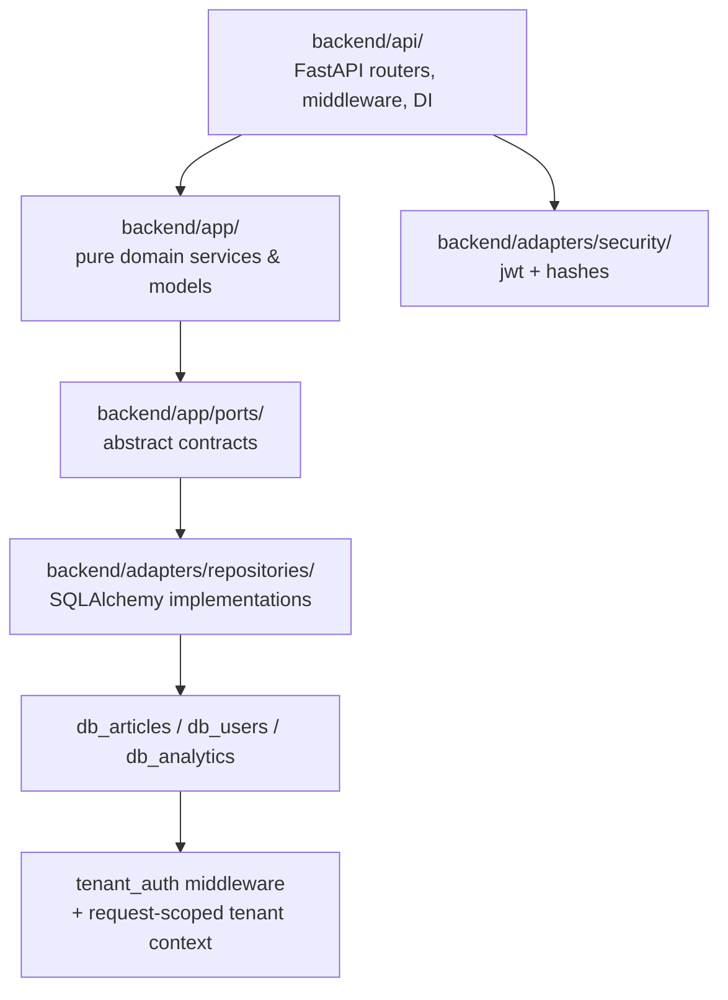

# 🏛️ ARCHITECTURE.md — Current Backend Architecture

This document reflects the current implementation in the repository and should be treated as the working architecture reference for the backend service.

---

## 1. Architecture Overview

The backend is built as a layered Hexagonal Architecture with three primary concentric zones:

- API / primary adapters: FastAPI routers, middleware, auth dependencies
- Domain / application: pure business services and abstract ports
- Infrastructure / secondary adapters: SQLAlchemy repositories, DB session factories, JWT provider, password hashing

### Core invariants

- Domain code in `backend/app/` must not import HTTP or SQL infrastructure libraries.
- Repository adapters implement the abstract contracts defined in `backend/app/*/ports.py`.
- The API layer orchestrates requests and delegates business rules to domain services.
- The system is explicitly multi-database and multi-tenant.

---

## 2. Current Multi-Database Layout

The implementation currently resolves three database contexts:

| Database | Purpose | Typical usage |
|:---------|:--------|:--------------|
| `db_users` | Authentication, user identity, roles | `UserRepository` |
| `db_articles` | Catalog, stock, branches, enterprises | `ArticleRepository`, `BranchRepository`, `EnterpriseRepository`, `StockRepository` |
| `db_analytics` | Audit ledger, work sessions, report aggregates | `AuditRepository`, `WorkSessionRepository`, report repositories |

This is implemented in `backend/adapters/database/connection.py` via three session factories:

- `get_articles_session_factory()`
- `get_users_session_factory()`
- `get_analytics_session_factory()`

These are consumed by the repository implementations and DI providers defined under `backend/api/dependencies/services.py`.

---

## 3. Tenant Binding and Request Context

Tenant context is established by the middleware in `backend/api/middlewares/tenant_auth.py`.

The middleware:

- reads the JWT from the `Authorization` header
- decodes and verifies it via `TokenProvider`
- binds the claims for `tenant_id`, `branch_id`, and `user_id` within a request-scoped context

The concrete context mechanism is located in `backend/adapters/database/multi_tenant.py` and uses `ContextVar` state to keep tenant information isolated per async request.

> Tokens are signed and verified; they are not encrypted payloads.

---

## 4. Layer Responsibilities

### 4.1 Domain layer — `backend/app/`

This layer contains pure business objects and business logic.

Current modules include:

- `app/articles/`
- `app/branches/`
- `app/enterprises/`
- `app/movements/`
- `app/reports/`
- `app/users/`
- `app/work_sessions/`
- `app/ports/`

Representative patterns already in use:

- `app/users/models.py` for `User`, `AuthToken`, `LoginCredentials`
- `app/movements/domain.py` for `VatClassifier`, `DeltaCalculator`, and audit domain types
- `app/reports/domain.py` for report raw records and financial math primitives
- `app/reports/services.py` for shrinkage, goods-received, and inventory-balance computations

### 4.2 API layer — `backend/api/`

The API layer contains the HTTP-facing entrypoints:

- `backend/api/main.py` registers the app and middleware
- `backend/api/v1/auth.py` exposes login flow
- `backend/api/v1/articles.py` exposes article catalog routes
- `backend/api/v1/stock.py` exposes stock and movement endpoints
- `backend/api/v1/branches.py` exposes branch endpoints
- `backend/api/v1/enterprises.py` exposes enterprise/tenant endpoints
- `backend/api/v1/reports.py` exposes administrator-only reporting endpoints
- `backend/api/v1/health.py` exposes connectivity health checks

### 4.3 Adapter layer — `backend/adapters/`

The concrete infrastructure layer is implemented here:

- `backend/adapters/database/connection.py` manages the async SQLAlchemy engines and session factories
- `backend/adapters/security/` holds JWT and password hashing implementations
- `backend/adapters/repositories/` contains the repository implementations for each domain port

Current repository implementations include:

- `article_repository.py`
- `stock_repository.py`
- `audit_repository.py`
- `user_repository.py`
- `branch_repository.py`
- `enterprise_repository.py`
- `work_session_repository.py`
- `report_repository.py`

---

## 5. Port-Driven Contracts

The important domain contracts currently live in the following files:

- `backend/app/users/ports.py`
- `backend/app/articles/ports.py`
- `backend/app/branches/ports.py`
- `backend/app/enterprises/ports.py`
- `backend/app/movements/ports.py`
- `backend/app/reports/ports.py`
- `backend/app/work_sessions/ports.py`
- `backend/app/ports/database.py`
- `backend/app/ports/security.py`

These ports define the expected behavior without binding the domain to the concrete database or framework implementation.

---

## 6. Current Reporting Architecture

Reporting is one of the clearest examples of the current business architecture.

The flow is:

1. API route in `backend/api/v1/reports.py` validates the request and authorized role.
2. Dependency provider in `backend/api/dependencies/services.py` wires the concrete report repository and article repository.
3. Domain service in `backend/app/reports/services.py` calculates financial values with VAT-aware logic.
4. Response models in `backend/app/reports/schemas.py` serialize the report output.

This includes the following report types:

- shrinkage report
- goods received report
- daily inventory balance report

---

## 7. File Ownership and Boundaries

The repo currently reflects a split between core backend ownership and DBA-controlled persistence work:

| Area | Ownership |
|:------|:----------|
| `backend/app/**` | Core domain and application logic |
| `backend/api/**` | HTTP, routing, middleware, dependencies |
| `backend/adapters/repositories/*.py` | Concrete repository implementations |
| `backend/adapters/database/*.py` | Multi-database session and tenant binding |
| `backend/adapters/security/**` | JWT and hashing adapters |
| `backend/adapters/repositories/models/**` | DBA-owned ORM mappings |
| `backend/migrations/**` | DBA-owned migration scripts |
| `backend/scripts/**` | DBA-owned lifecycle scripts |

This split is expected to be respected whenever schema or migration changes are required.

---

## 8. Architectural Checklist

- [x] Multi-database separation for users, articles, and analytics
- [x] Tenant context extraction from JWT claims
- [x] Domain abstractions via ports and services
- [x] API-driven dependency injection for repositories and services
- [x] Reporting domain and route layer integrated into backend
- [x] Decimal-based financial calculations for monetary outputs
- [x] JWT verification terminology aligned with signed token usage

---

## 9. Relevant Project Files

- [backend/README.md](../backend/README.md)
- [backend/app/README.md](../backend/app/README.md)
- [backend/adapters/README.md](../backend/adapters/README.md)
- [backend/api/main.py](../backend/api/main.py)
- [backend/api/middlewares/tenant_auth.py](../backend/api/middlewares/tenant_auth.py)
- [backend/adapters/database/connection.py](../backend/adapters/database/connection.py)
- [backend/api/v1/reports.py](../backend/api/v1/reports.py)
- [backend/app/reports/services.py](../backend/app/reports/services.py)
