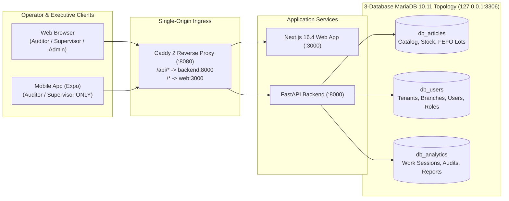

# 🧪 Manual Testing, Production Readiness & Stakeholder Live Demo Guide

This guide provides a complete, step-by-step playbook to:
1. **Run the entire SaaS Stock Deposit Control platform** (Infrastructure, Databases, Backend API, Web Console, and Mobile Field App) with a clear explanation of **what** each command does and **why** it is required.
2. **Execute a comprehensive Manual QA & Production Readiness Test Suite (`UC-01` – `UC-12`)** to verify every functional, security, RBAC, financial, and operational invariant before deploying to production.
3. **Record or present a structured 12-minute Live Stakeholder Demo** showcasing the platform's end-to-end value across Warehouse Auditors, Branch Supervisors, and Organization Administrators.

---

## 📑 Table of Contents

1. [System Topology & Execution Modes](#-part-1-system-topology--execution-modes)
2. [Step-by-Step Startup Guide (What to Run & Why)](#-part-2-step-by-step-startup-guide-what-to-run--why)
   - [Option A: Full Containerized Stack (Production-Like / Demo Mode)](#option-a-full-containerized-stack-production-like--demo-mode)
   - [Option B: Local Hybrid Development Mode (Docker DB + Host Backend/Web/Mobile)](#option-b-local-hybrid-development-mode-docker-db--host-backendwebmobile)
3. [Seeded Demo Credentials & Baseline Data](#-part-3-seeded-demo-credentials--baseline-data)
4. [Automated Pre-Flight Verification Suite](#-part-4-automated-pre-flight-verification-suite)
5. [Manual Use Cases for Production Readiness Sign-Off (`UC-01` – `UC-12`)](#-part-5-manual-use-cases-for-production-readiness-sign-off)
   - [UC-01: Infrastructure, Multi-DB Health Gate & Security Guards](#uc-01-infrastructure-multi-db-health-gate--security-guards)
   - [UC-02: Multi-Tenant Authentication & JWT Session Initialization](#uc-02-multi-tenant-authentication--jwt-session-initialization)
   - [UC-03: Structural Financial Privacy & Cost Masking Across Roles](#uc-03-structural-financial-privacy--cost-masking-across-roles)
   - [UC-04: Master Catalog Exploration, Search & FEFO Lot Inspection](#uc-04-master-catalog-exploration-search--fefo-lot-inspection)
   - [UC-05: Physical Stock Audit (Exact Match, Surplus `Alta`, Shrinkage `Baja` & Camera Scanner)](#uc-05-physical-stock-audit-exact-match-surplus-alta-shrinkage-baja--camera-scanner)
   - [UC-06: Real-Time Dashboard KPI Aggregation & Progress Tracking](#uc-06-real-time-dashboard-kpi-aggregation--progress-tracking)
   - [UC-07: Executive Financial Reports & VAT Fiscal Rules (0% vs 21%)](#uc-07-executive-financial-reports--vat-fiscal-rules-0-vs-21)
   - [UC-08: Administrator User Management & Anti-Lockout / Anti-Demotion Guards](#uc-08-administrator-user-management--anti-lockout--anti-demotion-guards)
   - [UC-09: Mobile Field Application — Dynamic Server URL, Field Role Guard & Scanning](#uc-09-mobile-field-application--dynamic-server-url-field-role-guard--scanning)
   - [UC-10: Offline Batch Audit Synchronization & Deduplication](#uc-10-offline-batch-audit-synchronization--deduplication)
   - [UC-11: DevOps Lifecycle — Encrypted Backup, Update & Automatic Rollback](#uc-11-devops-lifecycle--encrypted-backup-update--automatic-rollback)
   - [UC-12: Pharmacy Hybrid On-Premise Read-Only Catalog Protection](#uc-12-pharmacy-hybrid-on-premise-read-only-catalog-protection)
6. [Live Stakeholder Demo Playbook (Recording Script)](#-part-6-live-stakeholder-demo-playbook-recording-script)
7. [Production Go-Live Sign-Off Checklist](#-part-7-production-go-live-sign-off-checklist)

---

## 🏗️ Part 1: System Topology & Execution Modes

Before running commands, understand how the four layers of the system interact:



You can run the system in two ways:
- **Option A — Full Containerized Stack (Recommended for Production Verification & Stakeholder Demos):** Runs Caddy (`:8080`), FastAPI (`backend`), Next.js (`web`), and MariaDB 10.11 (`mariadb`) inside Docker Compose behind a single origin (`http://localhost:8080`).
- **Option B — Local Hybrid Development Mode:** Runs MariaDB 10.11 in Docker (`127.0.0.1:3306`) while running FastAPI (`:8000`), Next.js (`:3000`), and Expo (`frontend-mobile`) directly on your host machine for rapid debugging and Swagger UI exploration.

---

## 🚀 Part 2: Step-by-Step Startup Guide (What to Run & Why)

### Step 0: Configure the Root `.env` File (Required for Both Modes)

Run from the repository root (`/home/fede/Proyectos/SaaSStockDepositControl`):

```bash
cp .env.example .env
chmod 600 .env
```

- **Why you do this:** The platform enforces zero hardcoded secrets. Both Docker Compose and the Python backend read `.env` at startup. Setting `chmod 600` restricts file permissions so only your OS user can read database passwords and signing keys.

Next, generate a cryptographically strong 32+ character `SECRET_KEY` and set local passwords in `.env`:

```bash
SECRET_KEY_VAL="$(python3 -c 'import secrets; print(secrets.token_urlsafe(48))')"
sed -i "s|^SECRET_KEY=.*|SECRET_KEY=${SECRET_KEY_VAL}|" .env
sed -i "s|^DB_PASSWORD=.*|DB_PASSWORD=local_dev_app_pass_2026|" .env
sed -i "s|^MARIADB_APP_PASSWORD=.*|MARIADB_APP_PASSWORD=local_dev_app_pass_2026|" .env
sed -i "s|^MARIADB_ROOT_PASSWORD=.*|MARIADB_ROOT_PASSWORD=local_dev_root_pass_2026|" .env
```

- **Why you do this:**
  1. `SECRET_KEY`: In `ENVIRONMENT=production` (the default in `.env.example`), the FastAPI lifespan validator (`validate_production_secret_key()`) **refuses to boot** if `SECRET_KEY` is empty, shorter than 32 characters, or set to weak values like `changeme` or `secret`.
  2. `DB_PASSWORD` & `MARIADB_APP_PASSWORD`: When the MariaDB container initializes for the first time, `docker/mariadb/01-init-dbs.sh` creates the three logical databases (`db_articles`, `db_users`, `db_analytics`) and grants privileges to `app_user` using `MARIADB_APP_PASSWORD`. The backend connects using `DB_PASSWORD`, so both must match.

---

### Option A: Full Containerized Stack (Production-Like / Demo Mode)

Use this mode when validating production readiness or recording your stakeholder demo.

#### 1. Build Local Container Images (If Not Pulling from GHCR)
```bash
docker compose --profile with-db --profile demo build
```
- **Why you do this:** Compiles the multi-stage production Dockerfiles (`backend/Dockerfile` running as non-root UID `10001`, `frontend-web/Dockerfile` with Next.js `output: "standalone"` running as non-root UID `1001`, and `docker/caddy/Dockerfile` with Caddy 2).

#### 2. Start the Stack with Bundled MariaDB and Demo Seed Data
```bash
docker compose --profile with-db --profile demo up -d
```
*(Alternatively, if using pre-built images without the one-shot seed container, run `./scripts/devops/deploy.sh up with-db`.)*

- **Why you do this:**
  - Starts `mariadb` (bound strictly to `127.0.0.1:3306`, never exposed to the public internet) and runs `01-init-dbs.sh` to create `db_articles`, `db_users`, and `db_analytics` with `utf8mb4_unicode_ci` collation.
  - Starts `backend`, whose `docker-entrypoint.sh` automatically runs Alembic migrations (`upgrade head`) across all three databases before launching `uvicorn`.
  - Runs the one-shot `seed` service (`--profile demo`), which populates 500 realistic Argentine pharmacy SKUs (`Medicamentos`, `Perfumería`, `Cosmética`, `Accesorios`), EAN-13 barcodes, FEFO lots, 3 RBAC users, an active `OPEN` work session, and historical audit/report records.
  - Starts `web` and `proxy` (Caddy on `http://localhost:8080`), routing `/api/*` to `backend:8000` and all UI traffic to `web:3000` under a single origin.

#### 3. Verify Container & Package Health
```bash
./scripts/devops/deploy.sh status
./scripts/devops/deploy.sh health
./scripts/devops/verify-local-package.sh
```
- **Why you do this:** Confirms that all containers are running, `.env` and Compose configurations are valid, and `GET http://localhost:8080/api/v1/health` returns HTTP `200` with `"articles": "connected"`, `"users": "connected"`, and `"analytics": "connected"`.

#### 4. Access the Application
- **Unified Web Console:** Open [`http://localhost:8080`](http://localhost:8080) in your browser.
- **Health Endpoint:** [`http://localhost:8080/api/v1/health`](http://localhost:8080/api/v1/health)

---

### Option B: Local Hybrid Development Mode (Docker DB + Host Backend/Web/Mobile)

Use this mode when you want live code reloading, direct access to FastAPI Swagger UI (`http://localhost:8000/docs`), or local test execution.

#### 1. Start Only the MariaDB Container
```bash
docker compose --profile with-db up -d mariadb
```
- **Why you do this:** Starts MariaDB 10.11 on `127.0.0.1:3306` and initializes the 3 logical databases (`db_articles`, `db_users`, `db_analytics`) without starting the containerized backend or web services.

#### 2. Set Up the Backend Virtual Environment & Run Migrations
```bash
cd backend
python -m venv .venv
source .venv/bin/activate
pip install -r requirements.txt -r requirements-dev.txt
cd ..
```
- **Why you do this:** Creates an isolated Python 3.12 virtual environment (`backend/.venv`) with runtime dependencies (`fastapi`, `sqlalchemy`, `aiomysql`, `pyjwt`, `bcrypt`, `cryptography`) and development/QA tools (`pytest`, `pytest-cov`, `ruff`, `pip-audit`).

Now apply the three database migrations against `127.0.0.1:3306`:
```bash
DB_HOST=127.0.0.1 alembic -c backend/migrations/alembic.ini upgrade head
DB_HOST=127.0.0.1 alembic -c backend/migrations/alembic_users.ini upgrade head
DB_HOST=127.0.0.1 alembic -c backend/migrations/alembic_analytics.ini upgrade head
```
- **Why you do this:** Because `.env` sets `DB_HOST=mariadb` for internal Docker DNS, passing `DB_HOST=127.0.0.1` overrides the hostname so your host shell connects to the localhost-bound MariaDB container port and builds the tables for `db_articles`, `db_users`, and `db_analytics`.

#### 3. Seed Deterministic Pharmacy & Audit Data
```bash
DB_HOST=127.0.0.1 python -m backend.scripts.seed
```
- **Why you do this:** Idempotently populates the 3 databases with 500 pharmacy articles, FEFO lots (expired, near-expiry, and safe), 3 role-specific users, an `OPEN` work session for today, and sample audit records so dashboards and reports have immediate data.

#### 4. Start the FastAPI Backend Server (Terminal 1)
```bash
DB_HOST=127.0.0.1 CORS_ORIGINS=http://localhost:3000,http://localhost:8080 \
  ./backend/.venv/bin/uvicorn backend.api.main:app --host 0.0.0.0 --port 8000 --reload
```
- **Why you do this:** Launches the API on `http://localhost:8000` with CORS enabled for `http://localhost:3000` and interactive Swagger documentation at [`http://localhost:8000/docs`](http://localhost:8000/docs).

#### 5. Start the Next.js Web Frontend (Terminal 2)
```bash
cd frontend-web
npm ci
NEXT_PUBLIC_API_URL=http://localhost:8000 NEXT_PUBLIC_DATA_SOURCE=api npm run dev
```
- **Why you do this:** Installs locked dependencies from `package-lock.json` (`npm ci`) and runs the Next.js development server on [`http://localhost:3000`](http://localhost:3000) pointed directly at the live FastAPI backend (`NEXT_PUBLIC_DATA_SOURCE=api`).

#### 6. Start the Expo Mobile Field App (Terminal 3 — Optional)
```bash
cd frontend-mobile
npm ci
EXPO_PUBLIC_API_URL=http://localhost:8000 EXPO_PUBLIC_USE_MOCK=false npx expo start
```
- **Why you do this:** Starts the Expo Metro bundler so you can test the warehouse field app on an Android emulator (`a`), iOS simulator (`i`), or physical phone over Wi-Fi LAN.

---

## 🔑 Part 3: Seeded Demo Credentials & Baseline Data

The seeder (`backend/scripts/seed.py`) creates **Tenant 1 (`Empresa Principal` / `GlobalMedica Inc.`)** and **Branch 1 (`Sucursal Central`)** with three user accounts. All three use the password **`123456`**:

| Role | Email | Password | Web Access | Mobile App Access | Financial Visibility (`pcio_com_siva`, `monto_valorizado`, `/reports`) |
|:---|:---|:---|:---|:---|:---|
| **Administrador** | `admin@globalmedica.com` | `123456` | Full (`/dashboard`, `/catalog`, `/audit`, `/reports`, `/users`) | **Blocked** (Field-only guard rejects Admin on mobile) | **Visible** (Unmasked purchase costs, valorized KPIs, executive reports) |
| **Supervisor** | `supervisor@globalmedica.com` | `123456` | Operational (`/dashboard`, `/catalog`, `/audit`) — `/reports` & `/users` restricted | **Allowed** | **Masked** (`pcio_com_siva` and `monto_valorizado` stripped at API & client) |
| **Auditor** | `auditor@globalmedica.com` | `123456` | Operational (`/dashboard`, `/catalog`, `/audit`) — `/reports` & `/users` restricted | **Allowed** | **Masked** (`pcio_com_siva` and `monto_valorizado` stripped at API & client) |

---

## ✅ Part 4: Automated Pre-Flight Verification Suite

Before starting manual click-through tests, run these automated checks from `AGENTS.md` to confirm code, container, and security integrity:

| Check | Directory | Command | Why You Run It |
|:---|:---|:---|:---|
| **Backend Unit & Integration Tests** | `cd backend` | `./.venv/bin/pytest` | Runs 370+ tests covering domain services, VAT math, RBAC, CORS, entrypoint flags, and deploy scripts using in-memory SQLite/stubs. |
| **Backend Lint & Format** | `cd backend` | `./.venv/bin/ruff check . && ./.venv/bin/ruff format --check .` | Verifies zero Python lint or formatting regressions. |
| **Backend Dependency Audit** | `cd backend` | `./.venv/bin/pip-audit -r requirements.txt` | Verifies zero known CVEs in production Python dependencies. |
| **Web Unit & Component Tests** | `cd frontend-web` | `npm test` | Runs 128+ Vitest tests across adapters, mappers, barcode scanner hooks, and RBAC pages. |
| **Web Typecheck & Build** | `cd frontend-web` | `npx tsc --noEmit && npm run build` | Confirms strict TypeScript compilation and Next.js standalone production bundling. |
| **Mobile Typecheck** | `cd frontend-mobile` | `npx tsc --noEmit` | Confirms zero TypeScript errors across mobile screens, domain services, and `ServerSettingsModal`. |
| **Compose & Shell Syntax** | Repo root | `docker compose config -q && bash -n scripts/devops/deploy.sh scripts/devops/verify-local-package.sh docker/mariadb/01-init-dbs.sh` | Validates Compose YAML interpolation and defensive Bash syntax. |

---

## 🔬 Part 5: Manual Use Cases for Production Readiness Sign-Off

Execute the following 12 use cases in order. All 12 must pass to certify the release for production deployment.

---

### UC-01: Infrastructure, Multi-DB Health Gate & Security Guards

- **Objective:** Prove that the reverse proxy, backend, and all 3 MariaDB databases are healthy, MariaDB is not exposed on `0.0.0.0`, and weak production secrets are rejected.
- **Why this matters:** Prevents deploying a broken database pool or accidentally exposing port `3306` or weak JWT keys to the network.
- **Steps:**
  1. Probe the Caddy health endpoint and deep API health endpoint:
     ```bash
     curl -i http://localhost:8080/caddy-health
     curl -s http://localhost:8080/api/v1/health | python3 -m json.tool
     ```
  2. Run the automated on-premise verification script:
     ```bash
     ./scripts/devops/verify-local-package.sh
     ```
  3. Inspect MariaDB port bindings:
     ```bash
     docker compose ps mariadb
     ```
  4. Test the production `SECRET_KEY` guard (from `backend/`):
     ```bash
     cd backend && ENVIRONMENT=production SECRET_KEY=changeme ./.venv/bin/python -c "from fastapi.testclient import TestClient; from backend.api.main import app; TestClient(app).__enter__()"
     ```
- **Expected Pass Criteria:**
  - `/caddy-health` returns `HTTP/1.1 200 OK` with body `healthy`.
  - `/api/v1/health` returns `HTTP 200` with `"status": "healthy"` and `"databases": {"articles": "connected", "users": "connected", "analytics": "connected"}`.
  - `verify-local-package.sh` prints `[PASS]` for all checks and exits `0`.
  - `mariadb` port binding shows `127.0.0.1:3306->3306/tcp` (never `0.0.0.0:3306`).
  - Step 4 raises `RuntimeError` refusing to start with a weak `SECRET_KEY`.

---

### UC-02: Multi-Tenant Authentication & JWT Session Initialization

- **Objective:** Verify login validation, inactive-user rejection, and tenant-scoped JWT issuance.
- **Why this matters:** Ensures every request is cryptographically bound to `tenant_id`, `branch_id`, `id_usuario`, and `role`.
- **Steps:**
  1. Open `/login` in your browser (`http://localhost:8080/login` or `http://localhost:3000/login`).
  2. Enter invalid credentials (`admin@globalmedica.com` / `wrongpass`) and submit.
  3. Sign in with `auditor@globalmedica.com` / `123456`.
  4. Open Browser DevTools $\rightarrow$ **Application** $\rightarrow$ **Local Storage** (or navigate to `/debug`) and inspect the stored token claims.
- **Expected Pass Criteria:**
  - Step 2 displays an authentication error banner and stays on `/login`.
  - Step 3 redirects to `/dashboard` and displays the `Auditor` role badge in the top navigation bar.
  - Step 4 confirms the JWT payload contains `tenant_id: 1`, `branch_id: 1`, `role: "auditor"`, and a valid `exp` timestamp.

---

### UC-03: Structural Financial Privacy & Cost Masking Across Roles

- **Objective:** Verify that confidential supplier purchase costs (`pcio_com_siva`) and valorized currency totals (`monto_valorizado_baja`, `monto_valorizado_alta`) are **structurally absent** from both the UI and network JSON responses for `auditor` and `supervisor`, and visible only to `administrador`.
- **Why this matters:** Warehouse staff and branch supervisors must never see confidential supplier pricing or financial margins.
- **Steps:**
  1. While logged in as **`auditor@globalmedica.com`**, open Browser DevTools $\rightarrow$ **Network** tab (filter by `Fetch/XHR`).
  2. Navigate to **Dashboard** (`/dashboard`) and inspect the response JSON of `GET /api/v1/stock/kpis`.
  3. Navigate to **Catálogo** (`/catalog`) and inspect both the table columns on screen and the response JSON of `GET /api/v1/articles`.
  4. Log out, sign in as **`supervisor@globalmedica.com`** (`123456`), and repeat steps 2–3.
  5. Log out, sign in as **`admin@globalmedica.com`** (`123456`), and repeat steps 2–3.
- **Expected Pass Criteria:**
  - For **`auditor`** and **`supervisor`**:
    - The `/catalog` table does **not** render a unit cost (`Costo s/IVA`) column.
    - The raw JSON response from `/api/v1/articles` does **not** contain the `pcio_com_siva` key on any item (`ArticuloPublicOut`).
    - The raw JSON response from `/api/v1/stock/kpis` does **not** contain `monto_valorizado_baja` or `monto_valorizado_alta` (`DashboardKPIsPublicOut`).
  - For **`administrador`**:
    - The `/catalog` table displays the unit cost (`pcio_com_siva`) for each article.
    - `/dashboard` displays the financial shrinkage and surplus valuation cards (`monto_valorizado_baja`, `monto_valorizado_alta`).

---

### UC-04: Master Catalog Exploration, Search & FEFO Lot Inspection

- **Objective:** Validate catalog pagination, multi-token/barcode search, audited-status filtering, and FEFO lot expiration badges.
- **Why this matters:** Operators rely on fast lookup across hundreds of SKUs and immediate visual warnings for expired (`VENCIDO`) or near-expiry (`PRÓXIMO`) pharmaceutical batches.
- **Steps:**
  1. Navigate to **Catálogo** (`/catalog`).
  2. Type a medication name or code (e.g., `MED` or `ART`) in the search bar and verify filtered results.
  3. Toggle filters for **Auditado / Pendiente** and **Sin Stock (`stock_real = 0` ghost items)**.
  4. Inspect the FEFO expiration indicators on articles with batches (`VENCIDO` red badge for expired lots, `PRÓXIMO` amber badge for $\le 90$ days, `NORMAL` green badge for $> 90$ days).
- **Expected Pass Criteria:**
  - Search results update without page crashes; pagination controls navigate cleanly across pages.
  - Zero-stock ("ghost") items and FEFO status badges render with high-contrast semantic colors.

---

### UC-05: Physical Stock Audit (Exact Match, Surplus `Alta`, Shrinkage `Baja` & Camera Scanner)

- **Objective:** Verify all three physical audit outcomes (`Sin Acción`, `Alta`, `Baja`), barcode camera modal stability, and active work session recording.
- **Why this matters:** Physical stock counting is the core operational workflow of the platform.
- **Steps:**
  1. Sign in as **`auditor@globalmedica.com`** and navigate to **Auditoría** (`/audit`).
  2. **Camera Scanner Test:** Click the **Escanear Código** camera button to open `BarcodeScannerModal`, then close it immediately, and reopen it.
     - *Note:* On `http://localhost:8080` or `https://`, the browser allows camera access. Verify the modal opens cleanly without freezing or throwing unhandled promise rejections when toggled rapidly.
  3. **Scenario 5A — Exact Match (`Sin Acción`):**
     - Search and select an article with known `stock_real` (e.g., `stock_real = 20`).
     - Enter `stock_fisico_contado = 20` and submit.
  4. **Scenario 5B — Surplus (`Alta`):**
     - Select an article (e.g., `stock_real = 15`).
     - Enter `stock_fisico_contado = 18` (`delta = +3`), add observation `"Sobrante en estantería secundaria"`, and submit.
  5. **Scenario 5C — Shrinkage (`Baja`):**
     - Select an article (e.g., `stock_real = 10`).
     - Enter `stock_fisico_contado = 7` (`delta = -3`), add observation `"Blister dañado / merma constatada"`, and submit.
- **Expected Pass Criteria:**
  - Scenario 5A returns HTTP `201 Created` with `delta_stock: 0`, `tipo_accion: "Sin Acción"`, `cantidad_afectada: 0`.
  - Scenario 5B returns HTTP `201 Created` with `delta_stock: 3`, `tipo_accion: "Alta"`, `cantidad_afectada: 3`.
  - Scenario 5C returns HTTP `201 Created` with `delta_stock: -3`, `tipo_accion: "Baja"`, `cantidad_afectada: 3`.
  - The audited articles now show `fue_auditado: true` in the catalog.

---

### UC-06: Real-Time Dashboard KPI Aggregation & Progress Tracking

- **Objective:** Confirm that audits registered in `UC-05` immediately update database-aggregated KPIs on `/dashboard`.
- **Why this matters:** Supervisors and administrators need real-time visibility into branch audit completion and discrepancy counts.
- **Steps:**
  1. Navigate to **Dashboard** (`/dashboard`) after completing `UC-05`.
  2. Compare `auditados`, `pendientes`, `porcentaje_avance`, `discrepancias_alta`, `discrepancias_baja`, and `sin_accion` against their pre-audit values.
- **Expected Pass Criteria:**
  - `discrepancias_alta`, `discrepancias_baja`, and `sin_accion` each incremented by `1`.
  - `auditados` increased and `pendientes` decreased accordingly (`total_articulos = auditados + pendientes`).

---

### UC-07: Executive Financial Reports & VAT Fiscal Rules (0% vs 21%)

- **Objective:** Verify administrator-only access to `/reports` and exact `Decimal` VAT valuation (`0%` for `Medicamentos` vs `21%` default for `Perfumería`/`Cosmética`/`Accesorios`).
- **Why this matters:** Argentine pharmacy accounting requires medications to be valued at `0%` VAT while perfumery and retail items carry `21%` VAT.
- **Steps:**
  1. While logged in as **`auditor@globalmedica.com`** or **`supervisor@globalmedica.com`**, navigate to `/reports` (or call `GET /api/v1/reports/shrinkage?start_date=2026-10-01&end_date=2026-10-31`).
  2. Log out and sign in as **`admin@globalmedica.com`** (`123456`). Navigate to **Reportes** (`/reports`).
  3. Set the date range covering today (`start_date` to `end_date`) and inspect all three report tabs:
     - **Mermas (`Shrinkage`)**: Check `vat_rate` on `MEDICAMENTOS` items (`0.00`) vs `PERFUMERIA` / `COSMETICA` / `ACCESORIOS` (`0.21`), verifying `total_unit_cost = pcio_com_siva * (1 + vat_rate)` and `total_financial_loss = total_unit_cost * total_quantity`.
     - **Ingresos / Altas (`Goods Received`)**: Verify `capital_inyectado` matches the surplus audits recorded.
     - **Balance Diario (`Net Inventory Balance`)**: Verify $\Delta \text{Patrimonial} = \text{total\_addition\_value} - \text{total\_shrinkage\_value}$.
- **Expected Pass Criteria:**
  - Non-admin roles receive `403 Forbidden` from `/api/v1/reports/*` and see the **Acceso Restringido** guard in the UI.
  - Admin sees accurate `Decimal` currency totals across all three tabs and can export the JSON report.

---

### UC-08: Administrator User Management & Anti-Lockout / Anti-Demotion Guards

- **Objective:** Verify tenant user listing, account deactivation/reactivation, single-role assignment, **Self-Lockout Protection**, and **Self-Demotion Protection**.
- **Why this matters:** Prevents an administrator from accidentally deactivating or demoting their own account and locking the organization out of tenant administration.
- **Steps:**
  1. Logged in as **`admin@globalmedica.com`**, navigate to **Usuarios** (`/users`).
  2. **Role Assignment Test:** Change `auditor@globalmedica.com`'s role from `auditor` to `supervisor`, verify the UI updates, then change it back to `auditor`.
  3. **Account Deactivation Test:** Toggle `auditor@globalmedica.com`'s status to **Inactivo** (`is_active: false`).
  4. Open an incognito window (or use `curl`) and attempt to log in as `auditor@globalmedica.com` / `123456`:
     ```bash
     curl -i -X POST http://localhost:8080/api/v1/auth/login \
       -H "Content-Type: application/json" \
       -d '{"email":"auditor@globalmedica.com","password":"123456"}'
     ```
  5. Reactivate `auditor@globalmedica.com` (`is_active: true`) in `/users`.
  6. **Self-Lockout Guard Test:** Attempt to deactivate `admin@globalmedica.com` (your own account) in `/users` (or via `PATCH /api/v1/users/1/status`).
  7. **Self-Demotion Guard Test:** Attempt to change `admin@globalmedica.com`'s role to `supervisor` (or via `PUT /api/v1/users/1/roles`).
- **Expected Pass Criteria:**
  - Step 4 returns HTTP `400 Bad Request` (`"User account is inactive"`), proving deactivated accounts are immediately blocked from logging in.
  - Step 6 is blocked (UI disables self-toggle / API returns `400 Bad Request`: `"Administrators cannot deactivate their own account"`).
  - Step 7 is blocked (UI disables self-role change / API returns `400 Bad Request`: `"Administrators cannot remove the administrator role from themselves"`).

---

### UC-09: Mobile Field Application — Dynamic Server URL, Field Role Guard & Scanning

- **Objective:** Verify the React Native / Expo mobile field app (`frontend-mobile`), dynamic server URL configuration (`ServerSettingsModal`), strict field-only login guard, and mobile audit flow.
- **Why this matters:** Warehouse operators use mobile devices over Wi-Fi LAN (`http://<lan-ip>:8080`) without re-compiling the app when the server IP changes.
- **Steps:**
  1. Launch `frontend-mobile` (`npx expo start`) on an emulator, simulator, or physical phone on the same Wi-Fi LAN.
  2. On the Login screen, tap **Configuración del Servidor** beneath the login card.
  3. Enter an unreachable URL (e.g., `http://127.0.0.1:9999`) and tap **Probar Conexión** $\rightarrow$ verify red error state and that **Guardar** remains disabled.
  4. Enter the live server URL (`http://localhost:8080` or `http://<your-lan-ip>:8080`), tap **Probar Conexión** $\rightarrow$ verify green `"Conexión exitosa."` status, and tap **Guardar**.
  5. **Field-Role Guard Test:** Attempt to log in on mobile with **`admin@globalmedica.com`** / `123456`.
  6. Log in on mobile with **`auditor@globalmedica.com`** / `123456`.
  7. Pull to refresh on the Mobile **Dashboard**, navigate to **Catálogo** / **Auditar Artículo**, select an item, enter a physical count with a discrepancy motive, and submit.
- **Expected Pass Criteria:**
  - `ServerSettingsModal` enables **Guardar** only after `GET /api/v1/health` responds HTTP `200`, and persists `@stock_server_url` in `AsyncStorage`.
  - Step 5 **rejects** `admin@globalmedica.com` with an explicit role restriction message (only `auditor` and `supervisor` are permitted on mobile field devices).
  - Step 6–7 completes the audit and updates daily progress with zero financial fields in mobile state.

---

### UC-10: Offline Batch Audit Synchronization & Deduplication

- **Objective:** Verify `POST /api/v1/stock/audit/batch` processes queued offline audits and skips duplicate records safely.
- **Why this matters:** Warehouse dead zones can interrupt Wi-Fi; queued mobile audits must synchronize reliably without double-counting if retried.
- **Steps:**
  1. Obtain an auditor JWT token:
     ```bash
     TOKEN=$(curl -s -X POST http://localhost:8080/api/v1/auth/login \
       -H "Content-Type: application/json" \
       -d '{"email":"auditor@globalmedica.com","password":"123456"}' | python3 -c "import sys,json; print(json.load(sys.stdin)['access_token'])")
     ```
  2. Pick a valid `id_articulo` from `/api/v1/articles?limit=2`:
     ```bash
     ART_ID=$(curl -s "http://localhost:8080/api/v1/articles?limit=1" \
       -H "Authorization: Bearer ${TOKEN}" | python3 -c "import sys,json; print(json.load(sys.stdin)['items'][0]['id_articulo'])")
     ```
  3. Dispatch a batch payload to `/api/v1/stock/audit/batch`:
     ```bash
     curl -s -X POST http://localhost:8080/api/v1/stock/audit/batch \
       -H "Authorization: Bearer ${TOKEN}" \
       -H "Content-Type: application/json" \
       -d "{\"items\":[{\"id_articulo\":\"${ART_ID}\",\"stock_fisico_contado\":25,\"id_sucursal\":1,\"id_deposito\":1,\"observation\":\"Batch sync test\"}]}" | python3 -m json.tool
     ```
- **Expected Pass Criteria:**
  - Returns HTTP `200 OK` with `"total_processed": 1`, `"duplicates_skipped": 0`, and the computed `AuditEntryResult` in `"results"`.

---

### UC-11: DevOps Lifecycle — Encrypted Backup, Update & Automatic Rollback

- **Objective:** Verify that `./scripts/devops/deploy.sh` can dump all 3 databases with `0600` permissions and automatically roll back a failed update.
- **Why this matters:** Guarantees zero-data-loss backups before schema migrations and automatic recovery if a bad release fails health probes.
- **Steps:**
  1. Run a database backup:
     ```bash
     ./scripts/devops/deploy.sh backup
     ls -la backups/
     ```
  2. Inspect the generated archive permissions and verify it contains SQL dumps for `db_articles`, `db_users`, and `db_analytics`:
     ```bash
     gunzip -c backups/backup_*.sql.gz | grep -E "^CREATE DATABASE|^USE "
     ```
- **Expected Pass Criteria:**
  - `backups/backup_YYYYMMDD_HHMMSS.sql.gz` is created with `-rw-------` (`600`) permissions.
  - The archive contains all three logical databases (`db_articles`, `db_users`, `db_analytics`) and no database passwords appear in the process list or terminal output.

---

### UC-12: Pharmacy Hybrid On-Premise Read-Only Catalog Protection

- **Objective:** Verify that setting `RUN_MIGRATIONS_ARTICLES=false` skips Alembic migrations on `db_articles` while migrating `db_users` and `db_analytics`.
- **Why this matters:** In pharmacy branch installations (see [`docs/deploy/local-onpremise-runbook.md`](deploy/local-onpremise-runbook.md)), `db_articles` is the pharmacy's live production database accessed via a `SELECT`-only MySQL/MariaDB user (`ro_user`). Alembic must never attempt DDL changes on it.
- **Steps:**
  1. Run the entrypoint unit test suite that verifies per-database migration flags:
     ```bash
     cd backend && ./.venv/bin/pytest tests/unit/test_docker_entrypoint.py -v
     ```
  2. Or inspect container logs when starting `backend` with `RUN_MIGRATIONS_ARTICLES=false`:
     ```bash
     docker compose logs backend | grep -E "Running migrations|Skipping migrations"
     ```
- **Expected Pass Criteria:**
  - `Skipping migrations: backend/migrations/alembic.ini` is logged for `db_articles`, while `alembic_users.ini` and `alembic_analytics.ini` execute normally.

---

## 🎬 Part 6: Live Stakeholder Demo Playbook (Recording Script)

Use this **12–15 minute script** to record a polished video walkthrough or present live to stakeholders (Pharmacy Owners, Operations Directors, and Investors).

### Pre-Demo Preparation Checklist (5 Minutes Before Recording)
- [ ] Full stack is running (`docker compose --profile with-db --profile demo up -d`) and `./scripts/devops/verify-local-package.sh` shows `All checks passed`.
- [ ] Browser zoom is set to `110%`–`125%` on `http://localhost:8080/login` for crisp screen-recording readability.
- [ ] Open a second browser window (or DevTools Network panel) if you want to show live API payload masking to technical stakeholders.
- [ ] Have the three demo logins ready on a sticky note (`auditor@globalmedica.com`, `supervisor@globalmedica.com`, `admin@globalmedica.com` — password `123456`).

---

### Act 1: The Business Problem & Hybrid Architecture Trust (2 Minutes)
1. **What to show:** Terminal running `./scripts/devops/verify-local-package.sh` and `curl -s http://localhost:8080/api/v1/health | python3 -m json.tool`.
2. **Narrative talking points:**
   - *"Pharmacies and multi-branch warehouses lose significant margin every month to unrecorded stock shrinkage, expired FEFO medication batches, and blind spots between theoretical ERP stock and physical shelves."*
   - *"We built Audit Global with a 3-database Hexagonal Architecture: `db_articles` connects read-only to the pharmacy's existing catalog, while `db_users` and `db_analytics` run locally in an isolated container. We never alter or risk the client's existing ERP tables."*

---

### Act 2: Warehouse Floor Execution — The Auditor Experience (4 Minutes)
1. **What to show:** Log in at `http://localhost:8080/login` as **`auditor@globalmedica.com`** (`123456`).
2. **Step-by-step actions:**
   - **Dashboard (`/dashboard`):** Point out the clean operational progress bar (`Auditados`, `Pendientes`, `Avance %`, `Sin Stock`). Highlight that **no monetary figures or supplier costs** are shown.
   - **Catalog (`/catalog`):** Search for a medication, filter by **Pendientes**, and point out the **FEFO lot expiration badges** (`VENCIDO` in crimson, `PRÓXIMO` in amber, `NORMAL` in emerald). Point out that the unit cost column is completely absent for the auditor.
   - **Physical Audit (`/audit`):**
     - Click **Escanear Código** to show the live camera barcode scanner modal (`BarcodeScannerModal`).
     - Select an article with theoretical stock (e.g., `stock_real = 20`).
     - Enter a physical count of `17` (`delta = -3`). Show how the system automatically classifies the movement as **`Baja` (Shrinkage / Merma)** and requires an observation/reason (`"3 cajas con vencimiento cumplido retiradas de estantería"`). Submit the audit.
     - Immediately select a second article and enter a count higher than theoretical stock (`delta = +2`) to demonstrate an automatic **`Alta` (Surplus / Ingreso)** voucher.

---

### Act 3: Branch Operations Supervision — The Supervisor Experience (2 Minutes)
1. **What to show:** Log out and sign in as **`supervisor@globalmedica.com`** (`123456`).
2. **Step-by-step actions:**
   - Show `/dashboard` reflecting the newly updated audit progress and unit discrepancy counters (`Discrepancias Alta`, `Discrepancias Baja`) in real time.
   - Click on `/reports` or `/users` (if visible) or explain that **Executive Financial Reports and User Administration remain strictly locked** to protect commercial confidentiality at the branch floor level.

---

### Act 4: Executive Financial Intelligence & Governance — The Administrator Experience (4 Minutes)
1. **What to show:** Log out and sign in as **`admin@globalmedica.com`** (`123456`).
2. **Step-by-step actions:**
   - **Executive Dashboard (`/dashboard`):** Show that the administrator now sees **valorized financial metrics** (`Monto Valorizado Baja` and `Monto Valorizado Alta`) alongside the operational unit counts.
   - **Catalog with Supplier Costs (`/catalog`):** Show that the **Costo s/IVA (`pcio_com_siva`)** column now appears automatically for the administrator.
   - **Financial Reports (`/reports`):**
     - Open the **Mermas (Shrinkage)** tab: Highlight how the engine automatically applies **0% VAT** to `MEDICAMENTOS` and **21% VAT** to `PERFUMERIA`, `COSMETICA`, and `ACCESORIOS` using exact `Decimal` arithmetic.
     - Open the **Ingresos (Goods Received)** tab: Show the total injected capital from positive stock adjustments.
     - Open the **Balance Diario (Net Inventory Balance)** tab: Show the consolidated daily ledger and **Net Patrimonial Variation ($\Delta \text{Patrimonial}$)**. Click **Exportar JSON** to demonstrate data portability.
   - **User & Role Governance (`/users`):**
     - Show the live user directory and role breakdown KPIs.
     - Toggle a user's active status and change a user's role between `auditor` and `supervisor`.
     - Point to the administrator's own row to highlight **Self-Lockout and Self-Demotion Protection**—guaranteeing an admin can never accidentally lock the company out.

---

### Act 5: Enterprise Operations & Zero-Downtime Reliability (1 Minute)
1. **What to show:** Switch back to the terminal and run:
   ```bash
   ./scripts/devops/deploy.sh backup
   ./scripts/devops/deploy.sh health
   ```
2. **Closing talking point:**
   - *"With a single command, the entire multi-database state is backed up with strict `0600` encryption-ready permissions, and updates are protected by automatic health-gated rollback. The platform is ready for both local pharmacy branch servers and cloud deployments."*

---

## 🏁 Part 7: Production Go-Live Sign-Off Checklist

Before cutting a production release tag (`vX.Y.Z`) or handing off an on-premise server to a client, confirm:

- [ ] `.env` has `ENVIRONMENT=production` and a unique 48-byte `SECRET_KEY` (never `changeme`).
- [ ] Database passwords (`DB_PASSWORD`, `MARIADB_APP_PASSWORD`, `MARIADB_ROOT_PASSWORD`) are unique, strong, and `.env` permissions are `0600`.
- [ ] For pharmacy hybrid on-premise installs: `RUN_MIGRATIONS_ARTICLES=false` is set and `ARTICLES_DATABASE_URL` uses a `SELECT`-only database user (`ro_user`).
- [ ] For public HTTPS domain installs: `SERVER_NAME=<domain>` and `COMPOSE_FILE=docker-compose.yml:docker-compose.public.yml` are configured.
- [ ] `./scripts/devops/verify-local-package.sh` exits `0` with `[PASS]` on all checks.
- [ ] Manual use cases `UC-01` through `UC-12` have been executed and verified.
- [ ] Initial baseline backup (`./scripts/devops/deploy.sh backup`) has been created and copied off-host.
