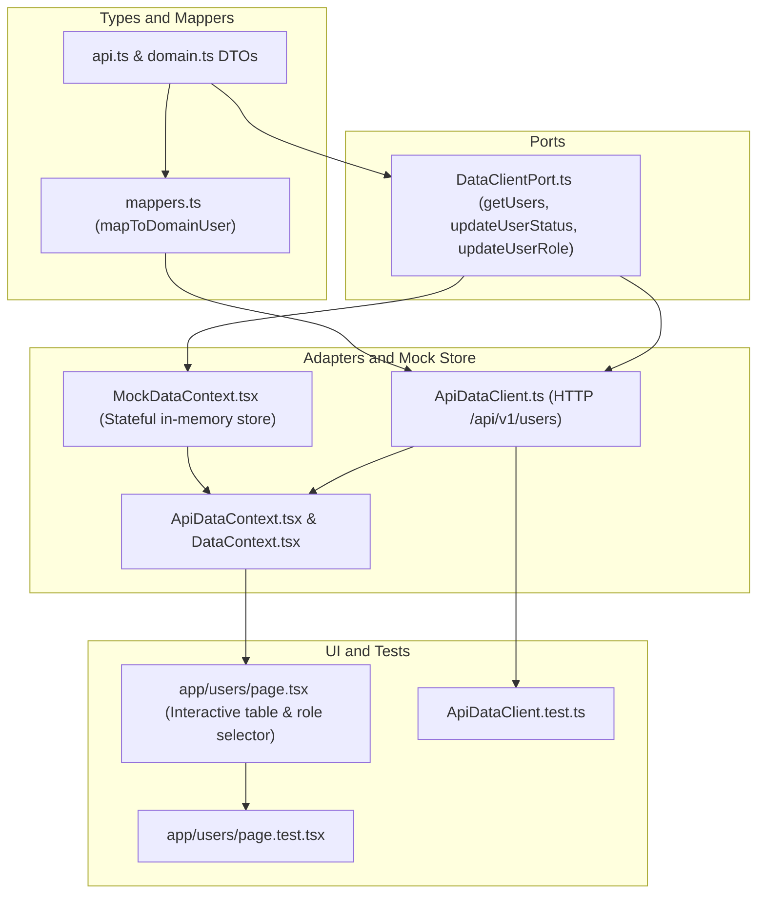

# Implementation Plan: Administrator User Management & Role Assignment (Frontend)

> **Status: Implemented & Verified (100% Complete)** — Administrator User Management & Role Assignment is fully implemented and tested end-to-end across [`backend/api/v1/users.py`](file:///home/fede/Proyectos/SaaSStockDepositControl/backend/api/v1/users.py) (`GET /api/v1/users`, `PATCH /api/v1/users/{user_id}/status`, `PUT /api/v1/users/{user_id}/roles`) and [`frontend-web/app/users/page.tsx`](file:///home/fede/Proyectos/SaaSStockDepositControl/frontend-web/app/users/page.tsx) (via `DataClientPort`, `ApiDataClient`, and `MockDataContext`).

**Reference Specification:** [`specs/SPEC-admin-user-management.md`](file:///home/fede/Proyectos/SaaSStockDepositControl/specs/SPEC-admin-user-management.md)  
**Lead Engineer:** Nova (Senior Frontend Engineer & Client Architecture Specialist)  
**Strict Ownership Boundaries:**
- **In Scope (Frontend):** `frontend-web/lib/types/`, `frontend-web/lib/ports/`, `frontend-web/lib/adapters/`, `frontend-web/lib/mocks/`, `frontend-web/lib/context/`, `frontend-web/app/users/`, and `shared/design-tokens/`.
- **Prohibited / Out of Scope:** `backend/` (routes, schemas, models, migrations are already implemented and sealed), `frontend-mobile/`.

---

## 1. Executive Summary & Architecture Alignment

The backend and database architecture for tenant-isolated user management and role assignment are fully implemented and verified in [`backend/api/v1/users.py`](file:///home/fede/Proyectos/SaaSStockDepositControl/backend/api/v1/users.py) (`GET /api/v1/users`, `PATCH /api/v1/users/{user_id}/status`, `PUT /api/v1/users/{user_id}/roles`).

The frontend integration in [`frontend-web/app/users/page.tsx`](file:///home/fede/Proyectos/SaaSStockDepositControl/frontend-web/app/users/page.tsx) and [`DataClientPort`](file:///home/fede/Proyectos/SaaSStockDepositControl/frontend-web/lib/ports/DataClientPort.ts) has also been completed, replacing the earlier static mock overrides with live API and stateful mock parity:

This plan establishes:
1. **Ports & Contracts Extension:** Add strongly typed user management operations (`getUsers`, `updateUserStatus`, `updateUserRole`) to `DataClientPort` and define clean DTO contracts in `frontend-web/lib/types/api.ts` and `domain.ts`.
2. **Adapter Implementations:**
   - **`ApiDataClient`:** Issues authenticated HTTP calls (`GET /api/v1/users`, `PATCH /api/v1/users/{id}/status`, `PUT /api/v1/users/{id}/roles`), correctly extracting errors such as HTTP 400 anti-lockout violations.
   - **`MockDataContext`:** Implements in-memory state mutations for user status and roles with domain validation (anti-lockout invariant and single-role constraint) to guarantee interactive parity in demo mode.
3. **UI Enhancements (`UsersPage`):**
   - Connects directly to `useDataClient()` for both live API and mock modes with zero direct `fetch` calls.
   - Interactive role selector (`administrador`, `supervisor`, `auditor`) enforcing the single-role constraint.
   - Disabled status toggle and demotion protection for the active administrator (`isMe`).
   - Optimistic UI updates with automatic rollback and user-facing feedback upon failure.
   - Dynamic KPI strip recalculating active/inactive counts and role distribution.
   - Strict adherence to `shared/design-tokens/` (colors, typography, spacing, semantic badges).

---

## 2. Dependency Graph

---

## 3. Implementation Tasks (Vertical Slices)

### Phase 1: Foundation & Contract Definition

#### Task 1: Define API DTOs and Domain Models for User Management
- **Description:** Declare the API request/response types matching the backend schemas (`UserResponse`, `UserStatusUpdate`, `UserRoleAssignment`) and update domain `MockUser` / `User` types.
- **Acceptance Criteria:**
  - `ApiUserResponse`, `ApiUserStatusUpdate`, and `ApiUserRoleAssignment` defined in `frontend-web/lib/types/api.ts`.
  - `MockUser` in `frontend-web/lib/types/domain.ts` supports `first_name`, `last_name`, `tenant_id`, and `branch_id`.
  - Type-check passes with no breaking changes to existing components.
- **Verification:**
  - `npx tsc --noEmit`
- **Dependencies:** None
- **Files touched:**
  - `frontend-web/lib/types/api.ts`
  - `frontend-web/lib/types/domain.ts`
- **Scope:** Small (2 files)

#### Task 2: Implement User Domain Mapper & Update DataClientPort
- **Description:** Implement `mapToDomainUser` in `mappers.ts` to map `ApiUserResponse` into domain `MockUser`, and declare user management mutation methods in `DataClientPort`.
- **Acceptance Criteria:**
  - `mapToDomainUser` transforms `user_id` to `id` (string), formats full name, maps `roles[0]` to `UserRole`, and preserves `is_active`.
  - `DataClientPort` declares:
    - `getUsers(includeInactive?: boolean): Promise<MockUser[]>`
    - `updateUserStatus(userId: string | number, isActive: boolean): Promise<MockUser>`
    - `updateUserRole(userId: string | number, role: UserRole): Promise<MockUser>`
- **Verification:**
  - `npm test -- lib/adapters/mappers.test.ts`
- **Dependencies:** Task 1
- **Files touched:**
  - `frontend-web/lib/adapters/mappers.ts`
  - `frontend-web/lib/adapters/mappers.test.ts`
  - `frontend-web/lib/ports/DataClientPort.ts`
- **Scope:** Small (3 files)

---

### Checkpoint 1: Foundation Complete
- [x] TypeScript compilation clean (`npx tsc --noEmit`).
- [x] Mapper tests pass.

---

### Phase 2: Adapters & Stateful Mock Layer

#### Task 3: Implement Live API Calls in `ApiDataClient`
- **Description:** Implement HTTP integration for user listing (`GET /api/v1/users`), status toggle (`PATCH /api/v1/users/{user_id}/status`), and role assignment (`PUT /api/v1/users/{user_id}/roles`) in `ApiDataClient`.
- **Acceptance Criteria:**
  - `getUsers` passes query parameter `include_inactive=true` and maps response items via `mapToDomainUser`.
  - `updateUserStatus` sends `{ is_active: isActive }` and returns mapped updated user.
  - `updateUserRole` sends `{ roles: [role] }` enforcing single-role array and returns mapped updated user.
  - Re-throws backend API errors (e.g. HTTP 400 for anti-lockout) with readable message.
- **Verification:**
  - Unit tests in `ApiDataClient.test.ts` assert endpoints, payload structure, and error propagation.
- **Dependencies:** Task 2
- **Files touched:**
  - `frontend-web/lib/adapters/ApiDataClient.ts`
  - `frontend-web/lib/adapters/ApiDataClient.test.ts`
- **Scope:** Small (2 files)

#### Task 4: Implement Stateful Mutations in `MockDataContext` & Context Wiring
- **Description:** Implement stateful in-memory mutations for status and roles in `MockDataContext`, ensuring demo mode dynamically updates users and derived counts without page reload. Wire new methods through `ApiDataContext` and `DataContext`.
- **Acceptance Criteria:**
  - `MockDataContext` stores `users` in React state and implements:
    - `updateUserStatus`: checks anti-lockout (cannot deactivate own account if `isMe`), flips `is_active`, updates state, returns user.
    - `updateUserRole`: checks anti-lockout (cannot demote self if only active admin), updates `role`, updates state, returns user.
  - `ApiDataContext.tsx` proxies `updateUserStatus` and `updateUserRole` through `wrappedClient`.
  - `useDataClient` exposes user management methods cleanly.
- **Verification:**
  - `npm test -- lib/context/ApiDataContext.test.tsx`
- **Dependencies:** Task 3
- **Files touched:**
  - `frontend-web/lib/mocks/MockDataContext.tsx`
  - `frontend-web/lib/context/DataContext.tsx`
  - `frontend-web/lib/context/ApiDataContext.tsx`
  - `frontend-web/lib/hooks/useDataClient.ts`
- **Scope:** Medium (4 files)

---

### Checkpoint 2: Adapters & Context Complete
- [x] All unit tests in `lib/adapters/ApiDataClient.test.ts` pass.
- [x] Both `ApiDataClient` and `MockDataContext` satisfy `DataClientPort`.

---

### Phase 3: UI Enhancement & Component Integration

#### Task 5: Enhance Users Management UI (`app/users/page.tsx`)
- **Description:** Modernize the users management page to consume `useDataClient()`, add interactive single-role selection, implement optimistic updates with rollback, enforce anti-lockout button disabling, and render dynamic KPI counters.
- **Acceptance Criteria:**
  - Remove obsolete mock development warning banner.
  - Asynchronously fetch users on mount via `client.getUsers(true)` with loading skeleton / spinner.
  - KPI strip dynamically recalculates total, active, inactive, auditors, supervisors, and administrators.
  - Role column renders an accessible selector dropdown or pill control allowing switching between `ADMINISTRADOR`, `SUPERVISOR`, and `AUDITOR`.
  - Changing role calls `client.updateUserRole` with optimistic state update, reverting on error and surfacing feedback toast/alert.
  - Status column allows activating/deactivating users with optimistic update.
  - Status toggle and role demotion are disabled for the current logged-in user (`isMe`), preventing accidental lockout.
  - All styling utilizes design tokens from `shared/design-tokens/` (no rogue arbitrary colors).
- **Verification:**
  - Component renders correctly in both mock and API environments.
- **Dependencies:** Task 4
- **Files touched:**
  - `frontend-web/app/users/page.tsx`
- **Scope:** Medium (1 file)

#### Task 6: Comprehensive Component Regression & Integration Tests
- **Description:** Create dedicated test suite `frontend-web/app/users/page.test.tsx` verifying rendering, access control, optimistic updates, disabled actions for current user, and error rollbacks.
- **Acceptance Criteria:**
  - Asserts non-admin users see "Acceso Restringido".
  - Asserts administrator sees user list with correct status badges and role options.
  - Asserts self-deactivation button is disabled for active administrator.
  - Asserts calling status toggle triggers port mutation.
  - Asserts calling role selector triggers port mutation.
  - Asserts mutation error displays error message and rolls back UI state.
- **Verification:**
  - `npm test -- app/users/page.test.tsx`
- **Dependencies:** Task 5
- **Files touched:**
  - `frontend-web/app/users/page.test.tsx`
- **Scope:** Small (1 file)

---

### Checkpoint 3: Feature Complete & Regression Gate
- [x] 100% of frontend tests pass: `npm test` in `frontend-web/`.
- [x] Typecheck and production build pass: `npm run build` in `frontend-web/`.
- [x] Responsive inspection and WCAG accessibility standards verified.

---

## 4. Risks & Mitigations

| Risk | Impact | Mitigation Strategy |
|---|---|---|
| **Accidental Self-Lockout** | High | Frontend disables deactivation and demotion buttons for the current user (`isMe`). In addition, the domain layer in `MockDataContext` and the backend reject self-deactivation with an explicit error. |
| **Out-of-Sync Local State** | Medium | Implement optimistic updates with a rollback cache: if the API mutation rejects (e.g. network error, 400), restore the previous state immediately and display a banner alert. |
| **Field-Level RBAC & Cost Leak** | High | Non-admin users cannot access the `/users` page (`Acceso Restringido` view rendered). User management DTOs strictly exclude sensitive auth hashes and financial fields. |
| **Multi-Role Ambiguity** | Low | Per spec clarification, users support exactly one operational role at a time. The UI enforces single selection via a dedicated select element passing `roles: [selectedRole]`. |

---

## 5. Definition of Done Checklist

- [x] `frontend-web/lib/ports/DataClientPort.ts` includes `getUsers`, `updateUserStatus`, and `updateUserRole`.
- [x] `frontend-web/lib/adapters/ApiDataClient.ts` calls backend `/api/v1/users` endpoints.
- [x] `frontend-web/lib/mocks/MockDataContext.tsx` provides full stateful in-memory parity.
- [x] `frontend-web/app/users/page.tsx` features role select, anti-lockout guards, dynamic KPIs, and optimistic updates.
- [x] `frontend-web/app/users/page.test.tsx` and updated `ApiDataClient.test.ts` pass with 100% success.
- [x] `npm run build` passes with zero TypeScript or Next.js build errors.
