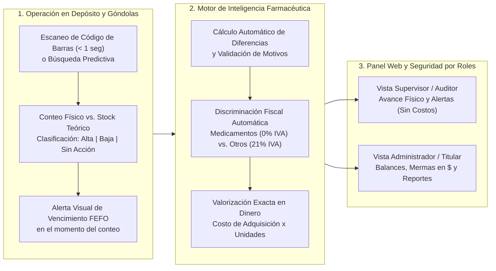

# Dossier Funcional del Sistema para Farmacias
## El Problema Observado, La Solución Integral y Los Resultados Obtenidos

---

## 1. El Problema Observado en la Gestión de Stock Farmacéutico

El inventario de una farmacia es uno de los entornos más exigentes del comercio minorista y de salud: conviven miles de presentaciones medicinales con estrictas fechas de caducidad, productos de alto valor unitario, artículos de perfumería y dermocosmética, y regímenes impositivos diferenciados.

En el relevamiento del trabajo diario dentro de las farmacias, identificamos **cinco problemas críticos** que erosionan silenciosamente la rentabilidad del negocio:

### 1.1. Doble trabajo operativo y errores por uso de papel y Excel
Las auditorías físicas realizadas en papel obligan a un doble esfuerzo: primero contar y anotar a mano en el depósito, y luego transcribir todo a planillas de Excel. Este proceso consume horas clave del personal farmacéutico, introduce errores de tipeo y genera diferencias ficticias entre lo que hay en la estantería y lo que dice el sistema.

### 1.2. Pérdidas invisibles por vencimientos en estantería (Falta de control FEFO)
Sin alertas proactivas por lote y fecha de caducidad en el momento del control físico, las cajas con vencimiento más próximo quedan detrás de los ingresos nuevos. Cuando el personal detecta el medicamento vencido, ya es tarde para rotarlo, promocionarlo o gestionar su devolución/canje con la droguería o laboratorio, transformando capital de trabajo en pérdida directa.

### 1.3. Desconocimiento del impacto monetario real de las mermas
En la mayoría de las farmacias, las bajas por rotura de envases, vencimientos o faltantes se registran únicamente en **unidades físicas** ("faltan 3 cajas", "se rompieron 2 frascos"). La gerencia no cuenta con una valorización instantánea en dinero que le permita saber cuánto capital se perdió en el día, en la semana o en el mes.

### 1.4. Distorsión contable por tratamiento fiscal uniforme (IVA en Medicamentos vs. Perfumería)
En el rubro farmacéutico, los **Medicamentos están exentos de IVA (0%)**, mientras que las familias de **Perfumería, Dermocosmética, Cuidado Personal y Accesorios tributan el 21% de IVA** sobre su costo de adquisición. Las planillas caseras o sistemas genéricos calculan los costos sin discriminar esta regla fiscal, distorsionando el valor real de las pérdidas y de los ingresos de mercadería.

### 1.5. Falta de confidencialidad en los costos de compra
Para que un empleado audite en una planilla tradicional de Excel o en un sistema administrativo abierto, suele quedar expuesto el **costo de adquisición de droguería** y los márgenes financieros de la farmacia. El titular se ve atrapado entre dar acceso total a datos sensibles o limitar quién puede ayudar a controlar el stock.

---

## 2. La Solución: Plataforma Integral de Auditoría e Inteligencia de Inventario

Nuestro sistema resuelve estos cinco puntos mediante una solución multiplataforma en tiempo real (**App Móvil para el Depósito + Panel Web Analítico para Supervisión y Gerencia**), conectada a un motor central de reglas farmacéuticas.

---

### 2.1. Módulo de Operaciones de Campo (App Móvil para Operarios)

Diseñado con alto contraste visual y botones de gran tamaño para trabajar cómodamente de pie en los pasillos del depósito o frente a las estanterías:

* **Escaneo Instantáneo y Búsqueda Inteligente:**
  * Lectura de códigos de barra en **menos de 1 segundo** utilizando la cámara del dispositivo móvil.
  * Si una etiqueta está dañada o borrosa, permite el **ingreso numérico manual del código/SKU** o la **búsqueda predictiva por nombre comercial o droga** (por ejemplo, *"Paracetamol 500mg"*, *"Ibuprofeno"*).
* **Auditoría Guiada y Transparente:**
  * La pantalla presenta la referencia del **stock teórico del sistema** y exige al operario registrar el **stock físico real efectivamente contabilizado**.
* **Clasificación Directa e Intuitiva de Movimientos:**
  * **Altas (Sobrantes):** Ingresos de mercadería o unidades encontradas por encima del registro teórico.
  * **Bajas (Faltantes / Mermas):** Salidas por rotura de envases, vencimiento o faltante detectado.
  * **Sin Acción (Stock Exacto):** Confirmación rápida con un toque cuando el conteo físico coincide exactamente con el stock del sistema.
* **Justificación Obligatoria de Diferencias:**
  * Siempre que el conteo físico difiere del teórico (`Alta` o `Baja`), el sistema exige seleccionar un **motivo estandarizado** antes de guardar (por ejemplo: *Vencido y dado de baja*, *Mercadería dañada / rotura*, *Faltante / pérdida desconocida*, *Sobrante no ingresado en recepción*, *Error de carga en sistema*) y permite adjuntar una observación de hasta 255 caracteres.

---

### 2.2. Motor de Reglas e Inteligencia de Negocio Farmacéutico

El corazón analítico del sistema procesa cada lectura en tiempo real aplicando las reglas propias del negocio farmacéutico:

* **Cálculo Financiero Instantáneo de Mermas y Ajustes:**
  * Cada vez que un operario reporta una baja o un alta en el depósito, el motor central multiplica las unidades físicas afectadas por su **costo de adquisición vigente**, traduciendo cajas contadas en impacto económico real al instante.
* **Discriminación Fiscal Automática (Motor de IVA):**
  * El sistema identifica automáticamente la familia a la que pertenece cada artículo auditado:
    * **Familia `"Medicamentos"`:** Queda automáticamente **exenta de impuestos (0% IVA)** sobre el costo base de adquisición.
    * **Demás familias (Perfumería, Dermocosmética, Accesorios, Insumos):** Aplica automáticamente la alícuota correspondiente (**21% IVA**) sobre el costo base de adquisición.
  * Fórmula aplicada con precisión decimal exacta:
    $$\text{Costo Unitario Final} = \text{Costo Base de Adquisición} \times (1 + \text{Alícuota IVA})$$
* **Trazabilidad por Lote y Semáforo de Vencimientos (Algoritmo FEFO):**
  * El sistema ordena e interroga el stock bajo el estándar farmacéutico **FEFO (*First Expired, First Out* — Primero en Vencer, Primero en Salir)**.
  * Segrega dinámicamente los lotes y expone **alertas semafóricas preventivas** para evitar que los productos venzan en el estante:
    * 🔴 **Rojo (Crítico):** **30 días o menos** para el vencimiento (o lote ya vencido). Requiere retiro inmediato de estantería o gestión urgente de devolución.
    * 🟡 **Amarillo (Alerta Media):** **Hasta 60 días** para el vencimiento. Ideal para priorizar su salida en mostrador o activar acciones comerciales.
    * 🟢 **Verde (Informativo / Preventivo):** **Hasta 90 días** para el vencimiento. Seguimiento preventivo de rotación de lote.

---

### 2.3. Panel Web Analítico y Control de Accesos por Rol (RBAC)

El módulo web convierte los conteos del depósito en tableros de comando y reportes ejecutivos para la toma de decisiones, protegiendo estrictamente quién puede ver cada dato:

* **Tablero de Control (KPIs en Tiempo Real):**
  * **Progreso de Auditoría:** Cantidad de artículos auditados sobre el total del catálogo y porcentaje de avance del día.
  * **Faltantes Registrados Hoy:** Cantidad de artículos con discrepancia negativa y (exclusivamente para el Administrador) el monto total en dinero perdido.
  * **Alertas Críticas de Almacén:** Conteo inmediato de productos con quiebre de stock (`stock = 0`) para agilizar el pedido a droguería.
* **Reportes Ejecutivos de Final de Jornada:**
  * Con filtro por rango de fechas y sucursal, el sistema genera automáticamente **cuatro vistas analíticas exportables**:
    1. **Reporte de Mermas (Bajas):** Detalle artículo por artículo de las pérdidas sufridas, unidades afectadas, costo unitario, IVA aplicado y monto total perdido.
    2. **Reporte de Mercadería Recibida / Ajustes Positivos (Altas):** Valorización de todos los ingresos o sobrantes detectados en la auditoría.
    3. **Balance Neto Patrimonial Diario:** Consolidado por jornada que cruza el valor total de las Altas frente al valor total de las Bajas, arrojando la **Variación Patrimonial Neta** de la farmacia:
       $$\text{Variación Patrimonial Neta} = \text{Valor Total de Altas} - \text{Valor Total de Bajas}$$
    4. **Historial Completo de Auditoría:** Trazabilidad inmutable con fecha, hora exacta, usuario que escaneó, lote, acción y motivo declarado.
* **Seguridad y Confidencialidad Financiera Basada en Roles (RBAC):**
  * El sistema oculta de raíz los costos de compra y los valores monetarios a los perfiles operativos. No es solo un filtro visual: el servidor nunca envía datos de dinero a quienes no tienen rol de Administrador.

| Perfil de Usuario | Herramienta Principal | Alcance Operativo | Visibilidad de Costos y Dinero (`$`) |
| :--- | :--- | :--- | :---: |
| **Administrador** *(Dueño / Titular / Gerente)* | Panel Web Gerencial | Acceso total a reportes financieros, balances patrimoniales, costos de compra, catálogo completo y administración de usuarios/sucursales. | **SÍ (100% Visible)** |
| **Supervisor** *(Encargado / Director Técnico)* | Panel Web Operativo + App Móvil | Seguimiento del porcentaje de avance diario de las auditorías, control de alertas de quiebre de stock, consulta de lotes FEFO y relevamiento físico. | **NO (Oculto por Seguridad)** |
| **Auditor** *(Operario de Depósito / Auxiliar)* | App Móvil de Campo | Acceso enfocado al escaneo de códigos de barra, consulta de stock físico/lotes FEFO y registro de conteos (`Alta`, `Baja`, `Sin Acción`). | **NO (Oculto por Seguridad)** |

---

## 3. El Resultado: Qué Logra la Farmacia al Implementar el Sistema

Pasar de las auditorías manuales en papel y Excel a **SaaS Stock Deposit Control** produce un impacto directo y medible desde la primera semana de uso:

### Comparativa Operativa: Antes vs. Después

| Dimensión en la Farmacia | Antes (Papel + Planilla Excel) | Después (Con Nuestro Sistema) |
| :--- | :--- | :--- |
| **Velocidad de Relevamiento** | Lenta: buscar en papel, contar y anotar a mano. | **Escaneo en $< 1\text{ segundo}$** por cámara o búsqueda predictiva instantánea. |
| **Carga de Datos** | Horas de transcripción manual a Excel al final del día con errores de tipeo. | **0 minutos de transcripción:** el conteo impacta en vivo al confirmar en el móvil. |
| **Control de Vencimientos** | Reactivo: se descubren las cajas cuando ya están vencidas en el estante. | **Preventivo (FEFO):** semáforo a **30, 60 y 90 días** para rotar o devolver a tiempo. |
| **Cálculo de Pérdidas ($)** | Manual o inexistente; suele mezclar productos con y sin IVA. | **Automático y exacto:** discrimina **0% IVA en Medicamentos** y **21% IVA en Perfumería**. |
| **Cierre de Balance Diario** | Toma días consolidar las diferencias de una auditoría general. | **Reporte de Fin de Jornada instantáneo** con Variación Patrimonial Neta en un clic. |
| **Privacidad de Costos** | Planillas expuestas donde cualquier operario ve los costos de droguería. | **Blindaje por Roles:** los operarios ven unidades; solo el titular ve el dinero. |

### ¿Por qué el sistema se paga solo? (Retorno de Inversión para la Farmacia)
1. **Ahorro directo en medicamentos salvados del vencimiento:** Detectar a tiempo un solo lote de medicamentos de alto costo o dermocosmética a 30/60 días de vencer (para priorizar su dispensación o gestionar su reconocimiento en droguería) recupera el valor del abono del sistema.
2. **Eliminación de horas extras y tiempos muertos administrativos:** Las horas semanales que el personal calificado perdía transcribiendo hojas a Excel vuelven a destinarse a la atención en mostrador y a la gestión farmacéutica.
3. **Reducción del "faltante hormiga" y roturas no declaradas:** Cuando el equipo sabe que existe trazabilidad por usuario, fecha, hora y motivo obligatorio en cada conteo, el cuidado de la mercadería en el depósito mejora drásticamente.
4. **Reposición inteligente sin pérdidas de venta:** Las alertas automáticas de artículos sin stock (`stock = 0`) evitan perder ventas en mostrador por falta de reposición oportuna desde la droguería.
