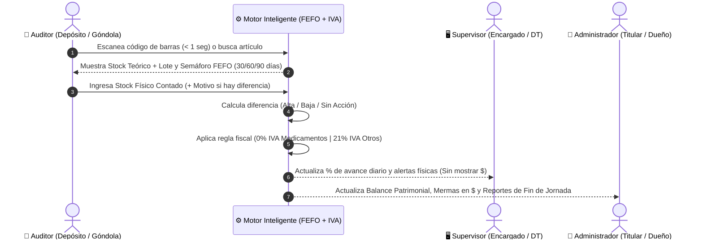

# Guía Operativa para Usuarios de la Farmacia
## Cómo Trabaja Cada Rol en el Día a Día (Auditor, Supervisor y Administrador)

---

## 1. Introducción: Un Sistema Pensado para la Rutina Real de la Farmacia

Sabemos que en una farmacia el tiempo apremia: entre la recepción de pedidos de droguería, la acomodación de lotes en estanterías y la atención al público, el control de stock debe ser **rápido, intuitivo y libre de fricciones**.

Por eso, el sistema adapta automáticamente sus pantallas y funciones según la persona que ingresa. A continuación, mostramos cómo vive una jornada de auditoría cada integrante del equipo de la farmacia.

---

## 2. El Flujo Diario Paso a Paso por Rol

---

### Perfil 1: El Operario de Depósito / Auxiliar de Farmacia (`Auditor`)
**Herramienta:** Aplicación Móvil de Campo (o Terminal de Auditoría).  
**Objetivo:** Relevar físicamente los estantes de forma ágil, sin usar papel, lápiz ni calculadora.

#### ¿Cómo es su trabajo paso a paso en el pasillo del depósito?
1. **Identificación en menos de 1 segundo:**
   - Toma una caja del estante y apunta con la cámara del celular al código de barras.
   - *¿El código de barras está roto o manchado?* Puede tipear los números manualmente o escribir parte del nombre (por ejemplo, `"Paracetamol"`) y el buscador predictivo se lo sugiere al instante.
2. **Verificación del Lote y Vencimiento (Alerta FEFO en mano):**
   - En pantalla ve el lote que debería salir primero (**FEFO: Primero en Vencer, Primero en Salir**) acompañado de una alerta visual por colores:
     - 🔴 **Rojo (Crítico - 30 días o menos):** Avisa inmediatamente para separar la caja y evitar que llegue vencida al mostrador.
     - 🟡 **Amarillo (Alerta Media - 60 días):** Permite adelantar esas unidades al frente del estante para priorizar su venta.
     - 🟢 **Verde (Informativo - 90 días):** Lote dentro del margen preventivo.
3. **Conteo y Confirmación con un Toque:**
   - La app muestra el **Stock Teórico del sistema** y el operario ingresa el **Stock Real contado**.
   - El sistema clasifica el movimiento automáticamente mediante botones claros:
     - ✅ **Sin Acción:** Si en el sistema figuraban `20` cajas y contó `20` cajas, confirma con un solo toque y pasa al siguiente producto.
     - 🔻 **Baja (Merma / Faltante):** Si figuraban `20` cajas pero hay `18` (por ejemplo, 2 envases rotos o vencidos), el sistema registra una **Baja de 2 unidades** y le pide elegir el motivo (*"Vencido y dado de baja"*, *"Mercadería dañada / rotura"* o *"Faltante / pérdida desconocida"*).
     - 🔺 **Alta (Sobrante / Ingreso):** Si figuraban `20` cajas y contó `22`, registra un **Alta de 2 unidades** indicando el motivo (*"Sobrante no ingresado en recepción"* o *"Error de carga en sistema"*).

> **Ventaja para el Auditor:** No tiene que hacer cuentas mentales, no anota en planillas de papel y termina su sector en una fracción del tiempo habitual.

---

### Perfil 2: El Encargado de Sucursal / Director Técnico (`Supervisor`)
**Herramienta:** Panel Web Operativo + Aplicación Móvil.  
**Objetivo:** Garantizar que el depósito esté auditado al día, sin quiebres de stock ni medicamentos próximos a vencer, manteniendo la reserva sobre los números financieros del dueño.

#### ¿Qué visualiza y controla durante la jornada?
1. **Progreso de Auditoría en Vivo:**
   - Desde el Panel Web ve la barra de progreso diario: cuántos artículos del catálogo ya fueron auditados hoy, cuántos están pendientes y cuál fue el último producto escaneado en el depósito.
2. **Control de Faltantes Físicos y Quiebres de Stock:**
   - Visualiza la cantidad total de unidades con faltante detectadas en la jornada y las **Alertas Críticas de Almacén** (artículos que llegaron a `stock = 0`) para disparar a tiempo la reposición con la droguería.
3. **Explorador de Catálogo y Lotes FEFO:**
   - Puede filtrar todo el catálogo de la farmacia por familia (*Medicamentos*, *Perfumería*, *Dermocosmética*, *Accesorios*) y revisar el estado de vencimiento de cada lote.
4. **Privacidad Financiera Garantizada:**
   - El Supervisor tiene todas las herramientas operativas para dirigir el depósito, pero **el sistema oculta automáticamente los costos unitarios de compra y las pérdidas valorizadas en dinero**, cuidando la información sensible del titular.

---

### Perfil 3: El Titular / Dueño / Gerente de la Farmacia (`Administrador`)
**Herramienta:** Panel Web Analítico y Gerencial.  
**Objetivo:** Conocer la rentabilidad real del inventario, controlar cuánto dinero representan las mermas y contar con balances automáticos al cierre del día.

#### ¿Qué decisiones toma con el Panel Gerencial?
1. **Visibilidad Monetaria Instantánea en el Tablero Principal:**
   - Al abrir su panel, ve de un vistazo no solo el avance físico sino también el indicador de **Faltantes Registrados Hoy expresado en dinero (`$`)**, calculado contra el costo real de reposición.
2. **Ejemplo Práctico del Motor Fiscal (Medicamentos vs. Perfumería):**
   - Supongamos que en la auditoría de la mañana se registraron dos bajas por rotura:
     - **Caso A — Medicamento (*Ibuprofeno 600mg x 20 comp.*):** Costo base de droguería `\$4.000`. Al pertenecer a la familia **Medicamentos**, el sistema aplica **0% de IVA**. Si se dan de baja 2 cajas, la pérdida registrada es exactamente **`\$8.000,00`**.
     - **Caso B — Dermocosmética (*Protector Solar Facial FPS 50*):** Costo base `\$10.000`. Al no pertenecer a la familia Medicamentos, el sistema aplica automáticamente el **21% de IVA** (`\$12.100` de costo final unitario). Si se da de baja 1 unidad por envase dañado, la pérdida real contabilizada es **`\$12.100,00`**.
   - El Administrador obtiene ambos cálculos hechos de forma 100% automática y sin errores de fórmulas.
3. **Reportes de Fin de Jornada y Balance Patrimonial:**
   - En la sección **Reportes**, filtra por día, semana o mes y accede a:
     - **Mermas (Bajas):** Ranking y detalle de pérdidas monetarias para identificar dónde se está fugando dinero.
     - **Ingresos / Ajustes Positivos (Altas):** Valorización de mercadería recuperada o ajustada a favor.
     - **Balance Neto de Inventario:** El cruce exacto entre Altas y Bajas que informa la **Variación Patrimonial Neta** de cada sucursal.
   - Además, puede **exportar los reportes** con un clic para su archivo contable o reunión de socios.
4. **Administración Segura del Equipo (`Usuarios`):**
   - Da de alta, activa o desactiva cuentas de empleados y cambia sus roles (`Auditor`, `Supervisor`, `Administrador`) en segundos, con bloqueos de seguridad integrados que impiden que el administrador desactive su propia cuenta por accidente.

---

## 3. Preguntas Frecuentes de Nuestros Clientes Farmacéuticos (FAQ)

### ¿Mis empleados del depósito van a poder ver a qué precio compro los medicamentos en la droguería?
**No.** El sistema aplica un bloqueo de seguridad a nivel de servidor (Control de Accesos Basado en Roles). Cuando un usuario con perfil `Auditor` o `Supervisor` inicia sesión, el sistema jamás envía los costos de compra ni los montos en dinero a su celular o computadora. Solo el perfil `Administrador` puede ver importes monetarios.

### ¿Qué pasa si una caja tiene el código de barras borroso, roto o no lo lee la cámara?
El operario nunca se queda trabado: desde la misma pantalla de auditoría puede ingresar el código numérico a mano o buscar el artículo por su nombre comercial (búsqueda predictiva) en menos de un segundo.

### ¿Cómo evita el sistema que alguien modifique el stock sin justificar por qué falta mercadería?
Cuando el conteo físico coincide con el stock teórico (*Sin Acción*), el registro es inmediato. Pero si existe aunque sea **1 unidad de diferencia** (sea un faltante o un sobrante), el sistema **bloquea el guardado hasta que el operario seleccione obligatoriamente un motivo válido** de la lista estandarizada, dejando asentado quién lo hizo, a qué hora y por qué razón.

### ¿Tengo que configurar manualmente qué productos llevan IVA y cuáles no para calcular las pérdidas?
**No.** El motor de reglas del sistema reconoce automáticamente la familia del artículo. Todo producto categorizado bajo la familia **Medicamentos** se valoriza exento de impuestos (**0% IVA**), mientras que el resto de las familias de la farmacia se valorizan contemplando el **21% de IVA** sobre su costo base.
