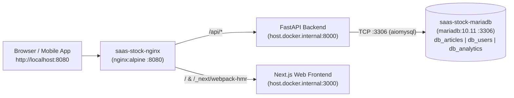

# 🚀 Container Infrastructure & NGINX Ingress Deployment Runbook

This runbook documents the deployment, configuration, and day-to-day operation of the containerized infrastructure stack (**MariaDB 10.11 LTS** multi-database engine + **NGINX Alpine** ingress reverse proxy) managed via [`docker-compose.yml`](../../docker-compose.yml) and [`scripts/devops/deploy.sh`](../../scripts/devops/deploy.sh).

---

## 1. Infrastructure Architecture Overview

The container stack runs two coordinated services connected to the `backend-net` bridge network:



### 1.1 Consolidated MariaDB 10.11 LTS (`saas-stock-mariadb`)

To minimize RAM footprint and share a single InnoDB buffer pool, three independent logical databases are consolidated inside one `mariadb:10.11` container instance:

| Logical Database | Declarative Base | Purpose & Key Tables | Environment Variables |
|:-----------------|:-----------------|:---------------------|:----------------------|
| `db_articles` | `BaseArticles` | Operational catalog, warehouse stock positions (`stock_por_deposito`), FEFO lots (`lotes_por_deposito`), and barcodes (`codigos_barra_articulo`) | `DB_NAME_ARTICLES` / `DATABASE_URL` / `ARTICLES_DATABASE_URL` |
| `db_users` | `BaseUsers` | Multi-tenant enterprises (`enterprises`), branches (`branches`), user accounts (`users`), and RBAC roles (`roles`, `user_roles`) | `DB_NAME_USERS` / `USERS_DATABASE_URL` |
| `db_analytics` | `BaseAnalytics` | Tenant audit ledger (`audit_records`), active branch work sessions (`work_sessions`), daily reports (`daily_reports`), and alerts (`critical_shrinkage_alerts`) | `DB_NAME_ANALYTICS` / `ANALYTICS_DATABASE_URL` |

- **Automated Initialization**: On first boot, [`docker/mariadb/init-dbs.sql`](../../docker/mariadb/init-dbs.sql) is mounted at `/docker-entrypoint-initdb.d/01-init-dbs.sql:ro` to create `db_articles`, `db_users`, and `db_analytics` with `utf8mb4_unicode_ci` collation and grant least-privilege access to `app_user`.
- **Persistent Storage**: Database files are persisted across container restarts in the local Docker volume `mariadb_data` (`/var/lib/mysql`).
- **Healthcheck**: Container readiness is verified via `mariadb-admin ping -h 127.0.0.1 --silent` (compatible with MariaDB's built-in `healthcheck.sh` / `mariadb-admin` probes).

### 1.2 NGINX Ingress Reverse Proxy (`saas-stock-nginx`)

The `nginx:alpine` container exposes a unified HTTP entry point on `NGINX_PORT` (default `8080`) using [`docker/nginx/nginx.conf`](../../docker/nginx/nginx.conf) and `extra_hosts: ["host.docker.internal:host-gateway"]`:

| Location Path | Upstream Target | Behavior & Headers |
|:--------------|:----------------|:-------------------|
| `/nginx-health` | Internal NGINX responder | Returns HTTP `200` (`healthy\n`) for Docker healthcheck probes (`wget --spider http://127.0.0.1:8080/nginx-health`). |
| `/api/` | `http://host.docker.internal:8000` | Proxies REST API requests to FastAPI with `X-Real-IP`, `X-Forwarded-For`, `X-Forwarded-Proto`, `120s` read timeout, and `20M` max body size. |
| `/_next/webpack-hmr` | `http://host.docker.internal:3000/_next/webpack-hmr` | Proxies Next.js Hot Module Replacement over WebSockets (`Upgrade: websocket`, `Connection: upgrade`). |
| `/_next/static/` | `http://host.docker.internal:3000/_next/static/` | Proxies Next.js static build assets. |
| `/` | `http://host.docker.internal:3000` | Proxies all web UI routes to the Next.js App Router server. |

---

## 2. Quick Start & Single-File Deployment

All container lifecycle operations are automated by [`scripts/devops/deploy.sh`](../../scripts/devops/deploy.sh) (strict Bash `set -euo pipefail`, supports both `docker compose` v2 and `docker-compose` v1).

### Step 1: Configure `.env`

Copy `.env.example` to `.env` at the repository root (if `.env` is missing, `deploy.sh up` will automatically copy `.env.example` and warn you):

```bash
cp .env.example .env
```

Verify key infrastructure settings in `.env`:

```env
MARIADB_ROOT_PASSWORD=changeme_root_password
MARIADB_APP_PASSWORD=changeme_app_password
MARIADB_PORT=3306
NGINX_PORT=8080
```

### Step 2: Start the Container Stack

```bash
./scripts/devops/deploy.sh up
```

What `./scripts/devops/deploy.sh up` does:
1. **Pre-flight Checks**: Verifies Docker CLI, Docker daemon permissions, `.env` file, and `docker-compose.yml`.
2. **Container Startup**: Runs `docker compose up -d --remove-orphans` for `mariadb` and `nginx`.
3. **MariaDB Health Gate**: Polls `mariadb-admin ping` (up to `60s`) and prints `SHOW DATABASES LIKE 'db_%';` to confirm `db_articles`, `db_users`, and `db_analytics` exist.
4. **NGINX Health Gate**: Polls `http://127.0.0.1:8080/nginx-health` (up to `30s`) to confirm ingress readiness.

### Step 3: Run Multi-Database Alembic Migrations & Seed Data

Once the containers are healthy, apply Alembic migrations to all three logical databases and optionally seed initial data:

```bash
# Activate Python virtual environment
source .venv/bin/activate

# Apply schema migrations for each logical database
alembic -c backend/migrations/alembic.ini upgrade head
alembic -c backend/migrations/alembic_users.ini upgrade head
alembic -c backend/migrations/alembic_analytics.ini upgrade head

# Optional: Seed multi-tenant demo data (all users: 123456)
python -m backend.scripts.seed
```

---

## 3. `./scripts/devops/deploy.sh` CLI Reference

| Command | Description |
|:--------|:------------|
| `./scripts/devops/deploy.sh up` | Runs pre-flight checks, starts `saas-stock-mariadb` and `saas-stock-nginx` in detached mode, and waits for both health gates to pass. |
| `./scripts/devops/deploy.sh down` | Gracefully stops and removes containers while **preserving** the `mariadb_data` persistent volume. |
| `./scripts/devops/deploy.sh status` | Displays `docker compose ps` output with container state, health status, and host port bindings. |
| `./scripts/devops/deploy.sh health` | Runs instant health probes against: (1) MariaDB internal ping, (2) NGINX internal `/nginx-health`, (3) host port `http://127.0.0.1:${NGINX_PORT}/nginx-health`, and (4) backend proxy `http://127.0.0.1:${NGINX_PORT}/api/v1/health`. |
| `./scripts/devops/deploy.sh logs [service]` | Tails the last 50 lines of container logs (`-f`). Pass `mariadb` or `nginx` to filter a single service. |
| `./scripts/devops/deploy.sh help` | Prints CLI usage instructions. |

---

## 4. Troubleshooting & Maintenance

### Backend Proxy Shows `BACKEND OFFLINE` During `deploy.sh health`
- `saas-stock-nginx` forwards `/api/` traffic to `host.docker.internal:8000`.
- Ensure the FastAPI server is running on your host machine (`uvicorn backend.api.main:app --host 0.0.0.0 --port 8000 --reload`) so NGINX can reach it across the Docker bridge gateway.

### Port Conflicts (`3306` or `8080` Already in Use)
- Update `MARIADB_PORT` (and `DB_PORT`) or `NGINX_PORT` in `.env`, then re-run `./scripts/devops/deploy.sh up`.

### `app_user` Authentication Failure After Changing Passwords
- `docker/mariadb/init-dbs.sql` only executes when the `mariadb_data` volume is initialized for the first time.
- If you change `MARIADB_APP_PASSWORD` in `.env` after initialization, either update the password inside MariaDB manually or reset the volume (see below).

### Reset Database Volume (Destructive Action)

> [!CAUTION]
> The following command permanently deletes all data stored in the `mariadb_data` Docker volume across `db_articles`, `db_users`, and `db_analytics`.

```bash
docker compose down -v
./scripts/devops/deploy.sh up
```

After resetting the volume, re-run the three `alembic upgrade head` commands and `python -m backend.scripts.seed` as shown in Step 3.
