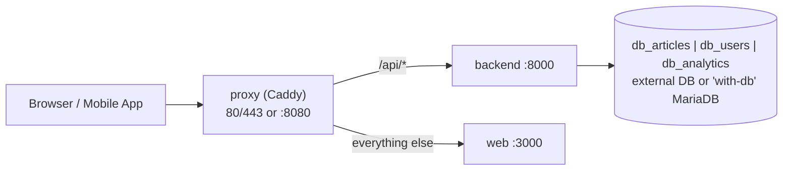

# Deployment Runbooks

The same container images run on every target; only `.env` changes. The stack is defined in [`docker-compose.yml`](../../docker-compose.yml) and operated with [`scripts/devops/deploy.sh`](../../scripts/devops/deploy.sh). Run every command from a repository checkout, at the repository root.



## 1. Common Setup

```bash
cp .env.example .env     # then fill the secrets below
```

| Variable | Requirement |
|:---|:---|
| `SECRET_KEY` | At least 32 characters, not `changeme`/`secret`. The backend refuses to start in `ENVIRONMENT=production` otherwise. Generate with `python3 -c "import secrets; print(secrets.token_urlsafe(48))"`. |
| `DB_PASSWORD` | Password of the application database user. |
| `MARIADB_ROOT_PASSWORD`, `MARIADB_APP_PASSWORD` | Only for the bundled `with-db` MariaDB. `MARIADB_APP_PASSWORD` has no fallback: set it explicitly (to the same value as `DB_PASSWORD`). |
| `IMAGE_TAG`, `GHCR_OWNER`, `COMPOSE_PROJECT_NAME` | Which GHCR image runs. Keep `COMPOSE_PROJECT_NAME=saas-stock`. |
| `SERVER_NAME` | `:8080` for plain HTTP, or a public domain for automatic HTTPS. |

Migrations run automatically when the `backend` container starts (`RUN_MIGRATIONS=true`); a failed migration stops the start-up.

The images are pulled from GHCR. For a private repository log in first with a token that has `read:packages`: `docker login ghcr.io -u <user>`.

## 2. Runbook: Client On-Premise Server (external MariaDB/MySQL)

1. Install Docker Engine with the Compose plugin and `curl` on the server.
2. In `.env`: `SERVER_NAME=<client-domain>` (public IP and DNS) or `:8080` (LAN only), `DB_HOST`, `DB_PORT`, `DB_USER`, `DB_PASSWORD`, `DB_SSL_MODE` (see section 6), a strong `SECRET_KEY`, and a fixed release `IMAGE_TAG` such as `v1.2.0`.
3. Create the three databases and grant the user (see the compatibility notes in section 6), then start:

   ```bash
   ./scripts/devops/deploy.sh up
   ```

4. Verify: `./scripts/devops/deploy.sh health`.

Known limitation: the proxy publishes host ports `80` and `443` unconditionally. If the host already serves those ports, `up` fails even for plain-HTTP deployments; stop the other service until the ports become configurable.

## 3. Runbook: Oracle Cloud Always Free VM (Ampere A1, arm64)

1. Create the VM (Ubuntu, arm64). Open TCP `80` and `443` in the VCN security list **and** in the VM firewall (`sudo iptables -I INPUT -p tcp --dport 80 -j ACCEPT`, same for `443`, then persist).
2. Point a free dynamic DNS name (DuckDNS) or `<ip>.sslip.io` at the VM's public IP.
3. Install Docker Engine and the Compose plugin. The GHCR images are multi-arch, so nothing is built on the VM.
4. In `.env`: `SERVER_NAME=<your-hostname>`, `ACME_EMAIL_OPTION="email you@domain"` (optional full Caddy directive), `COMPOSE_PROFILES=with-db` to use the bundled MariaDB, `IMAGE_TAG=edge`, secrets.
5. `./scripts/devops/deploy.sh up`. Caddy obtains the Let's Encrypt certificate on the first request; HTTPS is also what browsers require for the camera barcode scanner.

If Let's Encrypt rate-limits the shared dynamic-DNS domain, use a dedicated subdomain.

## 4. Runbook: Developer Machine + Cloudflare Tunnel (zero open ports)

1. Create a tunnel in the Cloudflare Zero Trust dashboard pointing its public hostname at `http://proxy:8080`.
2. In `.env`: `SERVER_NAME=:8080`, `CLOUDFLARE_TUNNEL_TOKEN=<token>` (never commit it), `COMPOSE_PROFILES=with-db,demo,tunnel` (bundled DB, seed data, tunnel).
3. `./scripts/devops/deploy.sh up`. The demo data (all users: `123456`) is loaded by the one-shot `seed` service; the app is reachable on the tunnel hostname.

For hot reload use the development override: `docker compose -f docker-compose.yml -f docker-compose.dev.yml up`.

## 5. Release Lifecycle with `deploy.sh`

| Command | Description |
|:---|:---|
| `up [with-db]` | Starts the services (`with-db` adds the bundled MariaDB) and waits for `/api/v1/health`. |
| `down` / `status` / `logs [service]` | Stop (the `mariadb_data` volume is preserved), inspect, and tail logs. |
| `health` | Probes `/api/v1/health` through the proxy: HTTP 200 only when `articles`, `users` and `analytics` are all connected. |
| `pull` | Pulls the `backend` and `web` images for the current `IMAGE_TAG`. |
| `update [tag]` | Pulls the new tag, records the running tag in `.previous_tag`, sets `IMAGE_TAG` in `.env`, restarts and waits for health. If it is not healthy within `HEALTH_TIMEOUT` seconds (default `60`), it rolls back to `.previous_tag` and exits non-zero. Without a tag it re-pulls the current one. |
| `rollback` | Sets `IMAGE_TAG` to the tag in `.previous_tag`, restarts and verifies health. |
| `backup` | Dumps `db_articles`, `db_users` and `db_analytics` to `backups/backup_YYYYMMDD_HHMMSS.sql.gz` (mode `600`). |

Settings (environment variables of the command): `HEALTH_TIMEOUT` (default `60`), `HEALTH_INTERVAL` (default `5`), `HEALTH_URL` (default derived from `SERVER_NAME`/`HTTP_PORT`).

Notes:

- `.previous_tag` is the only rollback record. Updating to the tag that is already deployed leaves it untouched, so a re-pull never overwrites the rollback target.
- With a bundled database, keep `COMPOSE_PROFILES=with-db` in `.env` so `update` and `rollback` manage the same profile as `up`.
- Back up before updating a release that includes migrations; a schema change that drops or rewrites columns is not guaranteed to be reversible by an image rollback.
- `backup` uses the bundled MariaDB container when it is running. Otherwise it needs `mariadb-dump` or `mysqldump` on the host and reads `DB_HOST`, `DB_PORT`, `DB_USER`, `DB_PASSWORD` (and `DB_SSL_*`) from `.env`; it does not parse `DATABASE_URL`. Passwords are passed through the environment, never on a command line. Restore with `gunzip -c backups/<file>.sql.gz | mariadb -u root -p`.
- Backups are stored locally and are not rotated or replicated; copy them off the host.

## 6. Database Connection Security and Compatibility

Choose the connection in this order of preference:

1. **Same private network / VPC (best):** the app host and the database server talk over a private IP (`10.x.x.x`, `192.168.x.x`); nothing is exposed publicly.
2. **Encrypted mesh or tunnel:** Tailscale, WireGuard, or a persistent SSH tunnel (`ssh -L 3306:127.0.0.1:3306 user@db-host`). Point `DB_HOST` at the tunnel endpoint.
3. **Public IP with TLS and allowlist:** restrict the database port in the client firewall to the app server's static egress IP, set `DB_SSL_MODE=verify-ca` with the client CA in `DB_SSL_CA`, and limit the user's privileges to the three databases.

`DB_SSL_MODE`: `disable` (default, internal Docker network), `require` (encrypted, certificate not verified), `verify-ca` (chain verified against `DB_SSL_CA`; the hostname is not checked).

`DATABASE_URL`, `ARTICLES_DATABASE_URL`, `USERS_DATABASE_URL` and `ANALYTICS_DATABASE_URL`, when set, take precedence over the `DB_*` components. Leave them unset (as in `.env.example`) when using `DB_HOST`.

| Topic | MariaDB 10.11 | MySQL 8 |
|:---|:---|:---|
| Collation | `utf8mb4_unicode_ci` | Create the databases with `utf8mb4_unicode_ci` (the default `utf8mb4_0900_ai_ci` differs). |
| Authentication | `mysql_native_password` | Create the user with `IDENTIFIED WITH mysql_native_password BY '...'` (`aiomysql` does not use `caching_sha2_password` over plain connections). |
| Privileges | Granted by `docker/mariadb/01-init-dbs.sh` | `SELECT, INSERT, UPDATE, DELETE, CREATE, ALTER, DROP, INDEX, REFERENCES` on `db_articles.*`, `db_users.*`, `db_analytics.*`. |

## 7. Troubleshooting

| Symptom | Check |
|:---|:---|
| `up` / `update` ends with "Health check failed" | `./scripts/devops/deploy.sh logs backend`. The first start may need longer while migrations run: raise `HEALTH_TIMEOUT`. |
| Health is 503 | At least one database is unreachable; check `DB_*`, `DB_SSL_MODE` and the database firewall. |
| Backend exits immediately in production | `SECRET_KEY` is empty, trivial or shorter than 32 characters. |
| No certificate on a public domain | Ports `80`/`443` must be reachable from the internet and `SERVER_NAME` must resolve to this host. |
| `app_user` authentication fails after changing `MARIADB_APP_PASSWORD` | `01-init-dbs.sh` only runs on an empty `mariadb_data` volume; change the password inside MariaDB or reset the volume. |

Reset the bundled database (destructive, deletes all three databases):

```bash
docker compose --profile with-db down -v
./scripts/devops/deploy.sh up with-db
```
