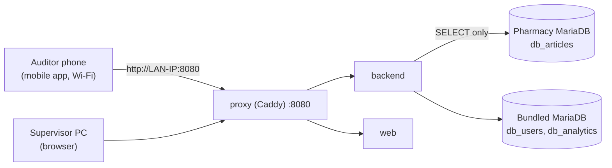

# Runbook: Pharmacy On-Premise Deployment (Hybrid Databases)

This runbook installs the platform on a pharmacy branch server inside the local network (LAN). It covers the hybrid topology:

- `db_articles`: the pharmacy's **own** MariaDB product/pricing database, accessed **read-only**. The application never runs migrations against it.
- `db_users` and `db_analytics`: hosted on the same server by the bundled MariaDB container (`with-db` profile).

Auditors scan barcodes with the native mobile app over the Wi-Fi LAN (plain HTTP, see step 7). For the general reference (all `.env` variables, `deploy.sh` lifecycle, backups) see [README.md](README.md).



## 1. Host Prerequisites

| Item | Requirement |
|:---|:---|
| OS | 64-bit Linux (amd64 or arm64) with Docker Engine and the Docker Compose plugin (`docker compose version`). |
| Tools | `git`, `curl`. |
| Memory | 4 GB RAM minimum (backend, web, proxy and MariaDB). |
| Storage | 20 GB free for images, the `mariadb_data` volume and local backups. |
| Network | A **fixed LAN IP** (DHCP reservation or static) so mobile devices keep a stable server URL. The server must reach the pharmacy database on its port (usually `3306`). |
| Ports | Only `HTTP_PORT` (default `8080`) is published. Hosts that already serve `80`/`443` need no changes. |

The pharmacy database must already contain the `db_articles` schema the application expects: no migration is applied to it.

```bash
git clone <repository-url> saas-stock && cd saas-stock
```

## 2. Read-Only User on the Pharmacy Database

Run on the pharmacy MariaDB server as an administrator. Replace `<app-host-ip>` with the fixed LAN IP of the application server (prefer it over `'%'`) and `db_articles` with the real database name if it differs.

```sql
CREATE USER 'ro_user'@'<app-host-ip>' IDENTIFIED BY '<strong-password>';
GRANT SELECT ON db_articles.* TO 'ro_user'@'<app-host-ip>';
FLUSH PRIVILEGES;
```

Check that the user can read but not write:

```sql
SHOW GRANTS FOR 'ro_user'@'<app-host-ip>';   -- only "GRANT SELECT ON `db_articles`.*"
```

From the application server (with a MariaDB client installed):

```bash
mariadb -h <pharmacy-db-host> -u ro_user -p -e "SELECT 1" db_articles          # succeeds
mariadb -h <pharmacy-db-host> -u ro_user -p -e "CREATE TABLE t (id INT)" db_articles  # must fail: command denied
```

If the connection is refused, check that the pharmacy MariaDB listens on the LAN (`bind-address` in its server config is not `127.0.0.1`) and that its firewall allows the application server's IP.

## 3. Bundled MariaDB for `db_users` and `db_analytics`

The `with-db` profile starts MariaDB 10.11, published on `127.0.0.1` only. On its **first** start (empty `mariadb_data` volume) [`docker/mariadb/01-init-dbs.sh`](../../docker/mariadb/01-init-dbs.sh) creates `db_articles`, `db_users` and `db_analytics` with `utf8mb4_unicode_ci` and the application user `DB_USER` (default `app_user`) with password `MARIADB_APP_PASSWORD`. The local `db_articles` stays empty and unused in this topology.

Requirements:

- `MARIADB_ROOT_PASSWORD` and `MARIADB_APP_PASSWORD` set in `.env`.
- `DB_PASSWORD` equal to `MARIADB_APP_PASSWORD`.
- The init script never runs again on an existing volume: changing `MARIADB_APP_PASSWORD` later requires changing it inside MariaDB (see README section 7).

Migrations for `db_users` and `db_analytics` run automatically when the `backend` container starts.

## 4. `.env` Configuration

```bash
cp .env.example .env && chmod 600 .env
```

Set at least these values (keep the rest of `.env.example` as is):

```dotenv
# Images: pin a release, never "latest", on client servers
IMAGE_TAG=v1.2.0

# Ingress: plain HTTP on the LAN, no certificates, no 80/443
SERVER_NAME=:8080
HTTP_PORT=8080
# Keep COMPOSE_FILE commented: docker-compose.public.yml is only for public domains.

# Bundled MariaDB for db_users / db_analytics
COMPOSE_PROFILES=with-db
MARIADB_ROOT_PASSWORD=<root-password>
MARIADB_APP_PASSWORD=<app-password>
DB_HOST=mariadb
DB_USER=app_user
DB_PASSWORD=<app-password>

# Pharmacy database for db_articles (read-only user from step 2).
# URL-encode special characters in the password (e.g. @ -> %40).
ARTICLES_DATABASE_URL=mysql+aiomysql://ro_user:<strong-password>@<pharmacy-db-host>:3306/db_articles

# Never run Alembic against the pharmacy database
RUN_MIGRATIONS_ARTICLES=false
RUN_MIGRATIONS_USERS=true
RUN_MIGRATIONS_ANALYTICS=true

# Application
ENVIRONMENT=production
SECRET_KEY=<at least 32 characters>
CORS_ORIGINS=http://<lan-ip>:8080
```

Generate `SECRET_KEY` with `python3 -c "import secrets; print(secrets.token_urlsafe(48))"`. `ARTICLES_DATABASE_URL` takes precedence over the `DB_*` values for `db_articles` only; `db_users` and `db_analytics` keep using `DB_HOST=mariadb`. Leave `DATABASE_URL` unset.

If `8080` is taken on the host, change `HTTP_PORT` and use that port in every URL below.

## 5. Start

```bash
./scripts/devops/deploy.sh up with-db
```

The command pulls the images if needed, starts proxy, backend, web and MariaDB, applies the `db_users`/`db_analytics` migrations and waits for `/api/v1/health`. The first start can take longer: raise the wait with `HEALTH_TIMEOUT=180 ./scripts/devops/deploy.sh up with-db`.

## 6. Verification

On the server:

```bash
./scripts/devops/deploy.sh health
curl -f http://localhost:8080/api/v1/health
```

Expected response (HTTP 200):

```json
{"status": "healthy", "database": "connected", "databases": {"articles": "connected", "users": "connected", "analytics": "connected"}, "version": "..."}
```

Any `disconnected` database returns HTTP 503 (see Troubleshooting). Then, from another device on the same LAN, open `http://<lan-ip>:8080` in a browser. If it does not load, allow the port in the host firewall, e.g. `sudo ufw allow 8080/tcp`.

## 7. Auditor Mobile App over Wi-Fi LAN

Browsers only allow camera access on secure contexts (`https://` or `localhost`). On `http://<lan-ip>:8080` the **web** barcode scanner cannot open the camera. Auditing devices must use the **native mobile app**, which accesses the camera through native permissions and is built to allow plain HTTP to the local server.

The web dashboard over HTTP remains fully usable for supervisors (reports, sessions, users); only browser camera scanning needs HTTPS.

Connect each auditing device:

1. Install the mobile app on the device.
2. Connect the device to the **same Wi-Fi network** as the server (not a guest network isolated from the LAN).
3. Open the app. On the login screen tap **Configuración del Servidor**.
4. Enter `http://<lan-ip>:8080` (no trailing path) and tap **Probar Conexión**. "Conexión exitosa." means `/api/v1/health` answered HTTP 200.
5. Tap **Guardar** and sign in with the auditor account.
6. Grant the camera permission when the app asks for it on the first scan.

Changing the server URL signs the device out (stored sessions are cleared so a token is never sent to another server).

For remote or multi-branch access without opening router ports, add the Cloudflare Tunnel (README section 4): set `COMPOSE_PROFILES=with-db,tunnel` and `CLOUDFLARE_TUNNEL_TOKEN`, then use the tunnel's `https://` hostname in the app. That hostname is HTTPS, so the browser scanner also works there.

## Troubleshooting

| Symptom | Check |
|:---|:---|
| Health 503 with `articles: disconnected` | `ARTICLES_DATABASE_URL` (host, port, encoded password), the `ro_user` host part matches the app server IP, the pharmacy MariaDB `bind-address`, and its firewall. |
| Health 503 with `users`/`analytics` disconnected | `DB_PASSWORD` equals `MARIADB_APP_PASSWORD`; `./scripts/devops/deploy.sh logs mariadb`. |
| Backend logs a migration error on `db_articles` | `RUN_MIGRATIONS_ARTICLES` must be `false` for the pharmacy database. |
| `bind: address already in use` | Another service uses `HTTP_PORT`; pick a free port. |
| App shows "No se pudo conectar con el servidor." | Same Wi-Fi as the server, correct LAN IP and port, host firewall allows the port, URL starts with `http://`. |
| Browser scanner cannot open the camera | Expected over plain HTTP: use the mobile app, or the HTTPS tunnel hostname. |
| `deploy.sh` says `SERVER_NAME=... needs ports 80/443` | Keep `SERVER_NAME=:8080` on the LAN; a domain needs `COMPOSE_FILE=docker-compose.yml:docker-compose.public.yml` (README section 2). |
