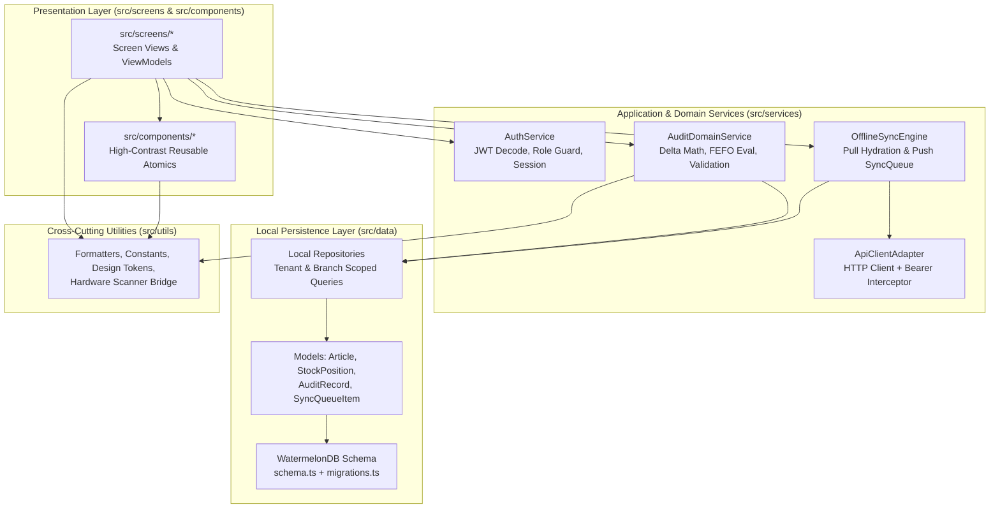
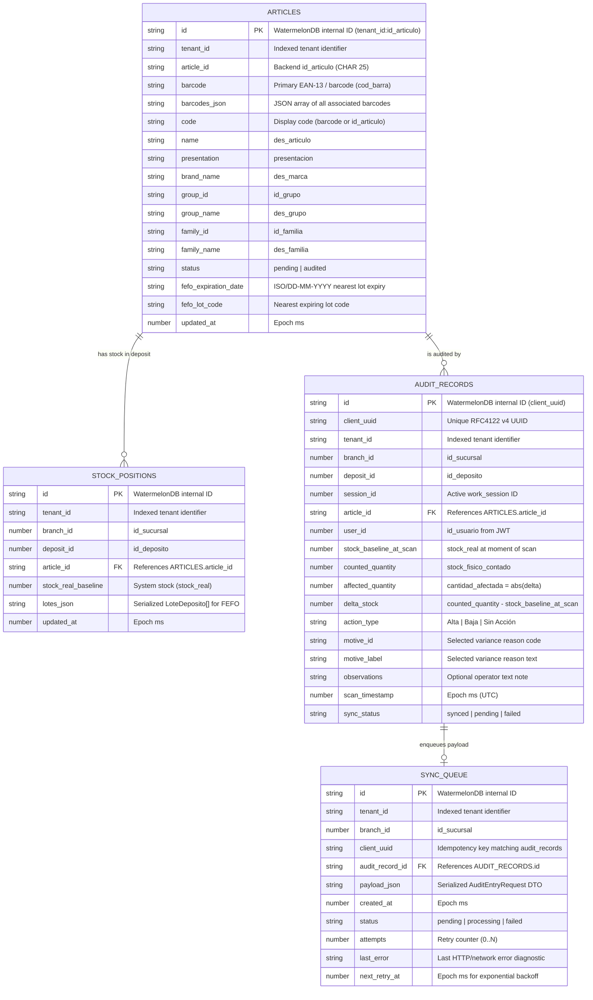
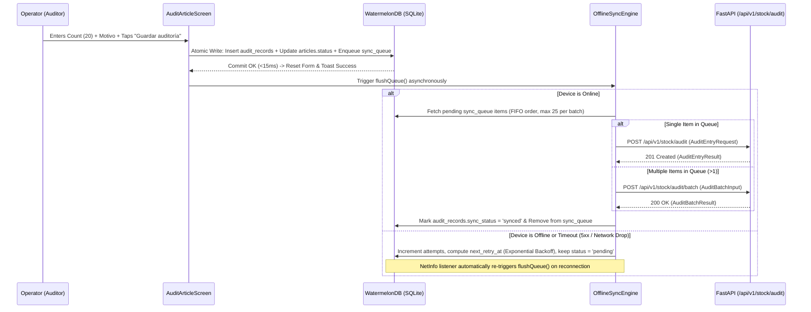

# 📱 Software Design Document (SDD) & Technical Specification (SPECS)
## Mobile Module (`frontend-mobile/`) — Audit Global ("Auditoría de Stock")

- **Document Version:** `1.0.0-SSoT`
- **Target Module:** `frontend-mobile/`
- **Canonical References:** [docs/ARCHITECTURE.md](file:///home/fede/Proyectos/SaaSStockDepositControl/docs/ARCHITECTURE.md), [README.md](file:///home/fede/Proyectos/SaaSStockDepositControl/README.md), [shared/design-tokens/index.ts](file:///home/fede/Proyectos/SaaSStockDepositControl/shared/design-tokens/index.ts)
- **Status:** Canonical Single Source of Truth (SSoT)

---

## 0. Capability Map & Explicit Assumptions

### 0.1 Explicit Architectural Assumptions
1. **Target Runtime:** Native-compiled iOS and Android client built with **Expo SDK 57 (`~57.0.2`)** and **React Native `0.86.0` (React `19.2.3`)** using Expo Prebuild / Development Builds (CNG) to support native JSI SQLite bindings for WatermelonDB.
2. **Offline-First Storage Engine:** **WatermelonDB (`@nozbe/watermelondb`)** backed by SQLite JSI on device, enabling sub-10ms local queries across thousands of articles and zero-latency audit capture inside RF-shielded warehouse aisles.
3. **Authentication & Multi-Tenancy:** JWT tokens issued by `POST /api/v1/auth/login` are signed (`HS256`) and stored exclusively in hardware-backed encrypted storage (`expo-secure-store`). Claims (`tenant_id`, `branch_id` / `id_sucursal`, `user_id` / `id_usuario`, `role`) are decoded locally to scope all SQLite queries and outbound sync payloads.
4. **Strict Field-Level RBAC (`pcio_com_siva` Prohibition):** The mobile app is exclusively operated by field roles (`auditor` and `supervisor`). Users with role `administrador` or inactive accounts (`is_active === false`) are either restricted to non-financial views or blocked per role policy, and **under no circumstance** does `pcio_com_siva` (unit purchase cost without VAT) or `monto_valorizado` exist in any mobile SQLite table, TypeScript interface, API DTO, or UI component.
5. **Dual Online/Offline Sync:** Individual audits attempt immediate dispatch via `POST /api/v1/stock/audit` when online, or queue atomically into the local `sync_queue` table and flush sequentially/batched via `POST /api/v1/stock/audit/batch` and `POST /api/v1/stock/audit` upon network restoration.

### 0.2 Capability Map

| Module ID | Responsibility | Depends On |
| :--- | :--- | :--- |
| `mobile-core-security` | JWT storage (`expo-secure-store`), claim decoding, tenant/branch context isolation, RBAC guards | — |
| `mobile-local-db` | WatermelonDB/SQLite schema, models (`articles`, `stock_positions`, `audit_records`, `sync_queue`), migrations | `mobile-core-security` |
| `mobile-sync-engine` | Pull catalog/stock hydration, push offline queue (`sync_queue`), conflict resolution, retry backoff | `mobile-core-security`, `mobile-local-db` |
| `mobile-ui-system` | High-contrast reusable atomic components, drawer overlay, top bar, custom numeric keypad, FEFO banners | `mobile-core-security` |
| `mobile-screens-flow` | Login, Dashboard Home, Article Audit (Empty/Scan/Inspect/Adjust), Catalog Listing & Sync Tray | `mobile-local-db`, `mobile-sync-engine`, `mobile-ui-system` |

**Build Order:** `mobile-core-security` → `mobile-local-db` → `mobile-sync-engine`, `mobile-ui-system` → `mobile-screens-flow`

---

## 1. Goal & Scope

### 1.1 Operational Purpose
**Audit Global ("Auditoría de Stock")** is an industrial-grade, offline-resilient mobile field auditing application designed for pharmacy and warehouse operators (`Auditor` and `Supervisor` roles) operating inside physical distribution deposits (`depositos`) and retail branches (`sucursales`).

Warehouse deposits frequently suffer from dead Wi-Fi/cellular zones due to metal racking, cold-chain insulation, and subterranean layouts. The mobile application guarantees **100% operational continuity without network connectivity** after initial session hydration:
- Instantaneous local article lookup by **EAN-13 / Code-128 barcode** (via camera or Bluetooth/USB HID laser scanner), internal article code (`id_articulo`), or tokenized description (`des_articulo`).
- Immediate visibility into **FEFO (First-Expired, First-Out)** lot expiration alerts (`vencimiento`) to flag expiring or expired stock on the shelf.
- Real-time physical count registration (`stock_fisico_contado`), deterministic discrepancy calculation ($\Delta = \text{stock\_fisico\_contado} - \text{stock\_real\_previo}$), automatic movement classification (`Alta`, `Baja`, `Sin Acción`), mandatory variance reason (`Motivo`) enforcement, and operator observations.
- Durable local persistence in **WatermelonDB / SQLite** paired with an idempotent, transactional **Offline Sync Queue (`sync_queue`)** that reconciles field audits with the FastAPI Hexagonal Backend (`db_analytics`) once connectivity is restored.

### 1.2 Scope Boundaries
- **In Scope:**
  - Role-restricted authentication (`POST /api/v1/auth/login`) and local JWT session management.
  - Multi-tenant (`tenant_id` / `id_empresa`) and branch/deposit (`branch_id` / `id_sucursal`, `id_deposito`) data segregation in local SQLite.
  - Daily audit progress tracking (`auditados`, `pendientes`, `totalArticulos`, percentage bar) computed reactively from local WatermelonDB observables.
  - Barcode scanning (camera + hardware HID wedge) and debounced local catalog search.
  - FEFO lot expiration warning banners (`PRÓXIMO` / `VENCIDO`).
  - Physical stock count registration, dynamic delta feedback, variance motive selection, and offline queue synchronization.
  - Full catalog browsing with status badges (`PENDIENTE`, `AUDITADO`), zero-stock critical highlights (`⚠ 0 uds.`), search, and status filtering.
- **Out of Scope (Strictly Excluded from Mobile):**
  - Financial valuation reports, shrinkage monetary totals (`monto_valorizado`), and unit purchase costs (`pcio_com_siva`).
  - User CRUD administration (`/users`) and enterprise/branch configuration (`/enterprises`, `/branches`).
  - Direct mutation of legacy catalog metadata (`db_articles` is strictly immutable).

---

## 2. Technology Stack

### 2.1 Core Runtime & Libraries

| Layer | Package / Technology | Version | Purpose |
| :--- | :--- | :--- | :--- |
| **Framework** | `expo` | `~57.0.2` | Managed native workflow (Expo SDK 57) with Prebuild / CNG |
| **UI Runtime** | `react` / `react-native` | `19.2.3` / `0.86.0` | Native mobile rendering with New Architecture (Fabric / TurboModules) |
| **Language** | `typescript` | `~6.0.3` | Strict static type checking (`strict: true`) |
| **Styling Engine** | `nativewind` + `tailwindcss` | `^4.2.6` / `^3.4.17` | Utility-first styling compiled to native `StyleSheet` objects |
| **Local Database** | `@nozbe/watermelondb` | `^0.27.1` | Reactive, lazy-loaded offline-first ORM over SQLite JSI |
| **SQLite Adapter** | `expo-sqlite` / `@nozbe/watermelondb/adapters/sqlite` | SDK 57 compatible | Native JSI SQLite persistence engine |
| **Secure Storage** | `expo-secure-store` | `~14.0.1` | Keychain (iOS) / Keystore (Android) encrypted storage for JWT & session keys |
| **Key-Value Cache** | `@react-native-async-storage/async-storage` | `^3.1.1` | Non-sensitive UI preferences and last-sync watermark metadata |
| **Navigation** | `@react-navigation/native` + `@react-navigation/drawer` + `@react-navigation/native-stack` | `^7.x` | Typed stack & custom slide-over drawer navigation |
| **Camera / Scanner** | `expo-camera` | `~16.0.x` | Native EAN-13, EAN-8, UPC-A, Code-128, QR barcode scanning |
| **Network Monitor** | `@react-native-community/netinfo` | `^11.4.1` | Real-time connectivity state detection for offline queue flushing |
| **UUID Generator** | `expo-crypto` | `~14.0.x` | Cryptographically random RFC 4122 v4 `client_uuid` generation |
| **Icons** | `lucide-react-native` + `react-native-svg` | `^0.475.0` / `~15.11.x` | High-contrast vector iconography matching Figma specifications |
| **Lists** | `@shopify/flash-list` | `^1.7.x` | 60fps virtualized cell recycling for the Article Catalog & Sync Tray |
| **Safe Area** | `react-native-safe-area-context` | `~5.2.x` | Dynamic Island, Notch, and Android gesture navigation bar inset handling |

### 2.2 Custom Native Bridging & Hardware Scanner Integration
1. **WatermelonDB JSI Bridge:** Configured via Expo config plugin (`@nozbe/watermelondb` / `expo-build-properties`) with Babel decorators (`@babel/plugin-proposal-decorators` in `legacy: true` mode) so model properties (`@field`, `@text`, `@date`, `@readonly`, `@relation`, `@children`) compile to native C++ SQLite queries.
2. **Hardware Laser Scanner Bridge (HID Keyboard Wedge & Intent Listener):**
   - Industrial handheld terminals (Zebra TC21/TC26, Honeywell ScanPal) emit barcodes either as rapid HID keystrokes terminated by `Enter` (`\n` / keyCode `66`) or via Android Broadcast Intents.
   - The mobile app includes a dedicated `useHardwareScanner` hook in `src/utils/scannerBridge.ts` that intercepts rapid keystroke bursts (`< 35ms` inter-character latency) without requiring the search `TextInput` to hold visual keyboard focus, immediately routing the scanned EAN string to the Article Scan & Inspection pipeline.

### 2.3 Executable Project Commands

```bash
# Install dependencies (from frontend-mobile/)
npm install

# Start Metro bundler in development mode
npm run start

# Run native Android development build
npm run android

# Run native iOS simulator build
npm run ios

# Type-check TypeScript contracts across all layers
npx tsc --noEmit

# Run unit and integration test suite with coverage
npx jest --coverage

# Lint and validate formatting
npx eslint "src/**/*.{ts,tsx}" --max-warnings=0
```

---

## 3. Structural Separation & Layering

The mobile module (`frontend-mobile/`) enforces a strict **Clean / Hexagonal Client Architecture**. UI components (`src/screens/`, `src/components/`) are **strictly prohibited** from importing `fetch`, `axios`, `expo-secure-store`, or executing raw SQL queries directly. All data access and mutations flow through Domain Services (`src/services/`) and WatermelonDB Models/Repositories (`src/data/`).



### 3.1 Directory Layout (`frontend-mobile/`)

```text
frontend-mobile/
├── App.tsx                                 # Root provider composition (DatabaseProvider, SafeAreaProvider, AuthProvider, SyncProvider, AppNavigator)
├── index.ts                                # Expo registerRootComponent entrypoint
├── app.json                                # Expo SDK 57 configuration, permissions (CAMERA), plugins
├── babel.config.js                         # Decorators plugin for WatermelonDB + NativeWind v4 preset
├── metro.config.js                         # Metro bundler config with NativeWind CSS interop
├── tailwind.config.js                      # Design tokens mapped from shared/design-tokens
├── tsconfig.json                           # Strict TypeScript configuration with path aliases (@/*)
└── src/
    ├── screens/                            # View layer: Screen containers & navigation wiring
    │   ├── LoginScreen.tsx                 # image_0: Role-restricted authentication view
    │   ├── DashboardScreen.tsx             # image_1: Daily audit progress KPI & quick access home
    │   ├── AuditArticleScreen.tsx          # image_2, image_3, image_4: Empty search, FEFO inspection, physical count & variance form
    │   └── CatalogScreen.tsx               # image_6: Virtualized article catalog, filters & sync status tray
    ├── components/                         # High-contrast reusable visual atomics
    │   ├── layout/
    │   │   ├── TopAppBar.tsx               # Dark navy header (#111827) with drawer toggle & user initials avatar
    │   │   ├── SidebarDrawer.tsx           # image_5: Custom slide-over drawer with user identity, role pill, navigation & logout
    │   │   └── ScreenContainer.tsx         # Safe-area & keyboard-avoiding wrapper
    │   ├── audit/
    │   │   ├── SearchScannerBar.tsx        # Search input + camera scanner trigger + "Buscar" CTA
    │   │   ├── BarcodeScannerModal.tsx     # Full-screen camera barcode viewfinder overlay with torch toggle
    │   │   ├── ArticleInspectionCard.tsx   # Article header, status pill, EAN/stock grid, and FEFO red alert banner
    │   │   ├──FefoAlertBanner.tsx          # High-contrast red/amber FEFO expiration alert box
    │   │   ├── CountedQuantityInput.tsx    # Numeric input with inline semantic pill ("● Baja" / "● Alta" / "● Sin Acción") & delta label
    │   │   ├── MotiveSelectSheet.tsx       # Modal bottom sheet / dropdown for variance reason ("Motivo *")
    │   │   └── EmptyAuditState.tsx         # image_2: Empty state illustration & prompt before scanning
    │   ├── catalog/
    │   │   ├── CatalogItemCard.tsx         # Article card with PENDIENTE/AUDITADO badge & critical 0-stock alert ("⚠ 0 uds.")
    │   │   ├── CatalogFilterSheet.tsx      # Status (Todos / Pendientes / Auditados / Stock Crítico) & family filter modal
    │   │   └── SyncTrayBanner.tsx          # Compact top/bottom indicator showing pending/failed sync_queue count & retry action
    │   └── ui/
    │       ├── StatusBadge.tsx             # Semantic pill badges (PENDIENTE, AUDITADO, AUDITOR, SUPERVISOR, PRÓXIMO)
    │       ├── PrimaryButton.tsx           # High-contrast 48px height touch target button with loading/disabled states
    │       └── ProgressBar.tsx             # Smooth animated horizontal percentage progress bar
    ├── data/                               # Local schemas, WatermelonDB models, and tenant-scoped repositories
    │   ├── database.ts                     # WatermelonDB Database singleton initialization & SQLiteAdapter setup
    │   ├── schema.ts                       # Canonical WatermelonDB appSchema (version 1)
    │   ├── migrations.ts                   # Schema migrations definition
    │   ├── models/
    │   │   ├── ArticleModel.ts             # `articles` table model (strictly excludes pcio_com_siva)
    │   │   ├── StockPositionModel.ts       # `stock_positions` table model
    │   │   ├── AuditRecordModel.ts         # `audit_records` table model
    │   │   └── SyncQueueModel.ts           # `sync_queue` table model
    │   └── repositories/
    │       ├── LocalArticleRepository.ts   # Barcode, code, tokenized name search & catalog filtering
    │       ├── LocalAuditRepository.ts     # Atomic audit record creation + local baseline update + KPI aggregation
    │       └── LocalSyncQueueRepository.ts # FIFO queue enqueue, status transitions, batch retrieval & pruning
    ├── services/                           # Pure domain logic, offline queue worker, and HTTP API adapters
    │   ├── api/
    │   │   ├── ApiClient.ts                # Fetch wrapper with JWT injection, timeout, and structured error mapping
    │   │   ├── AuthApiService.ts           # POST /api/v1/auth/login contract
    │   │   ├── CatalogApiService.ts        # GET /api/v1/articles, GET /api/v1/articles/search, GET /api/v1/stock/position
    │   │   └── AuditApiService.ts          # POST /api/v1/stock/audit & POST /api/v1/stock/audit/batch
    │   ├── auth/
    │   │   ├── AuthService.ts              # SecureStore JWT persistence, claim extraction, role verification
    │   │   └── AuthContext.tsx             # React context exposing authenticated session & tenant/branch claims
    │   ├── domain/
    │   │   ├── DeltaCalculator.ts          # Pure deterministic delta & TipoAccion calculator
    │   │   ├── FefoEvaluator.ts            # Expiration date parser & risk level classifier (CRITICAL / WARNING / SAFE)
    │   │   └── AuditValidator.ts           # Form validation rules (Motivo requirement on delta != 0, bounds checking)
    │   └── sync/
    │       ├── OfflineSyncEngine.ts        # Background/foreground queue processor, exponential backoff, conflict resolver
    │       └── CatalogHydrator.ts          # Initial & incremental catalog + stock position pull into WatermelonDB
    └── utils/                              # Formatting, constants, and hardware bridges
        ├── constants.ts                    # Motives catalog, API timeouts, retry thresholds, storage keys
        ├── designTokens.ts                 # Re-exported & mobile-adapted color/spacing tokens from shared/design-tokens
        ├── formatters.ts                   # Spanish locale date formatting ("Lunes, 12 De Octubre", "DD/MM/YYYY"), initials
        ├── jwtDecoder.ts                   # Pure base64url JWT payload decoder (zero native crypto dependency)
        └── scannerBridge.ts                # Hardware HID barcode scanner keystroke buffer hook
```

---

## 4. Security & Multi-Tenant Boundaries

### 4.1 Local JWT Storage & Claim Extraction
1. **Hardware-Backed Storage (`expo-secure-store`):**
   - Upon successful authentication against `POST /api/v1/auth/login`, the returned `access_token` is stored under key `audit_global.jwt_token` using `SecureStore.setItemAsync('audit_global.jwt_token', token, { keychainAccessible: SecureStore.WHEN_UNLOCKED_THIS_DEVICE_ONLY })`.
   - Plaintext storage of the JWT in `AsyncStorage` or SQLite is **strictly forbidden**.
2. **Signed Token Verification & Claim Decoding:**
   - Per [docs/ARCHITECTURE.md](file:///home/fede/Proyectos/SaaSStockDepositControl/docs/ARCHITECTURE.md#L66), backend JWTs are signed (`HS256`) via `PyJWTTokenProvider`, not encrypted.
   - The mobile client decodes the JWT payload via `src/utils/jwtDecoder.ts` and validates the presence and types of the canonical claims emitted by [`AuthService.authenticate`](file:///home/fede/Proyectos/SaaSStockDepositControl/backend/app/users/services.py#L36-L43):

```typescript
// src/utils/jwtDecoder.ts
export type MobileAllowedRole = 'auditor' | 'supervisor';

export interface DecodedJwtClaims {
  sub: string;           // User email (e.g., "luis.operario@globalmedica.com")
  role: string;          // "auditor" | "supervisor" | "administrador"
  tenant_id: number;     // Enterprise ID (id_empresa)
  branch_id: number;     // Branch ID (id_sucursal)
  user_id: number;       // Numeric user ID
  id_usuario: number;    // Numeric user ID alias
  exp: number;           // Unix expiration timestamp (seconds)
}

export interface ActiveTenantSession {
  token: string;
  email: string;
  displayName: string;
  initials: string;
  role: MobileAllowedRole;
  tenantId: string;      // Normalized string representation of tenant_id
  branchId: number;      // Resolved id_sucursal (defaults to 1 if null in claim)
  depositId: number;     // Active id_deposito (defaults to 1, selectable per branch)
  userId: number;
  expiresAtMs: number;
}
```

### 4.2 Multi-Tenant & Branch Segregation in Local SQLite
- Every table in the local WatermelonDB database (`articles`, `stock_positions`, `audit_records`, `sync_queue`) embeds `tenant_id` (`string`) and, where applicable, `branch_id` (`number`, mapping to `id_sucursal`) and `deposit_id` (`number`, mapping to `id_deposito`).
- **Tenant Switch Wipe Guard:** On login, `AuthService` compares the incoming JWT's `tenant_id` and `branch_id` against the last stored `audit_global.last_tenant_branch` key. If a different tenant or branch logs in on the same shared warehouse device:
  1. If `sync_queue` has `pending` items for the previous tenant, the login flow blocks wipe and prompts to flush the pending queue first (if online) or requires explicit supervisor confirmation.
  2. Once safe, `database.write(async () => await database.unsafeResetDatabase())` is executed before hydrating the new tenant's catalog, guaranteeing **zero cross-tenant data leakage** on shared handheld terminals.
- **Query-Level Enforcement:** Every repository method in `LocalArticleRepository`, `LocalAuditRepository`, and `LocalSyncQueueRepository` requires `session: ActiveTenantSession` as its first parameter and appends `Q.where('tenant_id', session.tenantId)` and `Q.where('branch_id', session.branchId)` to every WatermelonDB query.

### 4.3 Strict Role Adaptation (`Auditor` vs `Supervisor`) & Blocked Profiles
1. **Login Gate & Blocked Profile Handling:**
   - Only `auditor` and `supervisor` roles are permitted to enter the mobile field workflow.
   - If a user authenticates with an unauthorized role or a disabled profile (`HTTP 401` / `HTTP 403`), or if the decoded `exp` is in the past, the session is immediately rejected and cleared from `SecureStore`, displaying the high-contrast error banner on `LoginScreen` while preserving the static footer notice:
     > *"El acceso es restringido por rol. Contactá a tu administrador si no podés ingresar."*
2. **Dynamic Role Adaptation (`Auditor` vs `Supervisor`):**

| Capability / UI Element | `auditor` Role | `supervisor` Role |
| :--- | :--- | :--- |
| **Role Badge in Sidebar (`image_5`)** | Light slate pill `"AUDITOR"` (`#E2E8F0` bg, `#1E293B` text) | Indigo pill `"SUPERVISOR"` (`#E0E7FF` bg, `#3730A3` text) |
| **Blind/Semi-Blind Audit Mode** | Can register counts and view system stock baseline (`STOCK EN SISTEMA`) when enabled by branch policy | Full visibility of `STOCK EN SISTEMA`, discrepancy history, and auditor attribution |
| **Re-Auditing Already Audited Items** | Can append a new count record; previous record remains immutable in history | Can inspect and override/re-audit items flagged with high variance |
| **Sync Queue Manual Retry / Force Flush** | Automatic background sync + manual `"Reintentar sincronización"` | Can inspect individual failed sync payloads and trigger force-retry |
| **Admin Routes (`/reports`, `/users`)** | **Structurally omitted** from navigation stack & drawer | **Structurally omitted** from navigation stack & drawer |
| **Financial Cost (`pcio_com_siva`)** | **Strictly hidden & absent from memory/DB** | **Strictly hidden & absent from memory/DB** |

---

## 5. WatermelonDB / SQLite Schema & Conflict Resolution

### 5.1 Entity-Relationship Diagram (Local SQLite)



### 5.2 Canonical WatermelonDB Schema (`src/data/schema.ts`)

```typescript
// src/data/schema.ts
import { appSchema, tableSchema } from '@nozbe/watermelondb';

export const mobileDatabaseSchema = appSchema({
  version: 1,
  tables: [
    tableSchema({
      name: 'articles',
      columns: [
        { name: 'tenant_id', type: 'string', isIndexed: true },
        { name: 'article_id', type: 'string', isIndexed: true }, // Backend id_articulo
        { name: 'barcode', type: 'string', isIndexed: true },    // Primary EAN/barcode
        { name: 'barcodes_json', type: 'string' },               // JSON string[] of all barcodes
        { name: 'code', type: 'string', isIndexed: true },       // Display code (EAN or id_articulo)
        { name: 'name', type: 'string', isIndexed: true },       // des_articulo
        { name: 'presentation', type: 'string', isOptional: true },
        { name: 'brand_name', type: 'string', isOptional: true },
        { name: 'group_id', type: 'string', isOptional: true },
        { name: 'group_name', type: 'string', isOptional: true },
        { name: 'family_id', type: 'string', isOptional: true },
        { name: 'family_name', type: 'string', isOptional: true },
        { name: 'status', type: 'string', isIndexed: true },     // 'pending' | 'audited'
        { name: 'fefo_expiration_date', type: 'string', isOptional: true }, // "DD/MM/YYYY" or ISO "YYYY-MM-DD"
        { name: 'fefo_lot_code', type: 'string', isOptional: true },
        { name: 'updated_at', type: 'number' },
      ],
    }),
    tableSchema({
      name: 'stock_positions',
      columns: [
        { name: 'tenant_id', type: 'string', isIndexed: true },
        { name: 'branch_id', type: 'number', isIndexed: true },  // id_sucursal
        { name: 'deposit_id', type: 'number', isIndexed: true }, // id_deposito
        { name: 'article_id', type: 'string', isIndexed: true }, // FK -> articles.article_id
        { name: 'stock_real_baseline', type: 'number' },         // Effective stock_real
        { name: 'lotes_json', type: 'string' },                  // JSON LoteDeposito[]
        { name: 'updated_at', type: 'number' },
      ],
    }),
    tableSchema({
      name: 'audit_records',
      columns: [
        { name: 'client_uuid', type: 'string', isIndexed: true },
        { name: 'tenant_id', type: 'string', isIndexed: true },
        { name: 'branch_id', type: 'number', isIndexed: true },
        { name: 'deposit_id', type: 'number', isIndexed: true },
        { name: 'session_id', type: 'number', isIndexed: true },
        { name: 'article_id', type: 'string', isIndexed: true },
        { name: 'user_id', type: 'number' },
        { name: 'stock_baseline_at_scan', type: 'number' },
        { name: 'counted_quantity', type: 'number' },
        { name: 'affected_quantity', type: 'number' },
        { name: 'delta_stock', type: 'number' },
        { name: 'action_type', type: 'string', isIndexed: true }, // 'Alta' | 'Baja' | 'Sin Acción'
        { name: 'motive_id', type: 'string', isOptional: true },
        { name: 'motive_label', type: 'string', isOptional: true },
        { name: 'observations', type: 'string', isOptional: true },
        { name: 'scan_timestamp', type: 'number', isIndexed: true },
        { name: 'sync_status', type: 'string', isIndexed: true }, // 'synced' | 'pending' | 'failed'
      ],
    }),
    tableSchema({
      name: 'sync_queue',
      columns: [
        { name: 'tenant_id', type: 'string', isIndexed: true },
        { name: 'branch_id', type: 'number', isIndexed: true },
        { name: 'client_uuid', type: 'string', isIndexed: true },
        { name: 'audit_record_id', type: 'string', isIndexed: true },
        { name: 'payload_json', type: 'string' },
        { name: 'created_at', type: 'number', isIndexed: true },
        { name: 'status', type: 'string', isIndexed: true },      // 'pending' | 'processing' | 'failed'
        { name: 'attempts', type: 'number' },
        { name: 'last_error', type: 'string', isOptional: true },
        { name: 'next_retry_at', type: 'number', isIndexed: true },
      ],
    }),
  ],
});
```

### 5.3 WatermelonDB Model Definitions (`src/data/models/`)

```typescript
// src/data/models/ArticleModel.ts
import { Model, Query } from '@nozbe/watermelondb';
import { field, text, children } from '@nozbe/watermelondb/decorators';
import type { Associations } from '@nozbe/watermelondb/Model';
import type StockPositionModel from './StockPositionModel';
import type AuditRecordModel from './AuditRecordModel';

export type ArticleAuditStatus = 'pending' | 'audited';

export default class ArticleModel extends Model {
  static table = 'articles';

  static associations: Associations = {
    stock_positions: { type: 'has_many', foreignKey: 'article_id' },
    audit_records: { type: 'has_many', foreignKey: 'article_id' },
  };

  @text('tenant_id') tenantId!: string;
  @text('article_id') articleId!: string;
  @text('barcode') barcode!: string;
  @text('barcodes_json') barcodesJson!: string;
  @text('code') code!: string;
  @text('name') name!: string;
  @text('presentation') presentation!: string | null;
  @text('brand_name') brandName!: string | null;
  @text('group_id') groupId!: string | null;
  @text('group_name') groupName!: string | null;
  @text('family_id') familyId!: string | null;
  @text('family_name') familyName!: string | null;
  @text('status') status!: ArticleAuditStatus;
  @text('fefo_expiration_date') fefoExpirationDate!: string | null;
  @text('fefo_lot_code') fefoLotCode!: string | null;
  @field('updated_at') updatedAt!: number;

  @children('stock_positions') stockPositions!: Query<StockPositionModel>;
  @children('audit_records') auditRecords!: Query<AuditRecordModel>;

  get parsedBarcodes(): string[] {
    try {
      return JSON.parse(this.barcodesJson) as string[];
    } catch {
      return this.barcode ? [this.barcode] : [];
    }
  }
}
```

```typescript
// src/data/models/StockPositionModel.ts
import { Model, Relation } from '@nozbe/watermelondb';
import { field, text, relation } from '@nozbe/watermelondb/decorators';
import type { Associations } from '@nozbe/watermelondb/Model';
import type ArticleModel from './ArticleModel';

export interface LocalLotItem {
  lote: string;
  vencimiento: string | null;
  stock_real: number;
}

export default class StockPositionModel extends Model {
  static table = 'stock_positions';

  static associations: Associations = {
    articles: { type: 'belongs_to', key: 'article_id' },
  };

  @text('tenant_id') tenantId!: string;
  @field('branch_id') branchId!: number;
  @field('deposit_id') depositId!: number;
  @text('article_id') articleId!: string;
  @field('stock_real_baseline') stockRealBaseline!: number;
  @text('lotes_json') lotesJson!: string;
  @field('updated_at') updatedAt!: number;

  @relation('articles', 'article_id') article!: Relation<ArticleModel>;

  get parsedLots(): LocalLotItem[] {
    try {
      return JSON.parse(this.lotesJson) as LocalLotItem[];
    } catch {
      return [];
    }
  }
}
```

```typescript
// src/data/models/AuditRecordModel.ts
import { Model, Relation } from '@nozbe/watermelondb';
import { field, text, relation } from '@nozbe/watermelondb/decorators';
import type { Associations } from '@nozbe/watermelondb/Model';
import type ArticleModel from './ArticleModel';

export type MobileActionType = 'Alta' | 'Baja' | 'Sin Acción';
export type RecordSyncStatus = 'synced' | 'pending' | 'failed';

export default class AuditRecordModel extends Model {
  static table = 'audit_records';

  static associations: Associations = {
    articles: { type: 'belongs_to', key: 'article_id' },
  };

  @text('client_uuid') clientUuid!: string;
  @text('tenant_id') tenantId!: string;
  @field('branch_id') branchId!: number;
  @field('deposit_id') depositId!: number;
  @field('session_id') sessionId!: number;
  @text('article_id') articleId!: string;
  @field('user_id') userId!: number;
  @field('stock_baseline_at_scan') stockBaselineAtScan!: number;
  @field('counted_quantity') countedQuantity!: number;
  @field('affected_quantity') affectedQuantity!: number;
  @field('delta_stock') deltaStock!: number;
  @text('action_type') actionType!: MobileActionType;
  @text('motive_id') motiveId!: string | null;
  @text('motive_label') motiveLabel!: string | null;
  @text('observations') observations!: string | null;
  @field('scan_timestamp') scanTimestamp!: number;
  @text('sync_status') syncStatus!: RecordSyncStatus;

  @relation('articles', 'article_id') article!: Relation<ArticleModel>;
}
```

```typescript
// src/data/models/SyncQueueModel.ts
import { Model, Relation } from '@nozbe/watermelondb';
import { field, text, relation } from '@nozbe/watermelondb/decorators';
import type { Associations } from '@nozbe/watermelondb/Model';
import type AuditRecordModel from './AuditRecordModel';

export type SyncQueueStatus = 'pending' | 'processing' | 'failed';

export default class SyncQueueModel extends Model {
  static table = 'sync_queue';

  static associations: Associations = {
    audit_records: { type: 'belongs_to', key: 'audit_record_id' },
  };

  @text('tenant_id') tenantId!: string;
  @field('branch_id') branchId!: number;
  @text('client_uuid') clientUuid!: string;
  @text('audit_record_id') auditRecordId!: string;
  @text('payload_json') payloadJson!: string;
  @field('created_at') createdAt!: number;
  @text('status') status!: SyncQueueStatus;
  @field('attempts') attempts!: number;
  @text('last_error') lastError!: string | null;
  @field('next_retry_at') nextRetryAt!: number;

  @relation('audit_records', 'audit_record_id') auditRecord!: Relation<AuditRecordModel>;
}
```

### 5.4 Conflict Resolution Rules (Offline Reconnection & Multi-Device Audits)

When multiple auditors scan articles offline across the same `branch_id` and `deposit_id` and subsequently reconnect, the system resolves conflicts deterministically:

1. **Idempotency via `client_uuid` (Duplicate Dispatch Protection):**
   - Every offline audit generates a deterministic RFC 4122 v4 `client_uuid` on device at the exact moment the operator taps `"Guardar auditoría"`.
   - On the backend (`db_analytics.audit_records`), `client_uuid` has a unique constraint (`idx_audit_tenant_client_uuid`) and `AuditRepository.exists_by_client_uuid` checks for duplicates. If a mobile client retries a batch that already succeeded before a network drop, duplicate records are safely skipped (`duplicates_skipped` in `AuditBatchResult`) and marked `synced` locally.
2. **Overlapping Physical Audit Timestamps (Append-Only Ledger + Latest-Scan-Wins Effective Stock):**
   - The backend `db_analytics.audit_records` table is an **append-only immutable audit ledger** (it never overwrites historical rows in `db_articles`).
   - Effective stock resolution in [`StockLookupService.get_effective_stock`](file:///home/fede/Proyectos/SaaSStockDepositControl/backend/app/movements/services.py#L33-L44) and [`SQLAlchemyAuditRepository.get_latest_audit_record`](file:///home/fede/Proyectos/SaaSStockDepositControl/backend/adapters/repositories/audit_repository.py#L93-L109) orders by `scan_timestamp DESC LIMIT 1`.
   - **Rule:** Both overlapping audits are persisted in the analytical ledger for full traceability. The record with the most recent `scan_timestamp` establishes the current effective `stock_real` for the active `work_session`.
   - **Local Reconciliation on Post-Sync Pull:** After flushing `sync_queue`, the mobile app reconciles local `stock_positions.stock_real_baseline` with the `audit_quantity` returned in `AuditEntryResult` (or re-pulls updated positions), ensuring the device reflects the authoritative server state.
3. **Non-Matching Identifier Keys (`EntityNotFoundException` / `HTTP 404`):**
   - If an offline audit references an `id_articulo` or barcode that cannot be resolved against `db_articles` during online sync (`HTTP 404 Not Found`):
     1. The item in `sync_queue` is **not** infinitely retried (which would block the queue head).
     2. Its `sync_queue.status` transitions immediately to `'failed'` with `last_error = "ERR_NON_MATCHING_ARTICLE_ID: Artículo no existe en el catálogo maestro"`.
     3. The corresponding `audit_records.sync_status` is set to `'failed'`, surfacing a warning badge in the Sync Tray so a Supervisor can inspect or discard the orphaned entry without blocking subsequent valid queue items.
4. **Closed Work Session Conflict (`NoActiveWorkSessionError` / `HTTP 400/422`):**
   - If the branch's `work_session` was closed while the device was offline, the backend `GET /api/v1/articles` or session initializer opens/resolves the active session before re-dispatching the queued batch.

---

## 6. UI/UX Screen-by-Screen Specifications (Figma Breakdown `image_0.png` – `image_6.png`)

### 6.1 Global Visual & Ergonomic Standards
- **High-Contrast Warehouse Readability:** Main content surfaces use crisp white cards (`#FFFFFF`) over a light cool-slate canvas (`#F8FAFC`) with `1px` structural borders (`#E2E8F0`) and deep slate typography (`#0F172A`) to maximize legibility under harsh warehouse fluorescent lighting or dim aisles.
- **Navigation Chrome (`TopAppBar` & `SidebarDrawer`):** Uses deep charcoal/navy (`#111827` / `#1A1D2E`) to frame the viewport and clearly separate global navigation from field forms.
- **Touch Target Minimums:** All interactive buttons, drawer rows, scanner triggers, and catalog cards enforce a minimum touch area of **`48x48dp`** (`min-h-[48px]`) for one-handed operation with warehouse gloves.

---

### 6.2 Screen 1: Login & Role Activation (`image_0.png` / `src/screens/LoginScreen.tsx`)

#### Visual Breakdown (`image_0.png`)
- **Safe Area & Viewport:** Full-screen `SafeAreaView` (`bg-[#F8FAFC]`), vertically centered content with `KeyboardAvoidingView` (`behavior="padding"` on iOS, `"height"` on Android) to prevent keyboard occlusion on compact rugged devices.
- **Brand Identity Header (Above Card):**
  - Centered circular icon badge (`w-14 h-14 rounded-full bg-[#EFF6FF] border border-[#BFDBFE] items-center justify-center mb-4`) containing a `ClipboardCheck` icon (`24px`, `#1A56DB`).
  - Title: `"Audit Global"` (`text-2xl font-extrabold text-[#0F172A] tracking-tight text-center`).
  - Subtitle: `"Sistema de control e inventario"` (`text-xs font-medium text-[#64748B] mt-1 text-center`).
- **Authentication Card (`bg-white rounded-2xl border border-[#E2E8F0] shadow-sm overflow-hidden mx-5`):**
  - **Top Accent Bar:** Full-width horizontal bar at top edge of card (`h-1.5 w-full bg-[#1A56DB]`).
  - **Email Input Group:**
    - Label: `"Correo electrónico"` (`text-xs font-semibold text-[#0F172A] mb-1.5`).
    - Input (`TextInput`): `h-12 px-4 rounded-xl bg-white border border-[#CBD5E1] text-sm text-[#0F172A]`, placeholder `"tu@globalmedica.com"` (`placeholderTextColor="#94A3B8"`), `keyboardType="email-address"`, `autoCapitalize="none"`, `autoCorrect={false}`.
    - Focus/Error States: Focused border `#1A56DB` (`border-2`); error border `#DC2626` (`bg-[#FEF2F2]`).
  - **Password Input Group:**
    - Label: `"Contraseña"` (`text-xs font-semibold text-[#0F172A] mb-1.5`).
    - Input wrapper: `h-12 px-4 rounded-xl bg-white border border-[#CBD5E1] flex-row items-center`.
    - `TextInput`: `flex-1 text-sm text-[#0F172A]`, placeholder `"••••••••"`, `secureTextEntry={!showPassword}`.
    - Visibility Toggle Button: Right-aligned `Pressable` (`w-10 h-10 items-center justify-center`, `hitSlop={8}`) rendering `Eye` / `EyeOff` icon (`18px`, `#64748B`).
  - **Primary Action Button (`Ingresar`):**
    - Full-width `Pressable` (`w-full h-12 bg-[#1A56DB] active:bg-[#1E40AF] rounded-xl items-center justify-center mt-2`).
    - Label: `"Ingresar"` (`text-sm font-bold text-white`). Displays `ActivityIndicator` (`color="#FFFFFF"`) while authenticating.
  - **Restricted Access Footer (Inside Card Bottom):**
    - Container: `bg-[#F8FAFC] border-t border-[#F1F5F9] px-5 py-4`.
    - Text: `"El acceso es restringido por rol. Contactá a tu administrador si no podés ingresar."` (`text-[11px] leading-4 text-[#64748B] text-center`).

#### Functional & Validation Rules
1. **Input Validation:** Both `email` (valid format, non-empty) and `password` (`minLength >= 4`) must be non-empty before enabling `"Ingresar"`.
2. **Authentication & Role Evaluation:**
   - Calls `POST /api/v1/auth/login` with `{ email: email.trim().toLowerCase(), password }`.
   - Decodes the returned `access_token` JWT.
   - Evaluates `claims.role`:
     - If `claims.role` is `'auditor'` or `'supervisor'`, persists JWT in `expo-secure-store`, triggers initial catalog hydration (`CatalogHydrator.hydrateIfNeeded(session)`), and navigates to `DashboardScreen`.
     - If `claims.role` is not permitted for mobile field operations or the backend returns `401/403`, clears any token and displays an inline error alert banner: `"Acceso denegado: tu perfil no tiene permisos operativos móviles o se encuentra bloqueado."`
3. **Offline Session Resume:** If the device boots without internet connectivity, `AuthService.restoreSession()` checks `expo-secure-store` for an existing non-expired JWT (`claims.exp * 1000 > Date.now()`). If valid, it bypasses `LoginScreen` and opens `DashboardScreen` directly against the local WatermelonDB store.

---

### 6.3 Screen 2: Dashboard & Navigation Home (`image_1.png` / `src/screens/DashboardScreen.tsx`)

#### Visual Breakdown (`image_1.png`)
- **TopAppBar (`src/components/layout/TopAppBar.tsx`):**
  - Dark Navy background (`bg-[#111827]`), height `56px` below status bar / Dynamic Island inset.
  - Left: Hamburger button (`Menu` icon, `22px`, `#F8FAFC`) opening `SidebarDrawer`.
  - Right: User Initials Circle (`w-9 h-9 rounded-full bg-[#1A56DB] items-center justify-center`), displaying uppercase 2-letter initials `"LO"` (`text-xs font-bold text-white`).
- **Greeting Header:**
  - Title: `"¡Hola, Luis! 👋"` (`text-2xl font-extrabold text-[#0F172A]`). Dynamically extracts the user's first name from session metadata.
  - Date Subtitle: `"Lunes, 12 De Octubre"` (`text-sm font-medium text-[#64748B] mt-0.5`), formatted via `formatSpanishFullDate(new Date())`.
- **Progress Section (`PROGRESO DE AUDITORÍA`):**
  - Section Label: `"PROGRESO DE AUDITORÍA"` (`text-[11px] font-bold uppercase tracking-wider text-[#64748B] mt-6 mb-2.5`).
  - Card (`bg-white rounded-2xl border border-[#E2E8F0] p-5 shadow-xs`):
    - Top Row (`flex-row items-baseline justify-between`):
      - Left Counter: `<Text className="text-3xl font-extrabold text-[#0F172A]">{auditedCount}</Text>` followed by `<Text className="text-base font-medium text-[#64748B]"> / {totalCount}</Text>`.
      - Right Percentage: `<Text className="text-xl font-extrabold text-[#D97706]">{percentage}%</Text>` (uses amber `#D97706` when `< 100%`, emerald `#059669` when `100%`).
    - Subtitle: `"artículos auditados hoy"` (`text-xs text-[#64748B] mt-0.5 mb-3.5`).
    - Progress Bar: Track (`w-full h-2 bg-[#E2E8F0] rounded-full overflow-hidden`) with inner fill (`h-full bg-[#1A56DB] rounded-full`, `width: `${percentage}%``).
    - Pending Counter Footer: `"{pendingCount} artículos pendientes"` (`text-xs font-medium text-[#64748B] mt-3`).
- **Quick Access Section (`ACCESO RÁPIDO`):**
  - Section Label: `"ACCESO RÁPIDO"` (`text-[11px] font-bold uppercase tracking-wider text-[#64748B] mt-6 mb-2.5`).
  - **Card 1 (`Auditar artículo`):**
    - `Pressable` (`bg-white rounded-2xl border border-[#E2E8F0] p-4 flex-row items-center justify-between mb-3 active:bg-[#F1F5F9]`).
    - Left Icon Box: Clipboard illustration/icon (`w-11 h-11 rounded-xl bg-[#FFFBEB] items-center justify-center mr-3.5`).
    - Middle Text (`flex-1 pr-2`):
      - Title: `"Auditar artículo"` (`text-base font-bold text-[#0F172A]`).
      - Subtitle: `"Buscá un artículo por código o nombre y registrá su auditoría."` (`text-xs text-[#64748B] mt-0.5 leading-4`).
    - Right Chevron: `ArrowRight` (`18px`, `#CBD5E1`).
  - **Card 2 (`Ver catálogo`):**
    - `Pressable` (`bg-white rounded-2xl border border-[#E2E8F0] p-4 flex-row items-center justify-between active:bg-[#F1F5F9]`).
    - Left Icon Box: Package/Box illustration/icon (`w-11 h-11 rounded-xl bg-[#FEF3C7] items-center justify-center mr-3.5`).
    - Middle Text (`flex-1 pr-2`):
      - Title: `"Ver catálogo"` (`text-base font-bold text-[#0F172A]`).
      - Subtitle: `"Consultá el catálogo completo con stock y estado de cada ítem."` (`text-xs text-[#64748B] mt-0.5 leading-4`).
    - Right Chevron: `ArrowRight` (`18px`, `#CBD5E1`).

#### Functional & Reactive State Rules
- **Reactive WatermelonDB Observables:**
  - `totalCount` is observed via `articlesCollection.query(Q.where('tenant_id', session.tenantId)).observeCount()`.
  - `auditedCount` is observed via `articlesCollection.query(Q.where('tenant_id', session.tenantId), Q.where('status', 'audited')).observeCount()`.
  - `pendingCount = Math.max(0, totalCount - auditedCount)`.
  - `percentage = totalCount > 0 ? Math.round((auditedCount / totalCount) * 100) : 0`.
  - Any audit saved in `AuditArticleScreen` immediately updates the SQLite `articles.status` to `'audited'`, causing `DashboardScreen` counters and progress bar to update in `< 16ms` without network calls.

---

### 6.4 Screen 3: Empty State Search (`image_2.png` / `src/screens/AuditArticleScreen.tsx` — Initial State)

#### Visual Breakdown
- **Header:** `TopAppBar` + Screen Title `"Auditoría de artículo"` (`text-xl font-bold text-[#0F172A] px-4 pt-4 pb-3`).
- **Search & Scanner Toolbar (`src/components/audit/SearchScannerBar.tsx`):**
  - Horizontal row (`flex-row items-center gap-2 px-4`):
    1. **Search Input Box (`flex-1 h-11 bg-white rounded-xl border border-[#CBD5E1] px-3 flex-row items-center`):**
       - Left `Search` icon (`16px`, `#94A3B8`).
       - `TextInput`: placeholder `"Código o nombre..."` (`text-sm text-[#0F172A] flex-1 ml-2`), `returnKeyType="search"`.
    2. **Quick-Action Camera / Hardware Scanner Button (`w-11 h-11 bg-white rounded-xl border border-[#CBD5E1] items-center justify-center active:bg-[#F1F5F9]`):**
       - `Camera` icon (`20px`, `#475569`). Tapping opens `BarcodeScannerModal` (native camera viewfinder) or triggers hardware laser wedge listener.
    3. **Primary `"Buscar"` Button (`h-11 px-4 bg-[#1A56DB] active:bg-[#1E40AF] rounded-xl items-center justify-center`):**
       - Text: `"Buscar"` (`text-sm font-semibold text-white`).
- **Empty-State Validation Prompt (`src/components/audit/EmptyAuditState.tsx`):**
  - Rendered when `selectedArticle === null` and no search error is active:
  - Centered container (`flex-1 items-center justify-center px-8 py-16`):
    - Muted circular badge (`w-16 h-16 rounded-full bg-[#F1F5F9] items-center justify-center mb-4`) with `Search` or `ScanBarcode` icon (`28px`, `#94A3B8`).
    - Primary Prompt: `"Buscá o escaneá un artículo para auditar"` (`text-sm font-semibold text-[#475569] text-center`).
    - Helper Text: `"Ingresá el código de barras (EAN), código interno o nombre del producto, o usá el botón de cámara."` (`text-xs text-[#94A3B8] text-center mt-1 leading-4`).
  - **Not-Found Validation State:** If a search or barcode scan returns zero matches in local SQLite, renders a high-contrast error card (`bg-[#FEF2F2] border border-[#FECACA] rounded-xl p-4 mx-4 mt-4 flex-row items-center gap-3`):
    - `AlertCircle` icon (`20px`, `#DC2626`) + `"No se encontró ningún artículo para el código o nombre ingresado."` (`text-xs font-medium text-[#B91C1C]`).

---

### 6.5 Screen 4: Article Scan & Inspection (`image_3.png` / `src/components/audit/ArticleInspectionCard.tsx`)

#### Visual Breakdown (`image_3.png` — Upper Card of `Auditoría de artículo`)
- **Card Container:** `bg-white rounded-2xl border border-[#E2E8F0] p-4 mx-4 mt-3 shadow-xs`.
- **Top Identity Row (`flex-row items-start justify-between`):**
  - Left Column (`flex-1 pr-3`):
    - Article Name: `"Ibuprofeno 400mg x 10"` (`text-base font-bold text-[#0F172A]`).
    - Manufacturer & Family Subtitle: `"Bayer · Medicamentos"` (`text-xs font-medium text-[#64748B] mt-0.5`, formatted as `${brandName || 'Sin marca'} · ${familyName || 'General'}`).
  - Right Status Badge:
    - If `status === 'pending'`: Pill `"PENDIENTE"` (`bg-[#FEF3C7] text-[#B45309] text-[10px] font-bold uppercase tracking-wider px-2.5 py-1 rounded-full`).
    - If `status === 'audited'`: Pill `"AUDITADO"` (`bg-[#D1FAE5] text-[#047857] text-[10px] font-bold uppercase tracking-wider px-2.5 py-1 rounded-full`).
- **Horizontal Divider:** `h-[1px] bg-[#F1F5F9] my-3`.
- **Specifications & System Stock Row (`flex-row items-end justify-between`):**
  - Left Column (`CÓDIGO`):
    - Label: `"CÓDIGO"` (`text-[10px] font-bold uppercase tracking-wider text-[#64748B]`).
    - Value: `"7798010343227"` (`text-xs font-bold font-mono text-[#0F172A] mt-1`). Displays primary EAN-13 barcode or `article_id`.
  - Right Column (`STOCK EN SISTEMA`):
    - Label: `"STOCK EN SISTEMA"` (`text-[10px] font-bold uppercase tracking-wider text-[#64748B]`).
    - Value: `<Text className="text-xl font-extrabold text-[#0F172A]">85</Text> <Text className="text-xs font-medium text-[#64748B]">uds.</Text>`.
- **FEFO Expiry Banner Alert (`src/components/audit/FefoAlertBanner.tsx`):**
  - Rendered whenever the article has a lot with an upcoming or past expiration date (`fefoExpirationDate`):
  - **Critical / Próximo Tier (`daysToExpiry <= 90` or expired, as shown in `image_3.png`):**
    - Container: `mt-3.5 bg-[#FEF2F2] border border-[#DC2626] rounded-xl px-3.5 py-2.5 flex-row items-center justify-between`.
    - Left Icon: `Calendar` icon (`16px`, `#DC2626`).
    - Middle Text (`flex-1 mx-2.5`):
      - `"Vencimiento más próximo\n(FEFO): 01/03/2026"` (`text-xs font-bold text-[#B91C1C] leading-4`).
    - Right Status Tag: `"PRÓXIMO"` (or `"VENCIDO"` if `daysToExpiry < 0`) (`text-[10px] font-extrabold uppercase tracking-wider text-[#B91C1C]`).

#### Functional Rules
1. **Lookup Resolution Order (`LocalArticleRepository.findArticleForAudit`):**
   - Step 1: Exact match on `articles.barcode == query` or inside `articles.barcodes_json`.
   - Step 2: Exact match on `articles.article_id == query`.
   - Step 3: Case-insensitive tokenized substring match on `articles.name` (`Q.where('name', Q.like(`%${token}%`))`), ordering `pending` items first.
2. **Stock Position Resolution:**
   - Queries `stock_positions` for `(tenant_id, branch_id, deposit_id, article_id)`.
   - Populates `stock_real_baseline` and computes the nearest expiring lot from `lotes_json` (sorted ascending by `vencimiento` date — First-Expired, First-Out).

---

### 6.6 Screen 5: Physical Adjustment Registry (`image_4.png` / `src/screens/AuditArticleScreen.tsx` — Lower Form)

#### Visual Breakdown (`image_4.png`)
- **Field 1: `Cantidad contada` & Inline Semantic Action Pill (`src/components/audit/CountedQuantityInput.tsx`):**
  - Label: `"Cantidad contada"` (`text-xs font-semibold text-[#475569] mb-1.5`).
  - Input Container: `h-12 bg-white rounded-xl border border-[#CBD5E1] focus:border-[#1A56DB] px-3.5 flex-row items-center justify-between`.
    - Left: `TextInput` (`keyboardType="number-pad"`, `text-lg font-extrabold font-mono text-[#0F172A] flex-1`), value `"20"`.
    - Right Inline Action Pill (computed dynamically from `countedQuantity` vs `stockRealBaseline`):
      - **When `counted < stockRealBaseline` (`Baja`):** Pill `bg-[#FEE2E2] px-2.5 py-1 rounded-full flex-row items-center gap-1.5` with red dot (`w-2 h-2 rounded-full bg-[#DC2626]`) and label `"Baja"` (`text-xs font-bold text-[#B91C1C]`).
      - **When `counted > stockRealBaseline` (`Alta`):** Pill `bg-[#D1FAE5] px-2.5 py-1 rounded-full flex-row items-center gap-1.5` with green dot (`w-2 h-2 rounded-full bg-[#059669]`) and label `"Alta"` (`text-xs font-bold text-[#047857]`).
      - **When `counted === stockRealBaseline` (`Sin Acción`):** Pill `bg-[#F1F5F9] px-2.5 py-1 rounded-full flex-row items-center gap-1.5` with slate dot (`w-2 h-2 rounded-full bg-[#64748B]`) and label `"Sin Acción"` (`text-xs font-bold text-[#475569]`).
  - **Dynamic Discrepancy Tracker Label (Below Input):**
    - For `Baja` (`delta < 0`): `"↓ Diferencia de 65 uds. respecto al sistema."` (`text-xs font-medium text-[#DC2626] mt-1.5`).
    - For `Alta` (`delta > 0`): `"↑ Diferencia de +15 uds. respecto al sistema."` (`text-xs font-medium text-[#059669] mt-1.5`).
    - For `Sin Acción` (`delta === 0`): `"✓ Stock físico coincide con el sistema (0 uds. de diferencia)."` (`text-xs font-medium text-[#64748B] mt-1.5`).
- **Field 2: `Motivo *` Dropdown / Bottom Sheet (`src/components/audit/MotiveSelectSheet.tsx`):**
  - Label: `"Motivo "` (`text-xs font-semibold text-[#475569]`) + red asterisk `"*"` (`text-[#DC2626]`) when `delta !== 0`.
  - Select Trigger (`Pressable`): `h-12 bg-white rounded-xl border border-[#CBD5E1] px-3.5 flex-row items-center justify-between mt-1.5`.
    - Selected Value Text: `"Vencido y dado de baja"` (`text-sm text-[#0F172A]`) or placeholder `"Seleccioná un motivo..."` (`text-sm text-[#94A3B8]`).
    - Right Icon: `ChevronDown` (`18px`, `#64748B`).
  - **Standardized Motives Catalog (`src/utils/constants.ts`):**

| `motive_id` | `motive_label` | Applicable `action_type` |
| :--- | :--- | :--- |
| `VENCIDO_BAJA` | `"Vencido y dado de baja"` | `Baja` |
| `MERCADERIA_DANADA` | `"Mercadería dañada / rotura"` | `Baja` |
| `PERDIDA_DESCONOCIDA` | `"Faltante / pérdida desconocida"` | `Baja` |
| `SOBRANTE_RECEPCION` | `"Sobrante no ingresado en recepción"` | `Alta` |
| `ERROR_SISTEMA` | `"Error de carga en sistema"` | `Alta`, `Baja` |
| `CONTEO_REGULAR` | `"Conteo regular sin diferencias"` | `Sin Acción` |

- **Field 3: `Observación (opcional)` (`TextInput`):**
  - Label: `"Observación "` (`text-xs font-semibold text-[#475569]`) + `"(opcional)"` (`text-xs font-normal text-[#94A3B8]`).
  - Multiline Input: `min-h-[84px] bg-white rounded-xl border border-[#CBD5E1] focus:border-2 focus:border-[#1A56DB] p-3 text-sm text-[#0F172A] mt-1.5`, `multiline={true}`, `textAlignVertical="top"`, `maxLength={255}` (matching `db_analytics.audit_records.observation` `VARCHAR(255)`).
- **Form Action Buttons:**
  - **Primary CTA (`Guardar auditoría`):**
    - `Pressable` (`w-full h-12 rounded-xl flex-row items-center justify-center gap-2 mt-5`).
    - Active State: `bg-[#1A56DB] active:bg-[#1E40AF]`, icon `Check` (`18px`, `#FFFFFF`), text `"Guardar auditoría"` (`text-sm font-bold text-white`).
    - Inactive / Disabled State (when `countedQuantity === ''` or (`delta !== 0` and `!motiveId`)): `bg-[#CBD5E1]`, text `#64748B`, `disabled={true}`.
  - **Secondary CTA (`Cancelar`):**
    - `Pressable` (`w-full h-12 rounded-xl bg-white border border-[#CBD5E1] active:bg-[#F1F5F9] items-center justify-center mt-2.5`).
    - Text: `"Cancelar"` (`text-sm font-semibold text-[#475569]`). Resets the form and clears `selectedArticle` back to the Empty State Search (`image_2.png`).

#### Functional & Blind Integrity Rules
1. **Deterministic Delta & Action Calculation (`DeltaCalculator`):**
   - Mirrors [`backend/app/movements/domain.py:DeltaCalculator`](file:///home/fede/Proyectos/SaaSStockDepositControl/backend/app/movements/domain.py#L104-L152):
     $$\Delta = \text{counted\_quantity} - \text{stock\_real\_baseline}$$
     - If $\Delta > 0 \implies \text{action\_type} = \text{'Alta'}, \text{affected\_quantity} = |\Delta|$
     - If $\Delta < 0 \implies \text{'Baja'}, \text{affected\_quantity} = |\Delta|$
     - If $\Delta = 0 \implies \text{'Sin Acción'}, \text{affected\_quantity} = 0$
2. **Mandatory Variance Motive Rule:**
   - Whenever $\Delta \neq 0$ (`Alta` or `Baja`), `motive_id` is **strictly required**. Attempting to submit without selecting a motive keeps `"Guardar auditoría"` disabled or highlights the `Motivo *` border in `#DC2626`.
   - When $\Delta = 0$ (`Sin Acción`), `motive_id` defaults automatically to `'CONTEO_REGULAR'`.
3. **Observation Composition for Backend Persistence:**
   - Because `POST /api/v1/stock/audit` accepts `observation: Optional[str]` (up to 255 chars in `db_analytics.audit_records`), the mobile service serializes the selected `motive_label` and operator note cleanly into `observation`:
     - If both `motive_label` and `observations` exist: `"[${motive_label}] ${observations.trim()}".slice(0, 255)`
     - If only `motive_label` exists: `"[${motive_label}]"`
4. **Atomic Local Write + Sync Enqueue:**
   - Tapping `"Guardar auditoría"` executes a single WatermelonDB `database.write()` transaction that:
     1. Inserts the `AuditRecordModel` row (`sync_status: 'pending'`).
     2. Updates `ArticleModel.status = 'audited'`.
     3. Updates `StockPositionModel.stockRealBaseline = countedQuantity`.
     4. Inserts a `SyncQueueModel` item (`status: 'pending'`, `attempts: 0`).
   - Immediately after the local commit finishes (`< 15ms`), triggers `OfflineSyncEngine.flushQueue()` asynchronously without blocking the UI thread.

---

### 6.7 Screen 6: Sidebar Control Overlays (`image_5.png` / `src/components/layout/SidebarDrawer.tsx`)

#### Visual Breakdown (`image_5.png`)
- **Overlay Backdrop:** Translucent dark backdrop (`bg-black/60`) covering the right `22%` of the screen; tapping the backdrop dismisses the drawer.
- **Drawer Surface:** Left-anchored panel (`w-[78%] max-w-[300px] h-full bg-[#161926] border-r border-white/10 flex-col justify-between`).
- **Top User Identity Header (`px-4 pt-14 pb-5 border-b border-white/10 flex-row items-center gap-3`):**
  - Avatar Circle: `w-11 h-11 rounded-full bg-[#1A56DB] items-center justify-center`, text `"LO"` (`text-sm font-bold text-white`).
  - Identity Column (`flex-1 min-w-0`):
    - Full Name: `"Luis Operario"` (`text-base font-bold text-white truncate`).
    - Role Badge Pill: `"AUDITOR"` (`bg-[#E2E8F0] px-2.5 py-0.5 rounded-full self-start mt-1`, text `text-[10px] font-extrabold uppercase tracking-wider text-[#0F172A]`). For `supervisor`, renders `"SUPERVISOR"`.
- **Navigation Route List (`flex-1 px-3 py-4 space-y-1.5`):**
  - **Item 1 (`Panel principal`):**
    - Icon: `LayoutGrid` (`18px`) + Label `"Panel principal"`.
  - **Item 2 (`Auditoría de artículo`):**
    - Icon: `ClipboardCheck` (`18px`) + Label `"Auditoría de artículo"`.
    - Active State (shown in `image_5.png`): Background `bg-[#252B43]`, text `text-white font-semibold`, rounded `rounded-xl`, with a vertical blue indicator bar on the left edge (`w-1 h-6 bg-[#3B82F6] rounded-r-full`).
  - **Item 3 (`Catálogo de artículos`):**
    - Icon: `ListFilter` / `PackageSearch` (`18px`) + Label `"Catálogo de artículos"`.
    - Inactive State: Background `transparent`, text `text-white/60 font-medium`.
- **Drawer Footer (`px-4 py-5 border-t border-white/10`):**
  - **Logout Action (`Cerrar sesión`):**
    - `Pressable` (`flex-row items-center gap-3 py-2.5 px-2 rounded-xl active:bg-white/5`).
    - Icon: `LogOut` (`18px`, `text-white/60`) + Label `"Cerrar sesión"` (`text-sm font-medium text-white/70`).

#### Functional & Privilege Restriction Rules
1. **Strict Route Whitelisting:** Only `Dashboard` (`Panel principal`), `AuditArticle` (`Auditoría de artículo`), and `Catalog` (`Catálogo de artículos`) exist in the mobile navigator. Administrative routes (`/reports`, `/users`, `/enterprises`) are **never** registered or linked.
2. **Safe Logout Protocol:**
   - Tapping `"Cerrar sesión"` checks `LocalSyncQueueRepository.getPendingCount(session)`.
   - If `pendingCount > 0`, displays a native confirmation `Alert.alert`:
     - Title: `"Auditorías pendientes de sincronizar"`
     - Message: `"Tenés ${pendingCount} auditorías guardadas localmente que aún no se enviaron al servidor. Si cerrás sesión, se conservarán en el dispositivo para tu próximo ingreso."`
     - Actions: `["Cancelar", "Cerrar sesión igual"]`.
   - Clears `audit_global.jwt_token` from `expo-secure-store` and resets navigation to `LoginScreen`.

---

### 6.8 Screen 7: Catalog Listing & Sync Tray (`image_6.png` / `src/screens/CatalogScreen.tsx`)

#### Visual Breakdown (`image_6.png`)
- **Header:** `TopAppBar` + Screen Title `"Catálogo de artículos"` (`text-xl font-bold text-[#0F172A] px-4 pt-4 pb-2`).
- **Search & Filter Row (`flex-row items-center gap-2.5 px-4 mt-1`):**
  - Search Box (`flex-1 h-11 bg-white rounded-xl border border-[#E2E8F0] px-3.5 flex-row items-center`):
    - `Search` icon (`16px`, `#94A3B8`) + `TextInput` placeholder `"Buscá por código o nombre..."` (`text-sm text-[#0F172A] flex-1 ml-2`).
  - Filter Button (`w-11 h-11 bg-white rounded-xl border border-[#E2E8F0] items-center justify-center active:bg-[#F1F5F9]`):
    - `ListFilter` icon (`18px`, `#475569`). Displays a small blue dot indicator if an active status/family filter is applied.
- **Results Counter Row (`px-4 py-2.5 flex-row items-center justify-between`):**
  - Left: `"{filteredCount} resultados"` (`text-xs font-medium text-[#64748B]`, e.g., `"18 resultados"`).
  - Right (`SyncTrayBanner` when `pendingSyncCount > 0` or `failedSyncCount > 0`):
    - Compact pill showing `"⟳ {pendingSyncCount} pend. sync"` (`bg-[#EFF6FF] text-[#1D4ED8]`) or `"⚠ {failedSyncCount} error sync"` (`bg-[#FEF2F2] text-[#DC2626]`).
- **Virtualized Catalog List (`FlashList` of `CatalogItemCard.tsx`):**
  - `estimatedItemSize={76}`, `contentContainerStyle={{ paddingHorizontal: 16, paddingBottom: 32 }}`.
  - **Card Anatomy (`bg-white rounded-2xl border border-[#E2E8F0] px-4 py-3.5 mb-2.5 flex-row items-center justify-between active:bg-[#F8FAFC]`):**
    - **Left Column (`flex-1 pr-3`):**
      - Article Title (`text-sm font-bold text-[#0F172A]`), e.g., `"Paracetamol 500mg x 20"`, `"Ibuprofeno 400mg x 10"`, `"Amoxicilina 500mg x 12"`.
      - Brand & Family Subtitle (`text-xs text-[#64748B] mt-1`), e.g., `"Bayer · Medicamentos"`, `"GSK · Antibióticos"`.
    - **Right Column (`items-end justify-between`):**
      - **Status Pill Badge:**
        - `"PENDIENTE"`: `bg-[#F1F5F9] px-2.5 py-0.5 rounded-full`, text `text-[10px] font-bold uppercase tracking-wider text-[#64748B]`.
        - `"AUDITADO"`: `bg-[#D1FAE5] px-2.5 py-0.5 rounded-full`, text `text-[10px] font-bold uppercase tracking-wider text-[#047857]`.
      - **Stock Count Indicator (Bottom-Right of Card):**
        - **Standard Positive Stock (`stockRealBaseline > 0`):**
          - `<Text className="text-sm font-extrabold font-mono text-[#0F172A] mt-2">{stock}</Text> <Text className="text-xs font-normal text-[#64748B]">uds.</Text>` (e.g., `"120 uds."`, `"85 uds."`).
        - **Critical Zero Stock (`stockRealBaseline === 0`, as shown on `"Amoxicilina 500mg x 12"` in `image_6.png`):**
          - Rendered in high-alert red (`#DC2626`) with warning triangle icon:
          - `<View className="flex-row items-center gap-1 mt-2"><AlertTriangle size={13} color="#DC2626" /><Text className="text-sm font-extrabold font-mono text-[#DC2626]">0 uds.</Text></View>`.

#### Functional Rules
1. **Direct Tap-to-Audit Navigation:** Tapping any `CatalogItemCard` navigates directly to `AuditArticleScreen` with `{ initialArticleId: item.articleId }`, pre-loading the article into the inspection and adjustment form.
2. **Real-Time Search & Filter:**
   - Typing in `"Buscá por código o nombre..."` filters the local WatermelonDB `articles` query (debounced at `120ms`) across `name`, `code`, `barcode`, and `brand_name`.
   - Tapping the Filter button opens `CatalogFilterSheet`, allowing filtering by Audit Status (`Todos`, `Pendientes`, `Auditados`), Stock Level (`Todos`, `Stock Crítico (0 uds.)`), and Product Family (`des_familia`).

---

## 7. API Client & Offline Sync Engine Specification

### 7.1 Backend Endpoint Contracts

The mobile client communicates exclusively with the FastAPI v1 endpoints defined in [`backend/api/v1/`](file:///home/fede/Proyectos/SaaSStockDepositControl/backend/api/v1/stock.py):

| Operation | HTTP Method & Path | Request Payload / Query | Response Model (Non-Admin Role) |
| :--- | :--- | :--- | :--- |
| **Authenticate** | `POST /api/v1/auth/login` | `{ email, password }` | `AuthToken { access_token, token_type }` |
| **Hydrate Catalog** | `GET /api/v1/articles?page=1&limit=200&id_deposito={id}` | Query params | `{ items: ArticuloPublicOut[], total, page, limit, pages }` |
| **Search Articles** | `GET /api/v1/articles/search?query={q}` | Query param | `ArticuloPublicOut[]` |
| **Stock Position** | `GET /api/v1/stock/position?id_articulo={id}&id_sucursal={s}&id_deposito={d}` | Query params | `ArticleStockPositionPublicOut` |
| **Single Audit** | `POST /api/v1/stock/audit` | `AuditEntryRequest` | `AuditEntryResult` (`HTTP 201`) |
| **Batch Audit Sync** | `POST /api/v1/stock/audit/batch` | `AuditBatchInput { items: AuditEntryRequest[] }` | `AuditBatchResult` (`HTTP 200`) |

### 7.2 API Client Configuration (`src/services/api/ApiClient.ts`)

```typescript
// src/services/api/ApiClient.ts
import * as SecureStore from 'expo-secure-store';
import { SECURE_STORE_KEYS, API_CONFIG } from '@/utils/constants';

export interface AuditEntryRequestDTO {
  id_sucursal: number;
  id_deposito: number;
  id_articulo: string;
  stock_fisico_contado: number;
  cantidad_afectada?: number;
  tipo_accion?: 'Alta' | 'Baja' | 'Sin Acción';
  observation?: string;
}

export interface AuditEntryResultDTO {
  client_uuid: string;
  id_articulo: string;
  stock_real: number;
  stock_fisico_contado: number | null;
  delta_stock: number;
  tipo_accion: 'Alta' | 'Baja' | 'Sin Acción';
  cantidad_afectada: number;
  audit_quantity: number;
  audit_id: number | null;
}

export interface AuditBatchInputDTO {
  items: AuditEntryRequestDTO[];
}

export interface AuditBatchResultDTO {
  results: AuditEntryResultDTO[];
  total_processed: number;
  duplicates_skipped: number;
}

export class ApiHttpError extends Error {
  constructor(
    public readonly statusCode: number,
    public readonly detail: string,
    public readonly isRetryable: boolean
  ) {
    super(`HTTP ${statusCode}: ${detail}`);
    this.name = 'ApiHttpError';
  }
}

export class ApiClient {
  private readonly baseUrl: string;

  constructor(baseUrl: string = API_CONFIG.BASE_URL) {
    this.baseUrl = baseUrl.replace(/\/+$/, '');
  }

  async request<TResponse>(
    path: string,
    options: RequestInit = {},
    timeoutMs: number = API_CONFIG.TIMEOUT_MS
  ): Promise<TResponse> {
    const token = await SecureStore.getItemAsync(SECURE_STORE_KEYS.JWT_TOKEN);
    const controller = new AbortController();
    const timer = setTimeout(() => controller.abort(), timeoutMs);

    try {
      const headers: Record<string, string> = {
        'Content-Type': 'application/json',
        Accept: 'application/json',
        ...(options.headers as Record<string, string>),
      };

      if (token) {
        headers.Authorization = `Bearer ${token}`;
      }

      const response = await fetch(`${this.baseUrl}${path}`, {
        ...options,
        headers,
        signal: controller.signal,
      });

      if (!response.ok) {
        let detail = response.statusText;
        try {
          const errorBody = await response.json();
          detail = errorBody.detail || JSON.stringify(errorBody);
        } catch {
          // Fallback to statusText
        }
        const isRetryable = response.status >= 500 || response.status === 408 || response.status === 429;
        throw new ApiHttpError(response.status, detail, isRetryable);
      }

      const rawJson = await response.json();
      return this.stripForbiddenFinancialFields(rawJson) as TResponse;
    } catch (error) {
      if (error instanceof ApiHttpError) {
        throw error;
      }
      // Network timeout or DNS/socket failure -> always retryable by sync queue
      const message = error instanceof Error ? error.message : 'Network error';
      throw new ApiHttpError(0, message, true);
    } finally {
      clearTimeout(timer);
    }
  }

  /**
   * Defense-in-depth sanitizer: recursively strips `pcio_com_siva` and `monto_valorizado`
   * from any incoming JSON payload before it ever reaches application memory or SQLite.
   */
  private stripForbiddenFinancialFields(payload: unknown): unknown {
    if (Array.isArray(payload)) {
      return payload.map((item) => this.stripForbiddenFinancialFields(item));
    }
    if (payload !== null && typeof payload === 'object') {
      const cleaned: Record<string, unknown> = {};
      for (const [key, value] of Object.entries(payload as Record<string, unknown>)) {
        if (key === 'pcio_com_siva' || key === 'monto_valorizado' || key === 'applied_unit_cost') {
          continue;
        }
        cleaned[key] = this.stripForbiddenFinancialFields(value);
      }
      return cleaned;
    }
    return payload;
  }
}
```

### 7.3 Client-Side Sync Queue Rules & Sequential/Batch Retry Engine



#### Sync Queue Operational Rules (`src/services/sync/OfflineSyncEngine.ts`)
1. **Offline Retention & Durability:**
   - Every audit entry is written to SQLite `sync_queue` **before** any network attempt is made. Even if the battery dies or the OS kills the app 10ms after tapping `"Guardar auditoría"`, the record is durably persisted on disk.
2. **Sequential & Batch Dispatching Strategy:**
   - A mutex lock (`this.isFlushing = true`) guarantees only one flush worker runs at a time, preventing race conditions when `NetInfo` fires rapid connectivity events.
   - Queue items are queried in strict chronological order (`Q.sortBy('created_at', Q.asc)`) scoped to the active `tenant_id` and `branch_id`:
     - If `queue.length === 1`: Dispatches via `POST /api/v1/stock/audit`.
     - If `queue.length > 1`: Chunks into batches of up to **`BATCH_SIZE = 25`** items and dispatches sequentially via `POST /api/v1/stock/audit/batch`.
3. **Exponential Backoff with Jitter (Retry Policy):**
   - For retryable errors (`statusCode === 0` network error, `408`, `429`, `500`, `502`, `503`, `504`):
     $$\text{delayMs} = \min\left(300000,\; 2000 \times 2^{\text{attempts}}\right) + \text{random}(0, 1000)$$
     - Attempt 1: ~2s
     - Attempt 2: ~4s
     - Attempt 3: ~8s
     - Attempt 4: ~16s
     - Attempt 5+: Capped at 5 minutes (`300,000ms`), or immediately bypassed when `NetInfo` transitions from `offline` → `online`.
   - After `MAX_ATTEMPTS = 10` consecutive failures, or immediately upon a non-retryable `4xx` domain validation error (`400`, `404`, `422`), the queue item transitions to `status = 'failed'` so it does not block newer valid items behind it in the queue.

---

## 8. Strict Field-Level RBAC & Financial Cost Masking (`pcio_com_siva`)

Per [docs/ARCHITECTURE.md](file:///home/fede/Proyectos/SaaSStockDepositControl/docs/ARCHITECTURE.md) and the backend RBAC boundary in [`backend/app/articles/models.py`](file:///home/fede/Proyectos/SaaSStockDepositControl/backend/app/articles/models.py#L82-L100):
1. **Three-Layer Defense Against `pcio_com_siva` Exposure:**
   - **Layer 1 (Backend API Contract):** When authenticated as `auditor` or `supervisor`, `GET /api/v1/articles`, `GET /api/v1/articles/search`, and `GET /api/v1/stock/position` serialize responses using `ArticuloPublicOut` and `ArticleStockPositionPublicOut`, which structurally exclude `pcio_com_siva`.
   - **Layer 2 (Mobile HTTP Sanitizer Interceptor):** `ApiClient.stripForbiddenFinancialFields()` strips `pcio_com_siva`, `monto_valorizado`, and `applied_unit_cost` from all JSON responses (including `AuditEntryResult` from `POST /api/v1/stock/audit`) before returning the DTO to any caller.
   - **Layer 3 (WatermelonDB Schema & TypeScript Compile-Time Enforcement):** Neither `articles`, `stock_positions`, nor `audit_records` in `src/data/schema.ts` contains any cost or monetary column. TypeScript interfaces (`ArticlePublicDTO`, `ArticleModel`, `AuditRecordModel`) strictly omit financial properties.

---

## 9. Code Style, Testing Strategy & Operational Boundaries

### 9.1 Reference Code Style (`src/services/domain/DeltaCalculator.ts` & `FefoEvaluator.ts`)

```typescript
// src/services/domain/DeltaCalculator.ts
import type { MobileActionType } from '@/data/models/AuditRecordModel';

export interface ComputedAuditDelta {
  readonly stockBaseline: number;
  readonly countedQuantity: number;
  readonly deltaStock: number;
  readonly affectedQuantity: number;
  readonly actionType: MobileActionType;
  readonly requiresMotive: boolean;
}

export class DeltaCalculator {
  static compute(stockBaseline: number, countedQuantity: number): ComputedAuditDelta {
    const safeBaseline = Math.max(0, Math.trunc(stockBaseline));
    const safeCounted = Math.max(0, Math.trunc(countedQuantity));
    const deltaStock = safeCounted - safeBaseline;
    const affectedQuantity = Math.abs(deltaStock);

    let actionType: MobileActionType = 'Sin Acción';
    if (deltaStock > 0) {
      actionType = 'Alta';
    } else if (deltaStock < 0) {
      actionType = 'Baja';
    }

    return {
      stockBaseline: safeBaseline,
      countedQuantity: safeCounted,
      deltaStock,
      affectedQuantity,
      actionType,
      requiresMotive: deltaStock !== 0,
    };
  }
}
```

```typescript
// src/services/domain/FefoEvaluator.ts
export type FefoAlertSeverity = 'EXPIRED' | 'PROXIMO' | 'SAFE' | 'NONE';

export interface FefoEvaluation {
  readonly severity: FefoAlertSeverity;
  readonly formattedDate: string | null;
  readonly badgeLabel: 'VENCIDO' | 'PRÓXIMO' | null;
  readonly daysUntilExpiry: number | null;
}

export class FefoEvaluator {
  static evaluate(
    rawExpirationDate: string | null | undefined,
    referenceDate: Date = new Date(),
    proximoThresholdDays: number = 90
  ): FefoEvaluation {
    if (!rawExpirationDate) {
      return { severity: 'NONE', formattedDate: null, badgeLabel: null, daysUntilExpiry: null };
    }

    const parsed = FefoEvaluator.parseDate(rawExpirationDate);
    if (!parsed) {
      return { severity: 'NONE', formattedDate: null, badgeLabel: null, daysUntilExpiry: null };
    }

    const startOfToday = new Date(
      referenceDate.getFullYear(),
      referenceDate.getMonth(),
      referenceDate.getDate()
    );
    const diffMs = parsed.getTime() - startOfToday.getTime();
    const daysUntilExpiry = Math.ceil(diffMs / (1000 * 60 * 60 * 24));

    const dd = String(parsed.getDate()).padStart(2, '0');
    const mm = String(parsed.getMonth() + 1).padStart(2, '0');
    const yyyy = parsed.getFullYear();
    const formattedDate = `${dd}/${mm}/${yyyy}`;

    if (daysUntilExpiry < 0) {
      return {
        severity: 'EXPIRED',
        formattedDate,
        badgeLabel: 'VENCIDO',
        daysUntilExpiry,
      };
    }

    if (daysUntilExpiry <= proximoThresholdDays) {
      return {
        severity: 'PROXIMO',
        formattedDate,
        badgeLabel: 'PRÓXIMO',
        daysUntilExpiry,
      };
    }

    return {
      severity: 'SAFE',
      formattedDate,
      badgeLabel: null,
      daysUntilExpiry,
    };
  }

  private static parseDate(input: string): Date | null {
    const clean = input.trim();
    // Support ISO YYYY-MM-DD
    const isoMatch = /^(\d{4})-(\d{2})-(\d{2})$/.exec(clean);
    if (isoMatch) {
      return new Date(Number(isoMatch[1]), Number(isoMatch[2]) - 1, Number(isoMatch[3]));
    }
    // Support DD/MM/YYYY
    const dmyMatch = /^(\d{2})\/(\d{2})\/(\d{4})$/.exec(clean);
    if (dmyMatch) {
      return new Date(Number(dmyMatch[3]), Number(dmyMatch[2]) - 1, Number(dmyMatch[1]));
    }
    return null;
  }
}
```

### 9.2 Testing Strategy

| Test Level | Scope & Location | Framework | Coverage Requirement |
| :--- | :--- | :--- | :--- |
| **Unit Tests (Domain & Utils)** | `DeltaCalculator`, `FefoEvaluator`, `AuditValidator`, `jwtDecoder`, `ApiClient` sanitizer (`tests/unit/`) | `jest` | **100%** branch coverage |
| **Repository & Sync Queue Tests** | `LocalArticleRepository`, `LocalAuditRepository`, `OfflineSyncEngine` with in-memory LokiJS/SQLite adapter (`tests/integration/`) | `jest` + `@nozbe/watermelondb/adapters/lokijs` | **>= 90%** line coverage |
| **Component & Screen Tests** | `LoginScreen`, `DashboardScreen`, `AuditArticleScreen`, `CatalogScreen`, `SidebarDrawer` (`tests/screens/`) | `@testing-library/react-native` | All 7 mockup states verified |

### 9.3 Three-Tier Operational Boundaries

- **ALWAYS DO:**
  - Scope every WatermelonDB query and mutation by `tenant_id` and `branch_id` extracted from the verified JWT session.
  - Persist audit records to local SQLite (`audit_records` + `sync_queue`) inside a single atomic `database.write()` transaction before attempting any HTTP call.
  - Require a valid `motive_id` whenever `counted_quantity !== stock_real_baseline` ($\Delta \neq 0$).
  - Consult Expo SDK 57 documentation (`https://docs.expo.dev/versions/v57.0.0/`) when configuring Expo native modules (`AGENTS.md` mandate).
- **ASK FIRST:**
  - Adding any new native third-party dependency to `frontend-mobile/package.json` that requires native prebuild modifications.
  - Modifying the WatermelonDB `mobileDatabaseSchema` version or adding new tables/columns.
- **NEVER DO:**
  - **Never** modify any file inside `backend/` or `frontend-web/` when implementing mobile tasks.
  - **Never** include `pcio_com_siva`, `monto_valorizado`, or `applied_unit_cost` in mobile SQLite schemas, TypeScript models, or UI components.
  - **Never** store JWT tokens in unencrypted `AsyncStorage` or SQLite tables.
  - **Never** import `fetch` or `ApiClient` directly inside `src/screens/` or `src/components/`.

---

## 10. Testable Success Criteria

1. **Offline Audit Continuity:** With airplane mode enabled after initial catalog hydration, an Auditor can search any article by EAN barcode or name, inspect its FEFO expiry alert, enter a physical count, select a variance motive, and save the audit in `< 50ms`, seeing the Dashboard progress bar (`auditados / totalArticulos`) and Catalog status badge (`AUDITADO`) update immediately.
2. **Idempotent Sync Reconciliation:** Re-enabling network connectivity automatically flushes all `pending` items in `sync_queue` via `POST /api/v1/stock/audit` or `POST /api/v1/stock/audit/batch` without duplicate records on retry.
3. **Zero Cost Leakage Verification:** Static AST/grep inspection and runtime network interceptor tests confirm that `pcio_com_siva` is stripped at the HTTP boundary and never stored or rendered anywhere in `frontend-mobile/`.
4. **Pixel & Behavioral Fidelity (`image_0.png` – `image_6.png`):** All 7 screen states match the layout hierarchy, Spanish copy, semantic badges (`PENDIENTE`, `AUDITADO`, `● Baja`, `● Alta`, `● Sin Acción`, `PRÓXIMO`, `⚠ 0 uds.`), and role-restricted navigation specified in this document.
