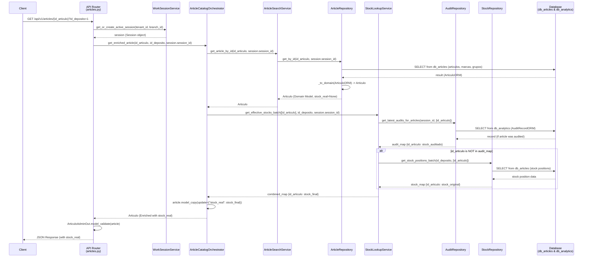

# Spec: Refactoring Get Article by ID Workflow

## Objective
Refactor the `GET /api/v1/articles/{id_articulo}` workflow to enrich the returned `Articulo` entity with effective stock (`stock_real`) for a specified warehouse/deposit (`id_deposito`).
The refactoring decouples HTTP controller logic, article search domain logic, and stock calculation logic by delegating orchestration to `ArticleCatalogOrchestrator` adhering to GRASP design principles (Controller, Pure Fabrication, Information Expert, Low Coupling, High Cohesion).

## Tech Stack
- **Framework**: FastAPI (Python 3.11+)
- **ORM / Database**: SQLAlchemy 2.0 (AsyncIO) querying `db_articles` and `db_analytics`
- **Domain Modeling**: Pydantic V2 (`Articulo`, `ArticuloAdminOut`, `ArticuloPublicOut`)
- **Testing**: pytest & pytest-asyncio with TestClient

## Sequence Diagram Reference


## GRASP Architectural Principles
1. **Controller (API Router `backend/api/v1/articles.py`)**: Responsible only for HTTP endpoint definition, parameter extraction (`id_articulo`, `id_deposito`), dependency injection, and role-based response validation.
2. **Pure Fabrication (`ArticleCatalogOrchestrator`)**: Application domain orchestrator bridging catalog retrieval and stock resolution across bounded contexts without polluting domain entities.
3. **Information Expert**:
   - `ArticleSearchService`: Expert in article catalog lookup and entity hydration.
   - `StockLookupService`: Expert in resolving effective stock (priority to active session audits in `db_analytics`, fallback to physical stock in `db_articles`).
   - `ArticleCatalogOrchestrator`: Expert in combining entity + stock into an enriched model via `model_copy(update={"stock_real": ...})`.
4. **Low Coupling & High Cohesion**: Services communicate via domain ports and typed entities; no database or web framework dependencies leak into business services.

## Project Structure
- `backend/api/v1/articles.py`: Update `get_article` endpoint to accept `id_deposito` query param and inject `ArticleCatalogOrchestrator`.
- `backend/app/articles/orchestrator.py`: Add `get_enriched_article(id_articulo, deposit_id, active_session_id)` method.
- `backend/tests/domain/test_article_catalog_orchestrator.py`: Add unit tests for `get_enriched_article`.
- `backend/tests/api/test_articles_routes.py`: Update route unit tests to verify `id_deposito` query param handling and stock enrichment.

## Commands
```bash
# Run pytest for articles route and orchestrator domain tests
pytest backend/tests/api/test_articles_routes.py backend/tests/domain/test_article_catalog_orchestrator.py -v
```

## Success Criteria
- [ ] `GET /api/v1/articles/{id_articulo}` accepts optional query param `id_deposito: int = Query(1, ge=1)` (default `1`).
- [ ] `GET /api/v1/articles/{id_articulo}` calls `orchestrator.get_enriched_article(...)`.
- [ ] `ArticleCatalogOrchestrator.get_enriched_article` fetches `Articulo` via `ArticleSearchService` and effective stock via `StockLookupService.get_effective_stocks_batch([id_articulo], deposit_id, active_session_id)`.
- [ ] Returned `Articulo` is enriched with `stock_real` matching effective stock calculation.
- [ ] Role-based schema response validation (`ArticuloAdminOut` vs `ArticuloPublicOut`) continues to function seamlessly with `stock_real` included in output JSON.
- [ ] All automated unit and integration tests pass.

## Boundaries
- **Always do**: Preserve entity immutability using Pydantic `model_copy`. Ensure non-existing articles still raise `EntityNotFoundException` (HTTP 404).
- **Ask first**: Any change to domain models `Articulo`, `ArticuloAdminOut`, or `ArticuloPublicOut`.
- **Never do**: Query database ORM directly from router endpoints or bypass `ArticleCatalogOrchestrator`.
