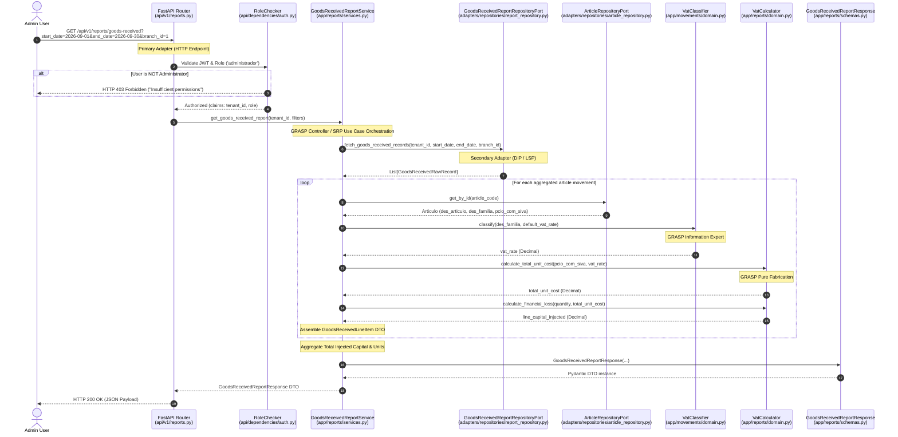

# Spec: Goods Received Report - Core Backend Agent Specification & Architecture Design

## Objective

This specification provides the technical architecture, design patterns, GRASP/SOLID principles mapping, and sequence diagram for **Use Case 1: Administrator Generation of the Goods Received Report (Reporte de Valorización de Ingresos y Altas)**.

It serves as the authoritative blueprint for the **Core Backend Agent** (`core_backend_agent` / Jules) to implement the domain logic, Pydantic schemas, application service, hexagonal ports/adapters, and FastAPI endpoint.

---

## Tech Stack

- **Framework**: FastAPI (Async HTTP Routing & Dependency Injection)
- **Domain & Validation**: Python 3.11+ (100% Pure Domain, Pydantic v2 schemas)
- **Persistence ORM**: Async SQLAlchemy 2.0 (Secondary Repository Adapters)
- **Security**: JWT Authentication + Role-Based Access Control (`RoleChecker`)
- **Testing Framework**: Pytest (`backend/tests/reports/`)

---

## Commands

Execute the following commands within the `/backend` directory:

```bash
# Run unit and integration tests for the Goods Received Report
pytest tests/reports/test_goods_received_report.py -v

# Run full report test suite
pytest tests/reports/ -v

# Check Hexagonal Architecture layer boundaries
pytest tests/architecture/ -v
```

---

## Project Structure & Core Backend Ownership Boundaries

```
backend/
├── api/
│   ├── dependencies/              → [CORE BACKEND OWNED] Service & Auth Dependency Generators
│   └── v1/
│       └── reports.py             → [CORE BACKEND OWNED] FastAPI Primary Adapter (Endpoints)
├── app/
│   └── reports/                   → [CORE BACKEND OWNED] Pure Domain (Services, Ports, Schemas)
│       ├── domain.py              → Domain calculations & Pure Fabrications (VatCalculator)
│       ├── ports.py               → Abstract Ports (GoodsReceivedReportRepositoryPort)
│       ├── schemas.py             → Pydantic DTOs (Filters, Line Items, Responses)
│       └── services.py            → Application Service Controller (GoodsReceivedReportService)
├── adapters/
│   └── repositories/
│       └── report_repository.py   → [CORE BACKEND OWNED] Secondary Adapter implementation
└── tests/
    └── reports/                   → [CORE BACKEND OWNED] Unit & Integration Test Suite
```

### Strict Core Backend Boundaries:
- **OWNED PATHS**: `backend/app/*`, `backend/api/*`, `backend/adapters/repositories/*` (except `models/`), `backend/tests/*`.
- **PROHIBITED PATHS**: Core Backend MUST NEVER edit `backend/migrations/*`, `backend/scripts/*`, or `backend/adapters/repositories/models/*` (owned by `dba_agent`).

---

## GRASP & SOLID Design Principles Mapping

### GRASP (General Responsibility Assignment Software Patterns)

1. **Controller (Use-Case Orchestration)**:
   - `GoodsReceivedReportService` acts as the use-case controller. It coordinates requests, delegates queries to repositories, and passes records to domain calculators. It contains no direct SQL or HTTP code.
2. **Information Expert**:
   - `VatClassifier` owns the tax rules for product families (`des_familia`).
   - `Articulo` owns catalog presentation data (`des_articulo`, `cod_barra`, `pcio_com_siva`).
3. **Low Coupling / Protected Variations**:
   - All data fetching is isolated behind abstract interface ports (`GoodsReceivedReportRepositoryPort`, `ArticleRepositoryPort`). The application service remains unaffected by changes in ORM models or database engines.
4. **High Cohesion**:
   - `GoodsReceivedReportService` is strictly responsible for Goods Received report generation (Command-Query Separation: reporting is completely separate from stock movement execution).
5. **Pure Fabrication**:
   - `VatCalculator` is a stateless, pure domain service performing financial calculations ($\text{Capital Inyectado} = \text{Cantidad Alta} \times \text{Costo Unitario Total}$) without infrastructure dependencies.
6. **Creator**:
   - `GoodsReceivedReportService` receives raw records and catalog data, making it the natural creator of `GoodsReceivedLineItem` and `GoodsReceivedReportResponse` Pydantic DTOs.

### SOLID Principles

1. **Single Responsibility Principle (SRP)**:
   - `FastAPI Router` (`api/v1/reports.py`): Handles HTTP requests, parameter parsing, and response serialization.
   - `RoleChecker` (`api/dependencies/auth.py`): Enforces RBAC security policies.
   - `GoodsReceivedReportService` (`app/reports/services.py`): Orchestrates report workflow.
   - `VatCalculator` (`app/reports/domain.py`): Encapsulates accounting arithmetic.
   - `SQLAlchemyGoodsReceivedReportRepository` (`adapters/repositories/report_repository.py`): Executes DB queries.
2. **Open/Closed Principle (OCP)**:
   - The report architecture is open for extension (e.g., adding new report types or export formats like CSV/Excel) without modifying existing domain calculation engines.
3. **Liskov Substitution Principle (LSP)**:
   - `SQLAlchemyGoodsReceivedReportRepository` strictly satisfies `GoodsReceivedReportRepositoryPort`, allowing seamless replacement with mock repositories in unit tests.
4. **Interface Segregation Principle (ISP)**:
   - `GoodsReceivedReportRepositoryPort` is a small, focused interface dedicated specifically to report queries, avoiding fat multi-purpose repository interfaces.
5. **Dependency Inversion Principle (DIP)**:
   - High-level domain logic (`app/reports/`) depends purely on abstract interfaces defined in `app/reports/ports.py`, never on database drivers or ORM libraries.

---

## Sequence Diagram: Use Case 1 (Goods Received Report Generation)



---

## Detailed Data Contracts

### 1. Request Query Parameters (`GoodsReceivedReportFilters`)
```python
class GoodsReceivedReportFilters(BaseModel):
    start_date: date = Field(..., description="Start date (inclusive)")
    end_date: date = Field(..., description="End date (inclusive)")
    default_vat_rate: Decimal = Field(default=Decimal("0.21"), ge=Decimal("0.0"), le=Decimal("1.0"))
    branch_id: Optional[int] = Field(default=None, ge=1)
```

### 2. Line Item DTO (`GoodsReceivedLineItem`)
```python
class GoodsReceivedLineItem(BaseModel):
    barcode: str
    article_code: str
    des_articulo: str
    des_familia: str
    reason: str  # Observation/Motivo e.g. "Ingreso mercadería", "Ajuste por sobrante"
    quantity_added: int
    pcio_com_siva: Decimal
    vat_rate: Decimal
    total_unit_cost: Decimal
    capital_inyectado: Decimal
```

### 3. Response Payload (`GoodsReceivedReportResponse`)
```python
class GoodsReceivedReportResponse(BaseModel):
    tenant_id: str
    start_date: date
    end_date: date
    default_vat_rate: Decimal
    total_items: int
    total_added_units: int
    total_capital_inyectado: Decimal
    line_items: List[GoodsReceivedLineItem]
```

---

## Success Criteria for Core Backend Implementation

1. [ ] Abstract port `GoodsReceivedReportRepositoryPort` defined in `app/reports/ports.py`.
2. [ ] Pydantic DTOs (`GoodsReceivedReportFilters`, `GoodsReceivedLineItem`, `GoodsReceivedReportResponse`) defined in `app/reports/schemas.py`.
3. [ ] Pure Fabrication domain math methods added to `VatCalculator` in `app/reports/domain.py`.
4. [ ] `GoodsReceivedReportService` implemented in `app/reports/services.py` with zero ORM/HTTP dependencies.
5. [ ] Secondary repository adapter `SQLAlchemyGoodsReceivedReportRepository` implemented in `adapters/repositories/report_repository.py`.
6. [ ] Primary adapter endpoint `GET /api/v1/reports/goods-received` registered in `api/v1/reports.py` with `require_admin` dependency.
7. [ ] Test suite `tests/reports/test_goods_received_report.py` passes 100% with full coverage of calculations and admin authorization.
