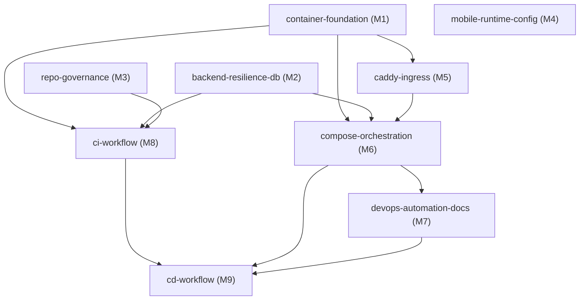
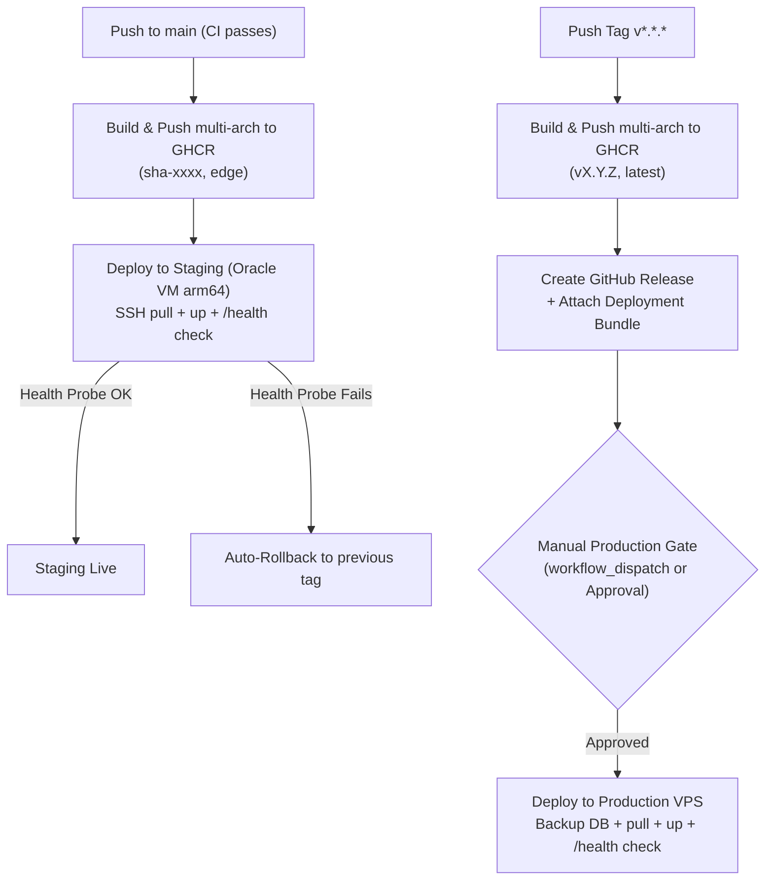

# Specification: Portable Deployment + CI/CD with GitHub Actions

- **Status:** Approved
- **Approved By:** fede
- **Approval Date:** 2026-10-24
- **Initiative:** `portable-deployment-cicd`
- **Target Environments:**
  1. Client On-Premise Server (External MariaDB/MySQL 8, optional public IP)
  2. Oracle Cloud Always Free VM (Ampere A1 arm64 Staging with dynamic DNS & Caddy TLS)
  3. Developer Machine + Cloudflare Tunnel (Quick demos, zero open ports)
  4. Production VPS (Multi-arch amd64/arm64 with backup & manual gate)

---

## Phase 0: Scope Check & Capability Map

The initiative encompasses container packaging, multi-arch cross-compilation, network ingress with automatic TLS, multi-database resilience, mobile client runtime flexibility, DevOps automation scripts, and full CI/CD GitHub Actions pipelines. Because these span independent subsystems, they are decomposed into the following capability map:

| Module ID | Responsibility | Depends On |
|:---|:---|:---|
| `container-foundation` | Multi-stage Dockerfiles for backend and web, standalone Next.js, non-root users, split runtime/dev dependencies. | — |
| `backend-resilience-db` | Database TLS configuration (`DB_SSL_MODE`/`DB_SSL_CA`), Alembic connection URL & SSL support, production `SECRET_KEY` validator, multi-db `/health` check. | — |
| `caddy-ingress` | Caddyfile ingress gateway, automatic Let's Encrypt / ZeroSSL HTTPS, HTTP local fallback, Web barcode scanner camera compatibility, replacing Nginx. | `container-foundation` |
| `compose-orchestration` | Unified `docker-compose.yml` with profiles (`default`, `with-db`, `demo`, `tunnel`), `docker-compose.dev.yml` override, MariaDB localhost binding, fixed init script. | `container-foundation`, `caddy-ingress`, `backend-resilience-db` |
| `mobile-runtime-config` | Dynamic server URL configuration on login screen stored in AsyncStorage, runtime API client base URL decoupling. | — |
| `devops-automation-docs` | Enhanced `scripts/devops/deploy.sh` (`pull`, `update`, `rollback`, `backup`), target runbooks in `docs/deploy/README.md`, DB connection security guide. | `compose-orchestration` |
| `repo-governance` | Update `antigravity.yaml` allowed directories, remove `/specs` from `.gitignore`, document branch protection rules. | — |
| `ci-workflow` | GitHub Actions `.github/workflows/ci.yml`, path filtering, `ci-success` aggregator, linters, tests, real MariaDB 10.11 migration smoke test, security scans, Dependabot. | `container-foundation`, `backend-resilience-db`, `repo-governance` |
| `cd-workflow` | GitHub Actions `.github/workflows/cd.yml`, multi-arch GHCR publishing (amd64/arm64), staging deployment with auto-rollback, release bundles, production gate, optional EAS build. | `ci-workflow`, `compose-orchestration`, `devops-automation-docs` |



**Build Order:**
1. `container-foundation` + `backend-resilience-db` + `repo-governance`
2. `caddy-ingress` + `compose-orchestration`
3. `mobile-runtime-config`
4. `devops-automation-docs`
5. `ci-workflow`
6. `cd-workflow`

---

## 1. Objective & Success Metrics

### 1.1 Objective
Deliver a single, hardened container distribution and automated CI/CD pipeline allowing the SaaS Stock Deposit Control platform to run portably across any target infrastructure (Client on-premise, Oracle Cloud ARM64 VM, Cloudflare Tunnel, or production VPS) changing only `.env`.

### 1.2 Core Success Metrics
- **Write Once, Run Anywhere:** Identical container images from GHCR run seamlessly on `linux/amd64` and `linux/arm64` hosts without local builds on destination servers.
- **Single-Origin Ingress with Auto-TLS:** Caddy provides zero-touch HTTPS on public domains, satisfying browser security requirements for HTML5 camera barcode scanning, while proxying both frontend and backend on one origin.
- **Fail-Safe Database Lifecycle:** Backend startup validates active connectivity across all 3 logical databases (`db_articles`, `db_users`, `db_analytics`), enforces TLS against remote databases, and tests migration forward/rollback idempotency in CI.
- **Automated Continuous Delivery with Instant Rollback:** Staging automatically deploys on `main` push and triggers an automated rollback to the previous image tag if `/health` fails.
- **Zero Secret Exposure:** Zero credentials, keys, or tokens committed to version control, embedded in Docker images, or emitted into CI/CD logs.

---

## 2. Tech Stack & Versions

- **Backend Runtime:** Python 3.12-slim, FastAPI 0.110+, SQLAlchemy 2.0+ (asyncio), aiomysql 0.2+, Alembic 1.13+, Uvicorn 0.28+
- **Frontend Web Runtime:** Next.js 16.2.10 (Standalone output), React 19.2.4, Node 20 LTS Alpine
- **Frontend Mobile Runtime:** Expo 57, React Native 0.86, `@react-native-async-storage/async-storage` 2.2.0
- **Ingress Gateway:** Caddy 2.8+ Alpine (replacing Nginx)
- **Database Engine:** MariaDB 10.11 LTS (official Docker image) / MySQL 8.0 compatibility
- **CI/CD Platform:** GitHub Actions (Ubuntu latest runners, Docker Buildx, QEMU for multi-arch, GHCR)
- **Quality & Security Tools:** Ruff, Pytest, Hadolint, Trivy, Gitleaks, Pip-audit, Npm audit, Dependabot

---

## 3. Assumptions & Clarifications

1. **GitHub Repository Visibility:** The repository is **Private**. On GitHub Free, Environment Protection Rules (required reviewers) are unavailable. A secure manual confirmation gate via `workflow_dispatch` will be provided for production deployments alongside optional Environment gates.
2. **Staging DNS:** Staging on Oracle Cloud Ampere A1 (arm64) will utilize dynamic/free DNS (e.g. DuckDNS, `nip.io`, or `sslip.io`) with Caddy handling ACME HTTP-01/TLS-ALPN-01 challenges automatically.
3. **Specs in Version Control:** The `/specs` directory is removed from `.gitignore` so specifications and task contracts are committed to git and shared across agents and CI.
4. **Mobile EAS Build:** EAS Build for Android preview APKs is specified as an optional, tag/manual-triggered phase using `EXPO_TOKEN`, without blocking backend/web CD.
5. **Proxy Unification:** Caddy completely replaces Nginx. In local development or Cloudflare Tunnel mode, Caddy operates in plain HTTP mode (`:8080`); in staging/production, it manages automatic TLS.

---

## 4. Commands Reference

All commands must be executed from their respective directories or the repository root:

```bash
# ─── Repository Root: Orchestration & LifeCycle ───
./scripts/devops/deploy.sh up              # Start default profile (external DB)
./scripts/devops/deploy.sh up with-db      # Start full stack including MariaDB container
./scripts/devops/deploy.sh health          # Deep connectivity probe across proxy, API & databases
./scripts/devops/deploy.sh backup          # Dump all 3 logical databases to dated SQL archive
./scripts/devops/deploy.sh rollback        # Revert staging/production to previous working image tag
./scripts/devops/deploy.sh update          # Pull latest GHCR images and restart services

# ─── Backend Service ───
cd backend
python -m venv .venv && source .venv/bin/activate
pip install -r requirements.txt -r requirements-dev.txt
ruff check .                               # Lint Python code
ruff format --check .                      # Check Python code formatting
pytest --cov=backend --cov-report=term-missing tests/

# Multi-Database Alembic Migrations
alembic -c backend/migrations/alembic.ini upgrade head
alembic -c backend/migrations/alembic_users.ini upgrade head
alembic -c backend/migrations/alembic_analytics.ini upgrade head

# ─── Frontend Web ───
cd frontend-web
npm ci
npm run lint                               # Next.js ESLint
npx tsc --noEmit                           # TypeScript verification
npm test                                   # Vitest suite
npm run build                              # Standalone production build

# ─── Frontend Mobile ───
cd frontend-mobile
npm ci
npx tsc --noEmit                           # TypeScript verification
npx expo-doctor                            # Expo project health verification

# ─── Docker & Security ───
hadolint backend/Dockerfile frontend-web/Dockerfile
docker compose config                      # Validate compose syntax across profiles
gitleaks detect --source . -v              # Scan for leaked secrets
pip-audit -r backend/requirements.txt      # Backend vulnerability scan
cd frontend-web && npm audit --audit-level=high
```

---

## 5. Detailed Architectural Design per Module

### 5.1 Module 1: Container Foundation (`container-foundation`)

#### Backend Dockerfile (`backend/Dockerfile`)
- **Base Image:** `python:3.12-slim`
- **Build Strategy:** Multi-stage build (builder + runner) to minimize final image footprint and attack surface.
  - *Stage 1 (Builder):* Installs build utilities (`gcc`, `default-libmysqlclient-dev` if needed, `curl`), creates virtualenv at `/opt/venv`, and installs runtime dependencies from `backend/requirements.txt`.
  - *Stage 2 (Runner):* Copies `/opt/venv` from builder, installs minimal runtime libraries (`curl` for healthcheck), creates non-privileged group `appgroup` (GID 10001) and user `appuser` (UID 10001).
- **Execution:** Runs via `docker-entrypoint.sh` as non-root user.
- **Entrypoint Behavior (`backend/docker-entrypoint.sh`):**
  1. Validates that `SECRET_KEY` is not default or weak.
  2. If `RUN_MIGRATIONS=true` (default in standalone, switchable via env), applies the 3 Alembic migrations sequentially (`alembic.ini`, `alembic_users.ini`, `alembic_analytics.ini`).
  3. If migrations fail, exits immediately with non-zero code to block container startup.
  4. Launches Uvicorn: `exec uvicorn backend.api.main:app --host 0.0.0.0 --port 8000 --workers ${UVICORN_WORKERS:-2} --no-access-log` (without `--reload`).
- **Container Healthcheck:**
  `HEALTHCHECK --interval=15s --timeout=5s --start-period=20s --retries=3 CMD curl -f http://127.0.0.1:8000/api/v1/health || exit 1`

#### Frontend Web Dockerfile (`frontend-web/Dockerfile`)
- **Base Image:** `node:20-alpine`
- **Multi-Stage Structure:**
  - *Stage 1 (Deps):* Copies `package.json`, `package-lock.json`, runs `npm ci`.
  - *Stage 2 (Builder):* Copies source code and dependencies. Requires `next.config.ts` configured with `output: "standalone"`. Builds with `npm run build`. Note: No build-time secrets required; `NEXT_PUBLIC_API_URL` defaults to empty string so requests are relative.
  - *Stage 3 (Runner):* Sets non-root user `nextjs` (UID 1001), copies `.next/standalone`, `.next/static` to `.next/standalone/.next/static`, and `public` directory.
- **Port:** Exposes port `3000`.
- **Command:** `node server.js`
- **Container Healthcheck:**
  `HEALTHCHECK --interval=15s --timeout=5s --start-period=15s --retries=3 CMD wget --no-verbose --spider http://127.0.0.1:3000/ || exit 1`

#### Dependency Separation
- `backend/requirements.txt`: Production runtime dependencies only (`fastapi`, `uvicorn[standard]`, `sqlalchemy[asyncio]`, `aiomysql`, `greenlet`, `alembic`, `python-dotenv`, `pydantic`, `bcrypt`, `PyJWT`, `cryptography` for TLS).
- `backend/requirements-dev.txt`: Development and testing dependencies (`pytest`, `pytest-asyncio`, `httpx`, `aiosqlite`, `faker`, `ruff`, `pip-audit`, `coverage`).

---

### 5.2 Module 2: Ingress Reverse Proxy (`caddy-ingress`)

#### Why Caddy Replaces Nginx
1. **Zero-Configuration Automatic HTTPS:** Manages Let's Encrypt / ZeroSSL TLS certificates and renewal automatically for any public domain or dynamic DNS hostname (`*.duckdns.org`, `*.nip.io`).
2. **Camera API Compliance:** Mobile browsers (Chrome Android, iOS Safari) strictly block `navigator.mediaDevices.getUserMedia` unless served over `https://` or `localhost`. Caddy provides HTTPS out-of-the-box without Certbot cron jobs or mounted secrets.
3. **Unified Single-Origin Proxy:** Directs `/api/*` to `backend:8000` and all other paths to `web:3000`, eliminating cross-origin issues and CORS headaches.
4. **Clean Fallback for Dev & LAN:** If `SERVER_NAME` is configured as `:8080` or `http://localhost:8080`, Caddy disables automatic HTTPS and acts as a lightweight HTTP reverse proxy.

#### `docker/caddy/Caddyfile` Specification
```caddy
{
    admin off
    # Global TLS options (optional email for ACME registration)
    email {$ACME_EMAIL:admin@example.com}
}

{$SERVER_NAME::8080} {
    # Logging configuration
    log {
        output stdout
        format json
    }

    # Healthcheck endpoint for Docker & orchestrator probes
    respond /caddy-health 200 {
        body "healthy\n"
    }

    # 1. API routes -> FastAPI Backend
    handle /api/* {
        reverse_proxy backend:8000 {
            header_up Host {host}
            header_up X-Real-IP {remote_host}
            header_up X-Forwarded-For {remote_host}
            header_up X-Forwarded-Proto {scheme}
            transport http {
                response_header_timeout 120s
            }
        }
    }

    # 2. Next.js Web Application & Assets
    handle {
        reverse_proxy web:3000 {
            header_up Host {host}
            header_up X-Real-IP {remote_host}
            header_up X-Forwarded-For {remote_host}
            header_up X-Forwarded-Proto {scheme}
        }
    }
}
```

---

### 5.3 Module 3: Docker Compose Multi-Profile Orchestration (`compose-orchestration`)

#### Structure of `docker-compose.yml`
Images use the standard release reference:
`image: ghcr.io/${GHCR_OWNER:-stockdeposit}/${COMPOSE_PROJECT_NAME:-saas-stock}-backend:${IMAGE_TAG:-latest}`
`image: ghcr.io/${GHCR_OWNER:-stockdeposit}/${COMPOSE_PROJECT_NAME:-saas-stock}-web:${IMAGE_TAG:-latest}`

#### Profile Definitions:
1. **Default Profile (`proxy`, `backend`, `web`):**
   - For connecting to an **external** database (Client on-premise DB, cloud managed DB, or host MariaDB).
   - Backend reads `DB_HOST`, `DB_PORT`, `DB_USER`, `DB_PASSWORD`, `DB_SSL_MODE`, `DB_SSL_CA` or direct `DATABASE_URL` variables from `.env`.
   - Ingress exposes ports `80` and `443` (or `${HTTP_PORT:-8080}` in dev/LAN).
2. **`with-db` Profile (adds `mariadb`):**
   - Activates containerized MariaDB 10.11 LTS.
   - `restart: unless-stopped`.
   - Bound to internal Docker network `backend-net`.
   - Port binding: `127.0.0.1:${MARIADB_PORT:-3306}:3306` (strictly bound to localhost, never `0.0.0.0`).
   - Volume: `mariadb_data:/var/lib/mysql`.
3. **`demo` Profile (adds `seed`):**
   - Runs `python -m backend.scripts.seed` once against the configured database, then exits cleanly.
   - Depends on `backend` reaching healthy state.
4. **`tunnel` Profile (adds `cloudflared`):**
   - Image: `cloudflare/cloudflared:latest`.
   - Command: `tunnel run`.
   - Environment: `TUNNEL_TOKEN=${CLOUDFLARE_TUNNEL_TOKEN}`.
   - Network: `backend-net`, targeting `http://proxy:8080`.

#### MariaDB Init Script Security Fix
- **Problem:** `docker/mariadb/init-dbs.sql` previously contained `IDENTIFIED BY '${MARIADB_APP_PASSWORD}'`. Because MariaDB does not substitute shell variables in `.sql` scripts placed in `/docker-entrypoint-initdb.d/`, the user was created with literal `${MARIADB_APP_PASSWORD}`.
- **Solution:** Replace `01-init-dbs.sql` with an executable entrypoint script `docker/mariadb/01-init-dbs.sh`:
```bash
#!/usr/bin/env bash
set -eo pipefail

mariadb -u root -p"${MARIADB_ROOT_PASSWORD}" <<EOSQL
CREATE DATABASE IF NOT EXISTS \`db_articles\` CHARACTER SET utf8mb4 COLLATE utf8mb4_unicode_ci;
CREATE DATABASE IF NOT EXISTS \`db_users\` CHARACTER SET utf8mb4 COLLATE utf8mb4_unicode_ci;
CREATE DATABASE IF NOT EXISTS \`db_analytics\` CHARACTER SET utf8mb4 COLLATE utf8mb4_unicode_ci;

CREATE USER IF NOT EXISTS '${DB_USER:-app_user}'@'%' IDENTIFIED BY '${MARIADB_APP_PASSWORD}';

GRANT SELECT, INSERT, UPDATE, DELETE, CREATE, ALTER, DROP, INDEX, REFERENCES ON \`db_articles\`.* TO '${DB_USER:-app_user}'@'%';
GRANT SELECT, INSERT, UPDATE, DELETE, CREATE, ALTER, DROP, INDEX, REFERENCES ON \`db_users\`.* TO '${DB_USER:-app_user}'@'%';
GRANT SELECT, INSERT, UPDATE, DELETE, CREATE, ALTER, DROP, INDEX, REFERENCES ON \`db_analytics\`.* TO '${DB_USER:-app_user}'@'%';

FLUSH PRIVILEGES;
EOSQL
```

#### Development Override (`docker-compose.dev.yml`)
- Overrides services to mount local source code:
  - `backend`: mounts `./backend:/app/backend`, runs `uvicorn backend.api.main:app --host 0.0.0.0 --port 8000 --reload`.
  - `web`: mounts `./frontend-web:/app`, runs `npm run dev`.
  - Enables rapid hot-reload workflow while keeping Caddy and MariaDB running in containers.

---

### 5.4 Module 4: Backend & Database Resilience (`backend-resilience-db`)

#### Database TLS & URL Support in SQLAlchemy Engines & Alembic
1. **Environment Variables:**
   - `DB_SSL_MODE`: Options: `disable` (default for localhost/internal docker), `require`, `verify-ca`.
   - `DB_SSL_CA`: Path to CA certificate bundle (e.g., `/etc/ssl/certs/ca-certificates.crt` or custom client CA).
2. **Application Engine Implementation (`backend/adapters/database/connection.py`):**
   - aiomysql connects using `connect_args={"ssl": ssl_context}` when `DB_SSL_MODE` != `disable`.
   - Standardizes URL building logic across all three databases (`db_articles`, `db_users`, `db_analytics`): prefers full explicit URLs (`ARTICLES_DATABASE_URL`, `USERS_DATABASE_URL`, `ANALYTICS_DATABASE_URL`, `DATABASE_URL`) before falling back to individual parameters (`DB_USER`, `DB_PASSWORD`, `DB_HOST`, `DB_PORT`).
3. **Alembic `migrations/env.py` Standardization:**
   - Update `migrations/env.py` to respect full database URLs (`DATABASE_URL`, `USERS_DATABASE_URL`, `ANALYTICS_DATABASE_URL`).
   - Propagate `connect_args={"ssl": ssl_context}` into `async_engine_from_config` so remote migrations over public IPs execute securely over TLS.

#### Production Startup Security Validator (`backend/api/main.py`)
- At application startup (`lifespan` handler):
  - Check `ENVIRONMENT = os.getenv("ENVIRONMENT", "development")`.
  - If `ENVIRONMENT == "production"`:
    - Validate `SECRET_KEY`: must NOT be empty, must NOT equal `"changeme"`, `"changeme_secret_key"`, or `"secret"`, and must be at least 32 characters in length.
    - If validation fails, log structured error: `CRITICAL: Application refused to start in production with insecure SECRET_KEY` and raise `RuntimeError("Insecure SECRET_KEY configured")`.

#### Multi-Database `/health` Connectivity Probe
- Enhance `backend/api/v1/health.py` and `ConnectionProvider.check_connectivity()`:
  - Executes `SELECT 1` across **all 3 logical databases** (`db_articles`, `db_users`, `db_analytics`).
  - Response Schema:
    ```json
    {
      "status": "healthy",
      "databases": {
        "articles": "connected",
        "users": "connected",
        "analytics": "connected"
      },
      "version": "1.0.0"
    }
    ```
  - If any database probe fails, responds with HTTP `503 Service Unavailable`, providing container healthchecks and CD smoke tests with true end-to-end readiness verification.

---

### 5.5 Module 5: Mobile Runtime Configuration (`mobile-runtime-config`)

#### Problem & Solution
- **Problem:** Currently `EXPO_PUBLIC_API_URL` is baked into the mobile bundle at build time. Connecting the same APK to a different server (e.g. client on-premise vs staging vs production) requires recompiling the app with EAS.
- **Solution:**
  1. Add an expandable "Server Settings" modal/sheet on the Mobile Login screen (`frontend-mobile/src/screens/LoginScreen.tsx` or settings modal).
  2. The input field displays the active server URL, defaulting to `process.env.EXPO_PUBLIC_API_URL` or fallback.
  3. User can enter custom URL (e.g., `https://stock.client-domain.com` or `https://staging-stock.duckdns.org`).
  4. Stored persistently in `@react-native-async-storage/async-storage` under key `@stock_server_url`.
  5. The mobile API client (`frontend-mobile/src/services/api/httpClient.ts`) resolves its base URL dynamically:
     - Check memory cache.
     - Fallback to AsyncStorage `@stock_server_url`.
     - Fallback to `EXPO_PUBLIC_API_URL`.
  6. Includes a "Test Connection" button that calls `<url>/api/v1/health` and verifies 200 OK before saving.

---

### 5.6 Module 6: DevOps Automation & Documentation (`devops-automation-docs`)

#### Enhanced `scripts/devops/deploy.sh`
Extend the script with defensive Bash (`set -euo pipefail`):
- `deploy.sh pull`: Pulls latest GHCR images for current `IMAGE_TAG`.
- `deploy.sh update`:
  1. Writes current tag to `.current_tag`.
  2. Pulls new image tag.
  3. Runs `docker compose up -d`.
  4. Runs health probe.
  5. If health check fails within 45s, invokes `deploy.sh rollback` automatically.
- `deploy.sh rollback`:
  1. Reads tag from `.previous_tag`.
  2. Sets `IMAGE_TAG=$PREVIOUS_TAG` and runs `docker compose up -d`.
  3. Verifies health.
- `deploy.sh backup`:
  1. Dumps `db_articles`, `db_users`, `db_analytics` using `mariadb-dump` / `mysqldump` to `./backups/backup_YYYYMMDD_HHMMSS.sql.gz`.
  2. Applies gzip compression and sets file permissions `600`.

#### Database Connection Guidance for Client-Server Deployment (`docs/deploy/README.md`)
Guidance in order of recommendation:
1. **Tier 1 (Best): Same Private Network / VPC:**
   - Both application container and client MariaDB/MySQL server communicate over private internal IP (e.g. `10.x.x.x` or `192.168.x.x`). Zero public database exposure.
2. **Tier 2: Encrypted Mesh / VPN (Tailscale, WireGuard, or SSH Tunnel):**
   - Deploy lightweight WireGuard/Tailscale node on the app host and database server, or establish an encrypted persistent SSH tunnel (`ssh -L 3306:127.0.0.1:3306`).
3. **Tier 3: Public IP with TLS & IP Allowlist:**
   - Restrict database port on client firewall strictly to the application server's static egress IP.
   - Enforce TLS (`DB_SSL_MODE=verify-ca`, client CA specified in `DB_SSL_CA`).
   - Restrict database user privileges to `db_articles`, `db_users`, `db_analytics` only.

#### MariaDB 10.11 vs MySQL 8 Compatibility Matrix
- **Collation:** MariaDB default `utf8mb4_unicode_ci` vs MySQL 8 default `utf8mb4_0900_ai_ci`. The schema must standardize on `utf8mb4_unicode_ci` or standard `utf8mb4_general_ci` which is fully compatible across both engines.
- **Authentication Plugin:** MySQL 8 uses `caching_sha2_password` by default; aiomysql requires `mysql_native_password` or modern PyMySQL/aiomysql auth helpers. Client MySQL 8 users must be created with:
  `CREATE USER 'app_user'@'%' IDENTIFIED WITH mysql_native_password BY 'password';`
- **JSON Functions:** Both engines support JSON columns and standard functions used by SQLAlchemy.

---

### 5.7 Module 7: CI Pipeline Architecture (`ci-workflow`)

#### Workflow: `.github/workflows/ci.yml`
- **Triggers:** `pull_request` against `main` and `push` to `main`.
- **Concurrency:** `group: ci-${{ github.ref }}, cancel-in-progress: true` (cancels superseded runs on PRs).
- **Default Permissions:** `permissions: { contents: read }`.
- **Path Filtering:** Uses `dorny/paths-filter` to optimize runner minute usage:
  - `backend`: `backend/**`, `docker/mariadb/**`, `.github/workflows/ci.yml`
  - `web`: `frontend-web/**`, `shared/**`, `.github/workflows/ci.yml`
  - `mobile`: `frontend-mobile/**`, `shared/**`, `.github/workflows/ci.yml`
  - `docker`: `docker/**`, `backend/Dockerfile`, `frontend-web/Dockerfile`, `docker-compose*.yml`
  - `security`: `**`

#### Job Breakdown:
1. **`backend` Job:**
   - Runs if `backend` changed.
   - Python 3.12, cache `pip`.
   - Install `requirements.txt` and `requirements-dev.txt`.
   - `ruff check .`
   - `ruff format --check .`
   - `pytest --cov=backend tests/`
   - Upload coverage report artifact.
2. **`migrations-smoke` Job (Real MariaDB 10.11 Service):**
   - Runs if `backend` or `docker/mariadb` changed.
   - GitHub Actions Service container:
     ```yaml
     services:
       mariadb:
         image: mariadb:10.11
         env:
           MARIADB_ROOT_PASSWORD: rootpassword
           MARIADB_APP_PASSWORD: apppassword
           MARIADB_DATABASE: db_articles
         ports:
           - 3306:3306
         options: --health-cmd="mariadb-admin ping -h 127.0.0.1 --silent" --health-interval 10s --health-timeout 5s --health-retries 5
     ```
   - Initialize databases via `01-init-dbs.sh`.
   - Run Alembic upgrades for all 3 databases:
     `alembic -c backend/migrations/alembic.ini upgrade head`
     `alembic -c backend/migrations/alembic_users.ini upgrade head`
     `alembic -c backend/migrations/alembic_analytics.ini upgrade head`
   - Test Seed: `python -m backend.scripts.seed`.
   - Start FastAPI API server in background: `uvicorn backend.api.main:app --host 0.0.0.0 --port 8000 &`.
   - Probe `/health` endpoint and verify HTTP 200 with all 3 DBs reported connected.
   - **Downgrade/Upgrade Smoke Test:** Test rolling back 1 migration revision and upgrading back:
     `alembic -c backend/migrations/alembic.ini downgrade -1 && alembic -c backend/migrations/alembic.ini upgrade head`
     `alembic -c backend/migrations/alembic_users.ini downgrade -1 && alembic -c backend/migrations/alembic_users.ini upgrade head`
     `alembic -c backend/migrations/alembic_analytics.ini downgrade -1 && alembic -c backend/migrations/alembic_analytics.ini upgrade head`
3. **`web` Job:**
   - Runs if `web` changed.
   - Node 20 LTS, cache `npm`.
   - `npm ci`
   - `npm run lint`
   - `npx tsc --noEmit`
   - `npm test` (Vitest)
   - `npm run build` (Next.js standalone build verification)
4. **`mobile` Job:**
   - Runs if `mobile` changed.
   - Node 20 LTS, cache `npm`.
   - `npm ci`
   - `npx tsc --noEmit`
   - `npx expo-doctor` (`continue-on-error: true` initially to prevent blocking early PRs)
5. **`docker` Job:**
   - Runs if `docker` or Dockerfiles changed.
   - Hadolint action on `backend/Dockerfile` and `frontend-web/Dockerfile`.
   - `docker compose config` validation on `docker-compose.yml` across all profiles (`default`, `with-db`, `demo`, `tunnel`).
   - Docker Buildx multi-arch test build (`--platform linux/amd64,linux/arm64`) using GitHub Actions cache (`cache-from: type=gha`, `cache-to: type=gha,mode=max`) without pushing.
6. **`security` Job:**
   - `gitleaks` secret detection.
   - `pip-audit -r backend/requirements.txt`
   - `cd frontend-web && npm audit --audit-level=high`
   - Trivy scan of built container images (fails on `CRITICAL` vulnerabilities with fix available).
7. **`ci-success` Aggregator Job:**
   - `needs: [backend, migrations-smoke, web, mobile, docker, security]`
   - `if: always()`
   - Evaluates whether all required jobs succeeded or were skipped by path filters.
   - **Single required status check** for GitHub branch protection.

#### Dependabot Configuration (`.github/dependabot.yml`)
- Schedules weekly automated PRs with grouped minor/patch updates for:
  - `github-actions` (`/`)
  - `pip` (`/backend`)
  - `npm` (`/frontend-web`)
  - `npm` (`/frontend-mobile`)
  - `docker` (`/backend` and `/frontend-web`)

---

### 5.8 Module 8: CD Pipeline & Release Engineering (`cd-workflow`)

#### Workflow: `.github/workflows/cd.yml`
- **Permissions:** `packages: write`, `contents: write` (for creating releases on tags).

#### Pipeline Triggers & Stages:


#### Multi-Arch Image Publishing
- Target architectures: `linux/amd64`, `linux/arm64`.
- Images published to GitHub Packages (GHCR):
  - `ghcr.io/<owner>/saas-stock-backend`
  - `ghcr.io/<owner>/saas-stock-web`
- Image tags:
  - On push to `main`: `edge`, `sha-<short>`
  - On tag `vX.Y.Z`: `vX.Y.Z`, `vX.Y`, `vX`, `latest`
- Uses QEMU (`docker/setup-qemu-action`) and Buildx (`docker/setup-buildx-action`).

#### Staging Deployment (Oracle Cloud Always Free VM - Ampere A1 arm64)
- Automated deployment via SSH (`appleboy/ssh-action` or native OpenSSH).
- Deployment Steps executed on VM:
  ```bash
  cd /opt/saas-stock-deposit
  # 1. Record current tag for rollback
  PREV_TAG=$(grep "^IMAGE_TAG=" .env | cut -d '=' -f2 || echo "edge")
  echo "${PREV_TAG}" > .previous_tag

  # 2. Update to new tag & pull
  sed -i "s/^IMAGE_TAG=.*/IMAGE_TAG=${NEW_TAG}/" .env
  docker compose pull backend web proxy

  # 3. Apply rolling restart
  docker compose up -d --remove-orphans

  # 4. Wait for health check with auto-rollback
  HEALTH_URL="https://${STAGING_DOMAIN}/api/v1/health"
  SUCCESS=0
  for i in {1..12}; do
    if curl -skf "${HEALTH_URL}" | grep -q '"status":"healthy"'; then
      echo "Health check passed!"
      SUCCESS=1
      break
    fi
    echo "Waiting for health check... ($i/12)"
    sleep 5
  done

  if [ ${SUCCESS} -ne 1 ]; then
    echo "Health check failed! Initiating automatic rollback to ${PREV_TAG}..."
    sed -i "s/^IMAGE_TAG=.*/IMAGE_TAG=${PREV_TAG}/" .env
    docker compose up -d
    exit 1
  fi
  ```

#### Release Packaging on `v*.*.*` Tags
- Builds deployment bundle tarball:
  `tar -czvf saas-stock-deployment-${TAG}.tar.gz docker-compose.yml docker/caddy/Caddyfile .env.example scripts/devops/deploy.sh docs/deploy/README.md`
- Creates GitHub Release with auto-generated release notes and attaches `saas-stock-deployment-${TAG}.tar.gz`.
- This bundle is the exact self-contained package downloaded by clients for on-premise installation.

#### Production Deployment Gating
- Because the repository is private and GitHub Free does not support Environment protection rules, provide a dual-track gate:
  1. Primary: Manual `workflow_dispatch` trigger requiring explicit user inputs:
     - `target_version`: e.g. `v1.2.0`
     - `confirm_text`: must equal `"DEPLOY-PRODUCTION"`
  2. Organization fallback: GitHub Environment `production` with required reviewers (if repository is upgraded to Team/Enterprise).
- Production deployment executes `deploy.sh backup` before pulling images and restarting services.

#### Mobile EAS Preview Build (Optional Later Phase)
- Workflow file: `.github/workflows/mobile-release.yml` (trigger: `workflow_dispatch` or semantic tags).
- Installs Expo CLI and runs:
  `npx eas-cli build --platform android --profile preview --non-interactive`
- Authenticates via GitHub secret `EXPO_TOKEN`.

#### Secrets & Variables Inventory
| Scope | Secret / Variable Name | Purpose | Location |
|:---|:---|:---|:---|
| **GitHub Secret** | `STAGING_SSH_KEY` | Ed25519 private SSH key for Oracle VM staging | GitHub Repository Secrets |
| **GitHub Secret** | `STAGING_SSH_HOST` | Hostname / IP address of Oracle VM staging | GitHub Repository Secrets |
| **GitHub Secret** | `STAGING_SSH_USER` | SSH user (e.g., `ubuntu` or `opc`) | GitHub Repository Secrets |
| **GitHub Secret** | `PROD_SSH_KEY` | Private SSH key for production VPS | GitHub Repository Secrets |
| **GitHub Secret** | `PROD_SSH_HOST` | Hostname / IP for production VPS | GitHub Repository Secrets |
| **GitHub Secret** | `PROD_SSH_USER` | SSH user for production VPS | GitHub Repository Secrets |
| **GitHub Secret** | `EXPO_TOKEN` | Expo access token for EAS Build (optional) | GitHub Repository Secrets |
| **GitHub Var** | `STAGING_DOMAIN` | Domain for staging health checks (e.g., `staging.duckdns.org`) | GitHub Repository Variables |
| **Server `.env`** | `SECRET_KEY` | Production JWT HMAC secret key (>= 32 chars) | Host Server `.env` ONLY (never in git/GitHub) |
| **Server `.env`** | `DB_PASSWORD` / `MARIADB_*` | Database credentials | Host Server `.env` ONLY (never in git/GitHub) |
| **Server `.env`** | `CLOUDFLARE_TUNNEL_TOKEN` | Cloudflare Tunnel credential | Host Server `.env` ONLY |

---

### 5.9 Module 9: Repository Governance (`repo-governance`)

#### Configuration Adjustments:
1. **`antigravity.yaml`:**
   Update `project.allowed_directories` to include `.github/`, `specs/`, and root files:
   ```yaml
   project:
     name: "app-stock-deposit-control"
     type: "monorepo"
     allowed_directories: ["backend/", "frontend-mobile/", "frontend-web/", "docker/", "scripts/", "docs/", ".github/", "specs/"]
   ```
2. **`.gitignore`:**
   Remove line 8 (`/specs`) so all specification files are tracked in version control.
3. **Branch Protection Guidelines for `main`:**
   - Require a pull request before merging (minimum 1 approval).
   - Require status check to pass before merging: `ci-success`.
   - Require branches to be up to date before merging.
   - Do not allow bypassing the above settings.

---

## 6. Acceptance Criteria (Verifiable Behavioral Criteria)

### Module 1: Container Foundation
- **S1 (Backend Containerization):** Given `backend/Dockerfile`, when built with `docker build -t test-backend backend/`, then the image builds without errors, executes as non-root user `appuser` (UID 10001), contains no test dependencies (`pytest` not found), and runs `uvicorn` on port 8000.
- **S2 (Web Containerization):** Given `frontend-web/Dockerfile` with `next.config.ts` configured for `output: "standalone"`, when built with `docker build -t test-web frontend-web/`, then the standalone bundle runs under non-root user `nextjs` (UID 1001), exposes port 3000, and serves HTML on `/`.
- **S3 (Requirements Separation):** Given `backend/requirements.txt` and `backend/requirements-dev.txt`, when inspecting `requirements.txt`, then it contains only runtime dependencies and zero test packages (`pytest`, `httpx`, `aiosqlite` reside in `requirements-dev.txt`).

### Module 2: Ingress Reverse Proxy
- **S4 (Caddy Automatic TLS):** Given `docker/caddy/Caddyfile` with a domain `SERVER_NAME=subdomain.duckdns.org`, when Caddy starts, then it binds ports 80/443 and issues Let's Encrypt certificates automatically.
- **S5 (Caddy Dev Fallback):** Given `SERVER_NAME=:8080`, when Caddy starts, then it binds port 8080 in plain HTTP mode without attempting ACME TLS registration.
- **S6 (Single-Origin Routing):** Given Caddy proxying requests, when requesting `/api/v1/health`, then the request is forwarded to `backend:8000/api/v1/health`; when requesting `/`, then the request is forwarded to `web:3000/`.

### Module 3: Compose Multi-Profile Orchestration
- **S7 (Default Profile External DB):** Given `docker compose up -d`, when launched without profiles, then only `proxy`, `backend`, and `web` start; `mariadb` is not started.
- **S8 (With-DB Profile & Localhost Binding):** Given `docker compose --profile with-db up -d`, when inspecting port bindings with `docker compose ps`, then MariaDB port 3306 is bound exclusively to `127.0.0.1:3306` (or no public host ports) and never `0.0.0.0:3306`.
- **S9 (MariaDB Init Script Expansion):** Given a clean `mariadb_data` volume and `.env` with `MARIADB_APP_PASSWORD=securepass123`, when MariaDB initializes, then user `app_user` is created with `securepass123` as its password and granted privileges across `db_articles`, `db_users`, and `db_analytics`.
- **S10 (Dev Hot-Reload Override):** Given `docker compose -f docker-compose.yml -f docker-compose.dev.yml up`, when a backend or web source file is modified, then the corresponding service hot-reloads without container restart.

### Module 4: Backend & Database Resilience
- **S11 (Database TLS Support):** Given `DB_SSL_MODE=require` in `.env`, when the backend connects to MariaDB/MySQL, then `aiomysql` establishes the connection with SSL enabled.
- **S12 (Alembic Full URL & TLS Support):** Given `DATABASE_URL` and `USERS_DATABASE_URL` specified in `.env`, when running Alembic migrations, then `migrations/env.py` connects to the URL target and passes SSL parameters to `async_engine_from_config`.
- **S13 (Insecure SECRET_KEY Refusal):** Given `ENVIRONMENT=production` and `SECRET_KEY=changeme`, when the backend starts, then application startup fails immediately with an explicit fatal error message.
- **S14 (Multi-Database Health Probe):** Given the backend running with all 3 databases accessible, when `GET /api/v1/health` is requested, then it returns HTTP 200 with status for `articles`, `users`, and `analytics`; if any database is offline, it returns HTTP 503.

### Module 5: Mobile Runtime Configuration
- **S15 (Mobile Dynamic Server URL):** Given the mobile app login screen, when the user opens Server Settings, enters `https://staging-stock.duckdns.org` and saves, then the URL is persisted in AsyncStorage and subsequent API calls target that URL.
- **S16 (Mobile Server Connectivity Test):** Given the Server Settings modal, when the user taps "Probar Conexión", then the app calls `${inputUrl}/api/v1/health` and displays green success status if HTTP 200, or red error if unreachable.

### Module 6: DevOps Automation & Documentation
- **S17 (Deploy Script LifeCycle):** Given `./scripts/devops/deploy.sh`, when running `deploy.sh backup`, then a compressed SQL archive containing all 3 databases is created in `backups/`.
- **S18 (Automated Rollback):** Given `deploy.sh update` updating to a broken tag, when the health check probe fails, then the script automatically reverts `IMAGE_TAG` to `.previous_tag` and restores the healthy deployment.

### Module 7: CI Pipeline Architecture
- **S19 (Matrix CI Execution):** Given a PR modifying only `backend/`, when CI triggers, then only `backend`, `migrations-smoke`, `docker`, and `security` run; `web` and `mobile` are skipped.
- **S20 (Real MariaDB Migration Smoke Test):** Given the `migrations-smoke` job in CI, when executed against a MariaDB 10.11 service container, then the 3 Alembic migrations succeed, seed data is applied, `/health` reports 200 OK, and downgrade-upgrade testing confirms reversibility.
- **S21 (CI Aggregator Gate):** Given any pull request, when all required jobs pass or are skipped, then `ci-success` finishes green; if any job fails, `ci-success` fails and blocks PR merge.

### Module 8: CD Pipeline & Release Engineering
- **S22 (Multi-Arch Publishing):** Given a push to `main` passing CI, when the CD pipeline executes, then multi-arch images (`linux/amd64` and `linux/arm64`) are built and pushed to GHCR tagged with `sha-<commit>` and `edge`.
- **S23 (Staging Continuous Deployment):** Given multi-arch images pushed to GHCR, when the staging deployment job executes, then it connects to the Oracle VM via SSH, updates `.env`, pulls images, restarts services, and verifies `/health`.
- **S24 (Release Deployment Bundle):** Given a tag `vX.Y.Z` pushed to the repository, when the release job runs, then a GitHub Release is created containing auto-generated notes and the standalone `saas-stock-deployment-vX.Y.Z.tar.gz` bundle.

---

## 7. Testing Strategy

### 7.1 Automated Unit & Integration Tests (CI)
- **Backend:** `pytest --cov=backend tests/` verifies domain logic, port/adapter implementations, and HTTP router contracts.
- **Web Frontend:** `vitest run` executes all component and hook unit tests (including camera scanner lifecycle and permissions).
- **Mobile Frontend:** `tsc --noEmit` verifies strict TypeScript contracts across all mobile screens and adapters.

### 7.2 Database & Migration Smoke Tests (CI)
- A real `mariadb:10.11` service container runs in GitHub Actions to validate MariaDB-specific syntax, utf8mb4 collations, foreign key constraints across the 3 logical databases, and two-way migration idempotency (`upgrade head` -> `downgrade -1` -> `upgrade head`).

### 7.3 Container & Infrastructure Tests (CI)
- **Hadolint:** Scans Dockerfiles for container security anti-patterns (e.g., untyped tags, missing non-root user, redundant cache layers).
- **Compose Linting:** `docker compose config` validates schema conformance for every defined profile (`default`, `with-db`, `demo`, `tunnel`).
- **Image Scanning:** Trivy inspects built container images for OS and package vulnerabilities, failing on fixable `CRITICAL` severity issues.

### 7.4 Live Health & Smoke Verification (CD & Staging)
- Deep health probe `GET /api/v1/health` checks:
  1. Ingress gateway availability.
  2. FastAPI ASGI worker loop.
  3. Active connection pools across `db_articles`, `db_users`, and `db_analytics`.

---

## 8. Threat Modeling & Risk Analysis

| Threat / Risk | Likelihood | Impact | Mitigation Strategy |
|:---|:---:|:---:|:---|
| **Weak or Default `SECRET_KEY` in Production** | High | Critical | Hard startup check in `backend/api/main.py`: refuse to start if `ENVIRONMENT=production` and `SECRET_KEY` is trivial or `< 32` characters. |
| **Exposed Database Port on Public Interface** | High | Critical | Remove MariaDB port mapping from default profile; in `with-db`, bind strictly to `127.0.0.1:3306`. |
| **Cleartext DB Credentials over Public IP** | Medium | High | Add `DB_SSL_MODE` and `DB_SSL_CA` support to both application engine and Alembic migration contexts. |
| **Root Execution in Containers** | Medium | Medium | Multi-stage Dockerfiles enforce unprivileged system users (`appuser` 10001, `nextjs` 1001). |
| **Camera Barcode Scanner Blocked on Mobile** | High | High | Caddy automatically provisions TLS for any public domain; mobile browsers allow `getUserMedia` only on HTTPS or localhost. |
| **Staging Downtime on Bad Release** | Medium | High | Automated rollback in CD script: if `/health` does not return 200 within 60s, automatically revert `IMAGE_TAG` to `.previous_tag`. |
| **Unintended Production Deploy on GitHub Free** | Medium | High | Dual-track gate: require explicit confirmation input via `workflow_dispatch` (`confirm_text: "DEPLOY-PRODUCTION"`). |

---

## 9. Boundaries (Operational Guardrails)

- **Always:**
  - Enforce non-root execution inside all container images.
  - Require the `ci-success` aggregator check to pass before merging into `main`.
  - Maintain the Hexagonal Architecture: infrastructure and container details must never leak into `backend/app/` domain core.
  - Use relative URLs in the web client (empty `NEXT_PUBLIC_API_URL`) so reverse proxy routing guarantees single-origin security.
  - Keep MariaDB port bound to `127.0.0.1` or internal Docker networks.
- **Ask First:**
  - Introducing any third-party SaaS services that incur recurring financial costs.
  - Altering database schema or changing collation from `utf8mb4_unicode_ci`.
  - Adding new privileged containers or mounting host Docker sockets.
- **Never:**
  - Commit secrets, database passwords, API tokens, or private SSH keys to git or GitHub Actions workflow definitions.
  - Set `ENVIRONMENT=production` with default passwords or `SECRET_KEY=changeme`.
  - Publish container images containing development or testing tools (`pytest`, `aiosqlite`, compilers).
  - Perform un-backed-up database migrations in production environments.

---

## 10. Open Questions & Future Considerations

1. **Let's Encrypt Rate Limits on Dynamic DNS:**
   - *Context:* Dynamic DNS providers (like `duckdns.org` or `nip.io`) share root domains that may occasionally encounter Let's Encrypt rate limits if many subdomains request certificates simultaneously.
   - *Action Plan:* If staging encounters rate limits, switch Caddy to ZeroSSL or configure a custom dedicated domain/subdomain pointing to the Oracle VM IP.
2. **Production Backup Retention Policy:**
   - *Context:* `deploy.sh backup` stores compressed database dumps locally in `./backups/`.
   - *Recommendation:* In a future phase, automate offsite replication (e.g., encrypted S3/GCS bucket or rsync to a backup server) with a 30-day retention pruning script.
3. **Database Migration Rollback Limitations:**
   - *Context:* Schema changes that drop columns or transform data are not trivially reversible.
   - *Recommendation:* Require an "expand-and-contract" phased migration policy: new versions must add columns and support both old and new schemas before deprecated columns are dropped in subsequent releases.
