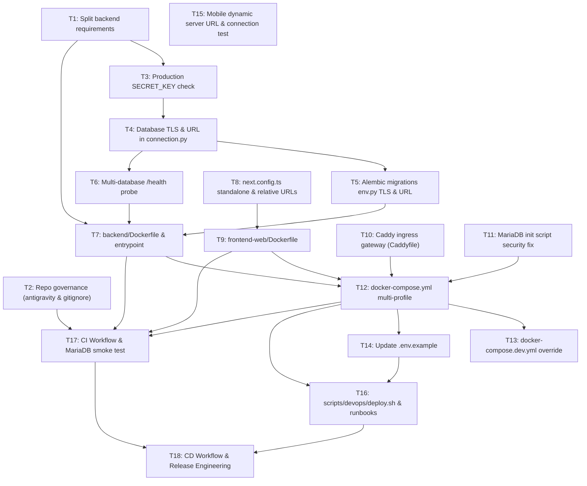

# Implementation Tasks: Portable Deployment + CI/CD with GitHub Actions

- **Spec Reference:** `specs/portable-deployment-cicd/spec.md`
- **Initiative:** `portable-deployment-cicd`
- **Estimated Slices:** 18 Vertical Tasks
- **Size Constraint:** `<= 400` changed lines per slice

---

## Task Dependency Graph

---

## Phase 1: Core Primitives & Security Hardening

- [ ] **T1: Split backend requirements into runtime and development**
  - **S#:** `S3`
  - **Risk Tier:** Low
  - **Description:** Move testing and development dependencies (`pytest`, `pytest-asyncio`, `httpx`, `aiosqlite`, `faker`) from `backend/requirements.txt` into a new `backend/requirements-dev.txt`. Ensure `backend/requirements.txt` contains `cryptography` for MySQL TLS.
  - **Files:** `backend/requirements.txt`, `backend/requirements-dev.txt`
  - **Verify:** `pip install -r backend/requirements.txt && python -c "import fastapi, aiomysql, sqlalchemy"`

- [ ] **T2: Update repository governance and remove specs from `.gitignore`**
  - **S#:** `repo-governance`
  - **Risk Tier:** Low
  - **Description:** Update `antigravity.yaml` `allowed_directories` to include `.github/`, `specs/`, and root files. Remove `/specs` entry from `.gitignore`.
  - **Files:** `antigravity.yaml`, `.gitignore`
  - **Verify:** `git status` verifies `specs/` is tracked and not ignored.

- [ ] **T3: Enforce production `SECRET_KEY` startup check in FastAPI**
  - **S#:** `S13`
  - **Risk Tier:** Medium
  - **Description:** In `backend/api/main.py` lifespan, check `ENVIRONMENT`. If `ENVIRONMENT == "production"` and `SECRET_KEY` is trivial (`changeme`, `changeme_secret_key`, empty, or `< 32` characters), log error and raise `RuntimeError` preventing server startup.
  - **Files:** `backend/api/main.py`, `backend/tests/test_startup_security.py`
  - **Verify:** `ENVIRONMENT=production SECRET_KEY=changeme python -c "from backend.api.main import app"` raises `RuntimeError`.

- [ ] **T4: Add Database TLS and full URL resolution in connection provider**
  - **S#:** `S11`
  - **Risk Tier:** Medium
  - **Description:** In `backend/adapters/database/connection.py`, support `DB_SSL_MODE` (`disable`, `require`, `verify-ca`) and `DB_SSL_CA` via `aiomysql` `connect_args={"ssl": ssl_context}` across all three engine factories. Standardize URL building to prefer full connection URLs before component variables.
  - **Files:** `backend/adapters/database/connection.py`, `backend/tests/db/test_connection_ssl.py`
  - **Verify:** `pytest backend/tests/db/test_connection_ssl.py`

- [ ] **T5: Standardize Alembic `migrations/env.py` for full URLs and TLS**
  - **S#:** `S12`
  - **Risk Tier:** Medium
  - **Description:** Update `backend/migrations/env.py` to prioritize `DATABASE_URL`, `USERS_DATABASE_URL`, and `ANALYTICS_DATABASE_URL` instead of reconstructing from `DB_HOST`/`DB_PORT`. Pass SSL connection arguments into `async_engine_from_config`.
  - **Files:** `backend/migrations/env.py`
  - **Verify:** `DATABASE_URL="sqlite+aiosqlite:///tmp/test.db" python -m alembic -c backend/migrations/alembic.ini current`

- [ ] **T6: Enhance `/api/v1/health` for multi-database connectivity probe**
  - **S#:** `S14`
  - **Risk Tier:** Medium
  - **Description:** Update `ConnectionProvider.check_connectivity()` and `backend/api/v1/health.py` to test connectivity (`SELECT 1`) across all three logical databases (`db_articles`, `db_users`, `db_analytics`). Return 200 OK only if all three are connected; return 503 if any probe fails.
  - **Files:** `backend/app/ports/database.py`, `backend/adapters/database/connection.py`, `backend/api/v1/health.py`, `backend/tests/api/test_health.py`
  - **Verify:** `pytest backend/tests/api/test_health.py`

---

## Phase 2: Containerization & Ingress Gateway

- [ ] **T7: Create production multi-stage `backend/Dockerfile` and entrypoint**
  - **S#:** `S1`
  - **Risk Tier:** Medium
  - **Description:** Author `backend/Dockerfile` (`python:3.12-slim`, non-root user `appuser` UID 10001, virtualenv, no test tools). Create `backend/docker-entrypoint.sh` supporting `RUN_MIGRATIONS=true` and launching Uvicorn.
  - **Files:** `backend/Dockerfile`, `backend/docker-entrypoint.sh`, `.dockerignore`
  - **Verify:** `docker build -t test-backend backend/ && docker run --rm test-backend python -c "import fastapi"`

- [ ] **T8: Configure Next.js standalone output and clean relative routing**
  - **S#:** `S2`, `S6`
  - **Risk Tier:** Medium
  - **Description:** In `frontend-web/next.config.ts`, add `output: "standalone"`. Remove hardcoded rewrite to `http://127.0.0.1:8000` and LAN IPs in `allowedDevOrigins`. Verify `frontend-web/lib/adapters/httpClient.ts` preserves relative URLs with empty `NEXT_PUBLIC_API_URL`.
  - **Files:** `frontend-web/next.config.ts`, `frontend-web/lib/adapters/httpClient.ts`
  - **Verify:** `cd frontend-web && npm run build` produces `.next/standalone`.

- [ ] **T9: Create production multi-stage `frontend-web/Dockerfile`**
  - **S#:** `S2`
  - **Risk Tier:** Medium
  - **Description:** Author `frontend-web/Dockerfile` (`node:20-alpine`, multi-stage, non-root user `nextjs` UID 1001, standalone server runner, healthcheck probe).
  - **Files:** `frontend-web/Dockerfile`, `frontend-web/.dockerignore`
  - **Verify:** `docker build -t test-web frontend-web/ && docker run --rm -p 3000:3000 test-web`

- [ ] **T10: Implement Caddy ingress gateway configuration**
  - **S#:** `S4`, `S5`, `S6`
  - **Risk Tier:** Medium
  - **Description:** Author `docker/caddy/Caddyfile` with `/api/*` reverse proxy to `backend:8000`, root reverse proxy to `web:3000`, `/caddy-health` endpoint, automatic HTTPS for public domains, and `:8080` HTTP fallback.
  - **Files:** `docker/caddy/Caddyfile`, `docker/caddy/Dockerfile`
  - **Verify:** `caddy validate --config docker/caddy/Caddyfile`

---

## Phase 3: Compose Orchestration & Dev Experience

- [ ] **T11: Secure MariaDB entrypoint script for environment variable expansion**
  - **S#:** `S9`
  - **Risk Tier:** Medium
  - **Description:** Replace `docker/mariadb/init-dbs.sql` with `docker/mariadb/01-init-dbs.sh` executing dynamic SQL with `$MARIADB_APP_PASSWORD` expansion.
  - **Files:** `docker/mariadb/01-init-dbs.sh`, `docker/mariadb/init-dbs.sql` (removed or deprecated)
  - **Verify:** `bash -n docker/mariadb/01-init-dbs.sh`

- [ ] **T12: Author unified `docker-compose.yml` with profiles**
  - **S#:** `S7`, `S8`
  - **Risk Tier:** Medium
  - **Description:** Refactor `docker-compose.yml` into service profiles: `default` (`proxy`, `backend`, `web`), `with-db` (`mariadb` with `127.0.0.1:3306`), `demo` (`seed`), and `tunnel` (`cloudflared`). Replace Nginx with Caddy. Reference GHCR images parameterized by `${IMAGE_TAG:-latest}`.
  - **Files:** `docker-compose.yml`
  - **Verify:** `docker compose config` and `docker compose --profile with-db config` validate cleanly.

- [ ] **T13: Author `docker-compose.dev.yml` override for local development**
  - **S#:** `S10`
  - **Risk Tier:** Low
  - **Description:** Author `docker-compose.dev.yml` mounting local `backend/` and `frontend-web/` directories with live code reload.
  - **Files:** `docker-compose.dev.yml`
  - **Verify:** `docker compose -f docker-compose.yml -f docker-compose.dev.yml config`

- [ ] **T14: Update `.env.example` with comprehensive deployment variables**
  - **S#:** `S4`, `S7`, `S11`
  - **Risk Tier:** Low
  - **Description:** Update `.env.example` with TLS settings (`DB_SSL_MODE`, `DB_SSL_CA`), Caddy domain (`SERVER_NAME`), image tags, and clear instructions for each deployment profile.
  - **Files:** `.env.example`
  - **Verify:** Review file formatting and variable consistency.

---

## Phase 4: Mobile Client Runtime Portability

- [ ] **T15: Implement dynamic server URL configuration on Mobile Login**
  - **S#:** `S15`, `S16`
  - **Risk Tier:** Medium
  - **Description:** Add Server Settings modal in `frontend-mobile/src/screens/LoginScreen.tsx` with AsyncStorage storage (`@stock_server_url`) and a "Probar Conexión" health check button calling `/api/v1/health`. Update mobile API client to resolve base URL dynamically.
  - **Files:** `frontend-mobile/src/services/api/httpClient.ts`, `frontend-mobile/src/screens/LoginScreen.tsx`, `frontend-mobile/src/components/ServerSettingsModal.tsx`
  - **Verify:** `cd frontend-mobile && npx tsc --noEmit`

---

## Phase 5: DevOps Automation & Runbooks

- [ ] **T16: Enhance `scripts/devops/deploy.sh` and author runbooks**
  - **S#:** `S17`, `S18`
  - **Risk Tier:** Medium
  - **Description:** Update `scripts/devops/deploy.sh` with `pull`, `update`, `rollback`, and `backup` commands with strict error handling. Update `docs/deploy/README.md` with targeted runbooks for Client On-Premise, Oracle Cloud VM (arm64), Cloudflare Tunnel, and Database TLS/compatibility guidance.
  - **Files:** `scripts/devops/deploy.sh`, `docs/deploy/README.md`
  - **Verify:** `bash -n scripts/devops/deploy.sh && ./scripts/devops/deploy.sh help`

---

## Phase 6: CI/CD GitHub Actions & Release Automation

- [ ] **T17: Author CI workflow and Dependabot configuration**
  - **S#:** `S19`, `S20`, `S21`
  - **Risk Tier:** High
  - **Description:** Author `.github/workflows/ci.yml` featuring path filtering (`dorny/paths-filter`), `backend` (ruff + pytest), `migrations-smoke` with real MariaDB 10.11 container (apply 3 Alembic migrations, seed, probe `/health`, downgrade/upgrade), `web` (lint, tsc, vitest, next build), `mobile` (tsc, expo-doctor), `docker` (hadolint, compose config, buildx test), `security` (gitleaks, pip-audit, npm audit, trivy), and `ci-success` aggregator. Author `.github/dependabot.yml`.
  - **Files:** `.github/workflows/ci.yml`, `.github/dependabot.yml`
  - **Verify:** Validate YAML schema with action-validator or online parser.

- [ ] **T18: Author CD workflow and Release Engineering**
  - **S#:** `S22`, `S23`, `S24`
  - **Risk Tier:** High
  - **Description:** Author `.github/workflows/cd.yml` supporting multi-arch (`linux/amd64`, `linux/arm64`) publishing to GHCR on `main` push, SSH staging deployment to Oracle VM with auto-rollback on `/health` failure, GitHub Release packaging on `v*.*.*` tags with attached deployment bundle tarball, and manual production confirmation gate. Add optional `.github/workflows/mobile-release.yml` for EAS build.
  - **Files:** `.github/workflows/cd.yml`, `.github/workflows/mobile-release.yml`
  - **Verify:** Validate YAML schema and permissions blocks.
