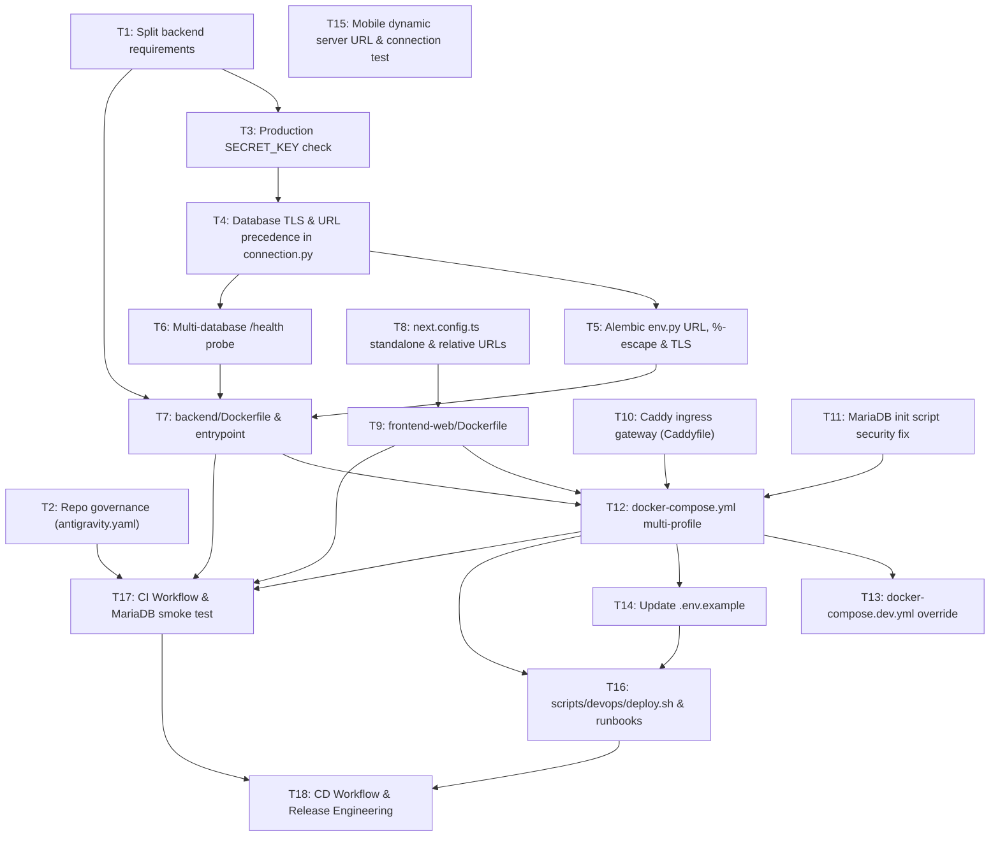

# Implementation Tasks: Portable Deployment + CI/CD with GitHub Actions

- **Spec Reference:** `specs/portable-deployment-cicd/spec.md` (`Status: Approved`)
- **Initiative:** `portable-deployment-cicd`
- **Delivery Strategy:** Vertical slices (`<= 400` changed lines per slice), TDD (`Red -> Green -> Refactor`), dependency-ordered.
- **Commands Source:** Project-level `AGENTS.md` (`## Commands`). Pytest commands must be run from `backend/`.

---

## Task Dependency Graph

---

## Phase 1: Core Primitives & Security Hardening

- [x] **T1: Split backend requirements into runtime and development** *(commit `0739f85`)*
  - **S#:** `S3`
  - **Risk Tier:** Low
  - **Description:** Move testing and development dependencies (`pytest`, `pytest-asyncio`, `httpx`, `aiosqlite`, `faker`) from `backend/requirements.txt` into `backend/requirements-dev.txt`. Ensure `backend/requirements.txt` includes `cryptography` for MySQL TLS.
  - **Files:** `backend/requirements.txt`, `backend/requirements-dev.txt`
  - **Verify:** `cd backend && python -c "with open('requirements.txt') as f: reqs = f.read(); assert 'pytest' not in reqs, 'pytest should be in requirements-dev.txt'"` && `cd backend && pip install -r requirements.txt && python -c "import fastapi, aiomysql, sqlalchemy, cryptography"`

- [x] **T2: Update repository governance in `antigravity.yaml`** *(commit `8ba48f2`)*
  - **S#:** `repo-governance`
  - **Risk Tier:** Low
  - **Description:** Update `antigravity.yaml` `allowed_directories` to include `".github/"`, `"specs/"`, and root configuration files. *(Note: The `.gitignore` half of this task—untracking `/specs`—is already done in commit `c4d5bc3`).*
  - **Files:** `antigravity.yaml`
  - **Verify:** `python3 -c "import yaml; cfg = yaml.safe_load(open('antigravity.yaml')); dirs = cfg['project']['allowed_directories']; assert '.github/' in dirs and 'specs/' in dirs, 'Missing allowed_directories'"` && `git status --porcelain specs/` confirms specs is tracked.

- [x] **T3: Enforce production `SECRET_KEY` startup check in FastAPI** *(commit `3580e00`)*
  - **S#:** `S13`
  - **Risk Tier:** Medium
  - **Description:** In `backend/api/main.py` lifespan, check `ENVIRONMENT`. If `ENVIRONMENT == "production"` and `SECRET_KEY` is trivial (`changeme`, `changeme_secret_key`, empty, or `< 32` characters), log a fatal structured error and raise `RuntimeError("Insecure SECRET_KEY configured")` to prevent server startup. This Python lifespan check is the single authoritative source of truth (not duplicated in shell entrypoints).
  - **Files:** `backend/api/main.py`, `backend/tests/unit/test_startup_security.py`
  - **Verify:** `cd backend && pytest tests/unit/test_startup_security.py` && `cd backend && ENVIRONMENT=production SECRET_KEY=changeme python -c "import asyncio; from backend.api.main import app; asyncio.run(app.router.lifespan_context(app).__aenter__())" 2>&1 | grep -q "RuntimeError" && echo "Lifespan rejected insecure SECRET_KEY successfully"`

- [x] **T4: Add Database TLS and full URL resolution in connection provider** *(commit `ff5eaf4`)*
  - **S#:** `S11`
  - **Risk Tier:** Medium
  - **Description:** In `backend/adapters/database/connection.py`, enforce deterministic URL precedence across all three engine factories (`ARTICLES_DATABASE_URL` / `USERS_DATABASE_URL` / `ANALYTICS_DATABASE_URL` -> `DATABASE_URL` fallback -> `DB_*` components). Support `DB_SSL_MODE` (`disable`, `require`, `verify-ca`) and `DB_SSL_CA` via `aiomysql` `connect_args={"ssl": ssl_context}` when mode is not `disable`.
  - **Files:** `backend/adapters/database/connection.py`, `backend/tests/db/test_connection_ssl.py`
  - **Verify:** `cd backend && pytest tests/db/test_connection_ssl.py`

- [x] **T5: Standardize Alembic `migrations/env.py` for URL precedence, % escaping, and TLS** *(commit `5de4820`)*
  - **S#:** `S12`
  - **Risk Tier:** Medium
  - **Description:** Update `backend/migrations/env.py` to follow the exact same URL precedence as `connection.py`. Escape `%` characters as `%%` when calling `config.set_main_option("sqlalchemy.url", escaped_url)` to prevent ConfigParser `InterpolationSyntaxError`. Pass SSL connection arguments into `async_engine_from_config`.
  - **Files:** `backend/migrations/env.py`
  - **Verify:** `DATABASE_URL="sqlite+aiosqlite:///tmp/test.db" alembic -c backend/migrations/alembic.ini current` && `cd backend && python -c "from backend.migrations.env import db_target; print('Alembic env.py loaded cleanly')"`

- [x] **T6: Enhance `/api/v1/health` for multi-database connectivity probe** *(commit `c825678`)*
  - **S#:** `S14`
  - **Risk Tier:** Medium
  - **Description:** Update `ConnectionProvider.check_connectivity()` and `backend/api/v1/health.py` to execute `SELECT 1` across all three logical databases (`db_articles`, `db_users`, `db_analytics`). Return 200 OK only if all three are connected; return 503 if any probe fails.
  - **Files:** `backend/app/ports/database.py`, `backend/adapters/database/connection.py`, `backend/api/v1/health.py`, `backend/tests/api/test_health.py`
  - **Verify:** `cd backend && pytest tests/api/test_health.py`

---

## Phase 2: Containerization & Ingress Gateway

- [x] **T7: Create production multi-stage `backend/Dockerfile` and entrypoint** *(commit `0696d93`)*
  - **S#:** `S1`
  - **Risk Tier:** Medium
  - **Description:** Author `backend/Dockerfile` (`python:3.12-slim`, non-root user `appuser` UID 10001, virtualenv, no test tools). Create `backend/docker-entrypoint.sh` executing Alembic migrations when `RUN_MIGRATIONS=true` and launching Uvicorn (without duplicating `SECRET_KEY` validation, which is handled exclusively by T3 in Python).
  - **Files:** `backend/Dockerfile`, `backend/docker-entrypoint.sh`, `.dockerignore`
  - **Verify:** `docker build -t test-backend backend/ && docker run --rm test-backend python -c "import fastapi"`

- [x] **T8: Configure Next.js standalone output and clean relative routing** *(commit `cdeb636`)*
  - **S#:** `S2`, `S6`
  - **Risk Tier:** Medium
  - **Description:** In `frontend-web/next.config.ts`, set `output: "standalone"`. Remove hardcoded rewrite to `http://127.0.0.1:8000` and LAN IPs in `allowedDevOrigins`. Verify `frontend-web/lib/adapters/httpClient.ts` preserves relative URLs with empty `NEXT_PUBLIC_API_URL`.
  - **Files:** `frontend-web/next.config.ts`, `frontend-web/lib/adapters/httpClient.ts`
  - **Verify:** `cd frontend-web && npm run build` produces `.next/standalone`.

- [x] **T9: Create production multi-stage `frontend-web/Dockerfile`** *(commit `6d0185a`)*
  - **S#:** `S2`
  - **Risk Tier:** Medium
  - **Description:** Author `frontend-web/Dockerfile` (`node:20-alpine`, multi-stage, non-root user `nextjs` UID 1001, standalone server runner, healthcheck probe).
  - **Files:** `frontend-web/Dockerfile`, `frontend-web/.dockerignore`
  - **Verify:** `docker build -t test-web frontend-web/ && docker run --rm -p 3000:3000 test-web node server.js & sleep 3 && curl -f http://127.0.0.1:3000/`

- [x] **T10: Implement Caddy ingress gateway configuration** *(commit `ab51f1a`)*
  - **S#:** `S4`, `S5`, `S6`
  - **Risk Tier:** Medium
  - **Description:** Author `docker/caddy/Caddyfile` with `/api/*` reverse proxy to `backend:8000`, root reverse proxy to `web:3000`, single-line `respond /caddy-health "healthy" 200` endpoint, automatic HTTPS for public domains, and `:8080` HTTP fallback. Omit invalid fake ACME email defaults.
  - **Files:** `docker/caddy/Caddyfile`, `docker/caddy/Dockerfile`
  - **Verify:** `docker run --rm -v $(pwd)/docker/caddy/Caddyfile:/etc/caddy/Caddyfile:ro caddy:2-alpine caddy validate --config /etc/caddy/Caddyfile`

---

## Phase 3: Compose Orchestration & Dev Experience

- [x] **T11: Secure MariaDB entrypoint script for environment variable expansion** *(commit `d73f519`)*
  - **S#:** `S9`
  - **Risk Tier:** Medium
  - **Description:** Replace `docker/mariadb/init-dbs.sql` with an executable `docker/mariadb/01-init-dbs.sh` executing dynamic SQL with `$MARIADB_APP_PASSWORD` expansion.
  - **Files:** `docker/mariadb/01-init-dbs.sh`, `docker/mariadb/init-dbs.sql` (removed or deprecated)
  - **Verify:** `bash -n docker/mariadb/01-init-dbs.sh`

- [x] **T12: Author unified `docker-compose.yml` with profiles and production default** *(commit `e8493e1`)*
  - **S#:** `S7`, `S8`
  - **Risk Tier:** Medium
  - **Description:** Refactor `docker-compose.yml` into service profiles: `default` (`proxy`, `backend`, `web`), `with-db` (`mariadb` bound to `127.0.0.1:3306`), `demo` (`seed`), and `tunnel` (`cloudflared`). Backend defaults `ENVIRONMENT: ${ENVIRONMENT:-production}`. Reference GHCR images parameterized by `${IMAGE_TAG:-latest}`.
  - **Carry-over from T7 review:** (1) migrations race: only one service/step may run Alembic (`RUN_MIGRATIONS=false` on extra replicas or a one-shot migrate service); (2) the backend `HEALTHCHECK` `start-period` (20s) can be shorter than first-boot migrations, so set it in compose; (3) observe the healthcheck live.
  - **Files:** `docker-compose.yml`
  - **Verify:** `docker compose config -q && docker compose --profile with-db config -q && docker compose --profile demo config -q && docker compose --profile tunnel config -q`

- [ ] **T13: Author `docker-compose.dev.yml` override for local development**
  - **S#:** `S10`
  - **Risk Tier:** Low
  - **Description:** Author `docker-compose.dev.yml` mounting local `backend/` and `frontend-web/` directories with live code reload and `ENVIRONMENT: development`.
  - **Files:** `docker-compose.dev.yml`
  - **Verify:** `docker compose -f docker-compose.yml -f docker-compose.dev.yml config -q`

- [ ] **T14: Update `.env.example` with comprehensive deployment variables**
  - **S#:** `S4`, `S7`, `S11`
  - **Risk Tier:** Low
  - **Description:** Update `.env.example` with TLS settings (`DB_SSL_MODE`, `DB_SSL_CA`), Caddy domain (`SERVER_NAME`), image tags, and clear instructions for each deployment profile.
  - **Files:** `.env.example`
  - **Verify:** Check variable consistency with compose and connection settings.

---

## Phase 4: Mobile Client Runtime Portability (Dedicated Slice)

- [ ] **T15: Implement dynamic server URL configuration on Mobile Login**
  - **S#:** `S15`, `S16`
  - **Risk Tier:** Medium
  - **Description:** Add Server Settings modal in `frontend-mobile/src/screens/LoginScreen.tsx` with AsyncStorage storage (`@stock_server_url`) and an inline "Probar Conexión" health check button calling `/api/v1/health`. Update mobile API client to resolve base URL dynamically.
  - **Files:** `frontend-mobile/src/services/api/httpClient.ts`, `frontend-mobile/src/screens/LoginScreen.tsx`, `frontend-mobile/src/components/ServerSettingsModal.tsx`
  - **Verify:** `cd frontend-mobile && npx tsc --noEmit && npx expo-doctor`

---

## Phase 5: DevOps Automation & Runbooks

- [ ] **T16: Enhance `scripts/devops/deploy.sh` and author runbooks**
  - **S#:** `S17`, `S18`
  - **Risk Tier:** Medium
  - **Description:** Update `scripts/devops/deploy.sh` with `pull`, `update`, `rollback`, and `backup` commands with strict error handling (`set -euo pipefail`). Update `docs/deploy/README.md` with targeted runbooks for Client On-Premise, Oracle Cloud VM (arm64), Cloudflare Tunnel, and Database TLS/compatibility guidance.
  - **Files:** `scripts/devops/deploy.sh`, `docs/deploy/README.md`
  - **Verify:** `bash -n scripts/devops/deploy.sh docker/mariadb/01-init-dbs.sh && ./scripts/devops/deploy.sh help`

---

## Phase 6: CI/CD GitHub Actions & Release Automation

- [ ] **T17: Author CI workflow and Dependabot configuration**
  - **S#:** `S19`, `S20`, `S21`
  - **Risk Tier:** High
  - **Description:** Author `.github/workflows/ci.yml` featuring path filtering (`dorny/paths-filter`), `backend` (ruff + pytest from `backend/`), `migrations-smoke` with real MariaDB 10.11 container (apply 3 Alembic migrations, seed, probe `/health`, test downgrade/upgrade idempotency), `web` (lint, tsc, vitest, next build), `mobile` (tsc, expo-doctor), `docker` (hadolint, compose config, buildx test), `security` (gitleaks, pip-audit, npm audit, trivy), and `ci-success` aggregator. Author `.github/dependabot.yml`.
  - **Carry-over from T7 review:** add a smoke test for the entrypoint branches (default `serve`, passthrough command, `RUN_MIGRATIONS=false`, migration failure aborts startup).
  - **Files:** `.github/workflows/ci.yml`, `.github/dependabot.yml`
  - **Verify:** `python3 -c "import yaml; yaml.safe_load(open('.github/workflows/ci.yml')); yaml.safe_load(open('.github/dependabot.yml')); print('CI YAML schema parsed cleanly')"` && `hadolint backend/Dockerfile frontend-web/Dockerfile && docker compose config -q`

- [ ] **T18: Author CD workflow and Release Engineering**
  - **S#:** `S22`, `S23`, `S24`
  - **Risk Tier:** High
  - **Description:** Author `.github/workflows/cd.yml` supporting multi-arch (`linux/amd64`, `linux/arm64`) publishing to GHCR on `main` push, SSH staging deployment to Oracle VM with auto-rollback on `/health` failure, GitHub Release packaging on `v*.*.*` tags with attached deployment bundle tarball, and manual production confirmation gate. Add optional `.github/workflows/mobile-release.yml` for EAS build.
  - **Files:** `.github/workflows/cd.yml`, `.github/workflows/mobile-release.yml`
  - **Verify:** `python3 -c "import yaml; yaml.safe_load(open('.github/workflows/cd.yml')); yaml.safe_load(open('.github/workflows/mobile-release.yml')); print('CD YAML schema parsed cleanly')"` && `git diff --check`
