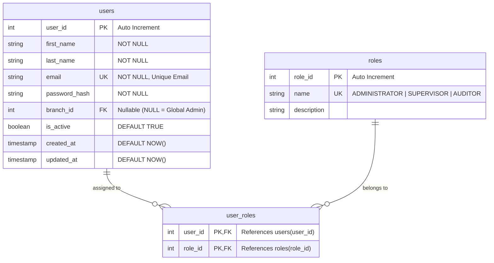
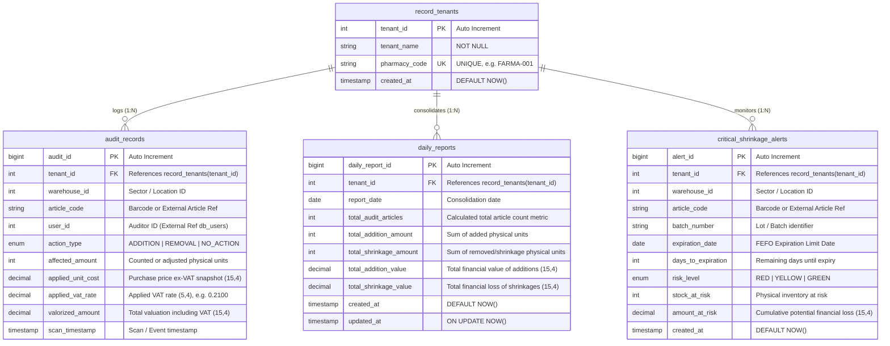

# Task Specification for DB-Agent: Database Setup for `db_users` and `db_analytics`

## 1. Overview & Objective

The goal of this task is for the **`db-agent`** to create, configure, and initialize two distinct PostgreSQL databases (or schemas) required by the SaaS Stock Deposit Control application:

1. **`db_users`**: Manages user authentication, profile data, branch associations, and Role-Based Access Control (RBAC).
2. **`db_analytics`**: Serves as the central data warehouse/analytical store for tenant audit events, consolidated daily performance metrics, and critical product shrinkage/expiry alerts.

All entity names, attribute names, table definitions, ENUMs, and constraints MUST be defined in **English** using standard PostgreSQL and SQL best practices.

---

## 2. Scope & Technical Deliverables

The `db-agent` must deliver the following artifacts:

1. **DDL Migration Scripts**: Clean, idempotent SQL script files (or framework migrations) for creating database tables, indexes, keys, check constraints, and ENUM types for both databases.
2. **Seed Data Scripts**: Pre-populated default records (e.g., system roles: `ADMINISTRATOR`, `SUPERVISOR`, `AUDITOR`).
3. **Indexes & Performance Tuning**: Primary keys, foreign key indexes, unique constraints, and search indexes (e.g., `article_code`, `tenant_id`, timestamp ranges).
4. **Verification Test Suite**: SQL queries or test scripts to validate relational integrity, schema creation, and index coverage.

---

## 3. Database Specification 1: User & Auth Database (`db_users`)

### 3.1 Overview
`db_users` stores identity records and permissions. It supports multi-branch assignments (`branch_id`) where a `NULL` value designates a Global Administrator.

### 3.2 Entity-Relationship Diagram (English)

### 3.3 Table Definitions & Requirements

#### Table: `users`
* **`user_id`**: `INT` / `SERIAL` | **PRIMARY KEY** | Auto Increment.
* **`first_name`**: `VARCHAR(100)` | **NOT NULL** | User's first name.
* **`last_name`**: `VARCHAR(100)` | **NOT NULL** | User's last name.
* **`email`**: `VARCHAR(255)` | **NOT NULL** | **UNIQUE** index. Primary login credential.
* **`password_hash`**: `VARCHAR(255)` | **NOT NULL** | Securely hashed user password.
* **`branch_id`**: `INT` | **NULLABLE** | Foreign reference to branch/sucursal. A `NULL` value indicates global system administrator status.
* **`is_active`**: `BOOLEAN` | **NOT NULL** | **DEFAULT `TRUE`**. Soft activation status flag.
* **`created_at`**: `TIMESTAMPTZ` | **NOT NULL** | **DEFAULT `CURRENT_TIMESTAMP`**.
* **`updated_at`**: `TIMESTAMPTZ` | **NOT NULL** | **DEFAULT `CURRENT_TIMESTAMP`**. Updated on change.

#### Table: `roles`
* **`role_id`**: `INT` / `SERIAL` | **PRIMARY KEY** | Auto Increment.
* **`name`**: `VARCHAR(50)` | **NOT NULL** | **UNIQUE**. Expected values: `'ADMINISTRATOR'`, `'SUPERVISOR'`, `'AUDITOR'`.
* **`description`**: `TEXT` | **NULLABLE** | Functional summary of permissions granted by this role.

#### Table: `user_roles` (Junction Table)
* **`user_id`**: `INT` | **PRIMARY KEY**, **FOREIGN KEY** -> `users(user_id)` ON DELETE CASCADE.
* **`role_id`**: `INT` | **PRIMARY KEY**, **FOREIGN KEY** -> `roles(role_id)` ON DELETE CASCADE.

---

## 4. Database Specification 2: Analytics Database (`db_analytics`)

### 4.1 Overview
`db_analytics` captures transactional audit logs, aggregated daily snapshot metrics, and predictive stock expiration/shrinkage alerts across tenants.

### 4.2 Entity-Relationship Diagram (English)

### 4.3 Table Definitions & Requirements

#### 1. Table: `record_tenants`
* **`tenant_id`**: `INT` / `SERIAL` | **PRIMARY KEY** | Auto Increment.
* **`tenant_name`**: `VARCHAR(150)` | **NOT NULL** | Human-readable name of the tenant/pharmacy.
* **`pharmacy_code`**: `VARCHAR(50)` | **NOT NULL** | **UNIQUE**. Unique business identification code (e.g. `'FARMA-001'`).
* **`created_at`**: `TIMESTAMPTZ` | **NOT NULL** | **DEFAULT `CURRENT_TIMESTAMP`**.

#### 2. Table: `audit_records`
* **`audit_id`**: `BIGINT` / `BIGSERIAL` | **PRIMARY KEY** | Auto Increment.
* **`tenant_id`**: `INT` | **NOT NULL** | **FOREIGN KEY** -> `record_tenants(tenant_id)` ON DELETE RESTRICT.
* **`warehouse_id`**: `INT` | **NOT NULL** | Sector / Warehouse identifier.
* **`article_code`**: `VARCHAR(100)` | **NOT NULL** | Article SKU or GTIN barcode reference.
* **`user_id`**: `INT` | **NOT NULL** | External reference to `db_users.users(user_id)` who performed the scan.
* **`action_type`**: `ENUM('ADDITION', 'REMOVAL', 'NO_ACTION')` | **NOT NULL** | Mapped from original ALTA (`ADDITION`), BAJA (`REMOVAL`), SIN_ACCION (`NO_ACTION`).
* **`affected_amount`**: `INT` | **NOT NULL** | Number of physical units counted/adjusted.
* **`applied_unit_cost`**: `DECIMAL(15,4)` | **NOT NULL** | Unit purchase cost snapshot excluding VAT.
* **`applied_vat_rate`**: `DECIMAL(5,4)` | **NOT NULL** | Applied tax rate multiplier (e.g. `0.2100` for 21% VAT).
* **`valorized_amount`**: `DECIMAL(15,4)` | **NOT NULL** | Calculated total financial valuation with VAT applied: `affected_amount * applied_unit_cost * (1 + applied_vat_rate)`.
* **`scan_timestamp`**: `TIMESTAMPTZ` | **NOT NULL** | Exact date and time when article scan occurred.

#### 3. Table: `daily_reports`
* **`daily_report_id`**: `BIGINT` / `BIGSERIAL` | **PRIMARY KEY** | Auto Increment.
* **`tenant_id`**: `INT` | **NOT NULL** | **FOREIGN KEY** -> `record_tenants(tenant_id)` ON DELETE RESTRICT.
* **`report_date`**: `DATE` | **NOT NULL** | Day for which metrics are consolidated.
* **`total_audit_articles`**: `INT` | **NOT NULL** | Total number of distinct articles audited during the day.
* **`total_addition_amount`**: `INT` | **NOT NULL** | Sum of physical units added (`ADDITION`).
* **`total_shrinkage_amount`**: `INT` | **NOT NULL** | Sum of physical units lost/removed (`REMOVAL`).
* **`total_addition_value`**: `DECIMAL(15,4)` | **NOT NULL** | Total monetary value of stock additions.
* **`total_shrinkage_value`**: `DECIMAL(15,4)` | **NOT NULL** | Total monetary value of stock shrinkage/loss.
* **`created_at`**: `TIMESTAMPTZ` | **NOT NULL** | **DEFAULT `CURRENT_TIMESTAMP`**.
* **`updated_at`**: `TIMESTAMPTZ` | **NOT NULL** | **DEFAULT `CURRENT_TIMESTAMP`**.

#### 4. Table: `critical_shrinkage_alerts`
* **`alert_id`**: `BIGINT` / `BIGSERIAL` | **PRIMARY KEY** | Auto Increment.
* **`tenant_id`**: `INT` | **NOT NULL** | **FOREIGN KEY** -> `record_tenants(tenant_id)` ON DELETE RESTRICT.
* **`warehouse_id`**: `INT` | **NOT NULL** | Sector / Warehouse identifier.
* **`article_code`**: `VARCHAR(100)` | **NOT NULL** | Article barcode/reference code.
* **`batch_number`**: `VARCHAR(100)` | **NOT NULL** | Lot / Batch identifier.
* **`expiration_date`**: `DATE` | **NOT NULL** | Expiration limit date under FEFO (First Expired, First Out).
* **`days_to_expiration`**: `INT` | **NOT NULL** | Computed remaining days until expiry.
* **`risk_level`**: `ENUM('RED', 'YELLOW', 'GREEN')` | **NOT NULL** | Calculated alert tier based on days to expiry and financial exposure.
* **`stock_at_risk`**: `INT` | **NOT NULL** | Total physical quantity vulnerable to expiration or damage.
* **`amount_at_risk`**: `DECIMAL(15,4)` | **NOT NULL** | Cumulative financial exposure for this stock batch.
* **`created_at`**: `TIMESTAMPTZ` | **NOT NULL** | **DEFAULT `CURRENT_TIMESTAMP`**.

---

## 5. Execution Instructions for `db-agent`

1. **Database Provisioning**:
   - Ensure PostgreSQL databases `db_users` and `db_analytics` are created (or distinct schema namespaces if using single-database tenancy).

2. **Enum Creation**:
   - Create custom PostgreSQL ENUM types before creating tables:
     - `action_type_enum`: `'ADDITION'`, `'REMOVAL'`, `'NO_ACTION'`
     - `risk_level_enum`: `'RED'`, `'YELLOW'`, `'GREEN'`

3. **Indexes to Create**:
   - `db_users`:
     - `idx_users_email` UNIQUE (`email`)
     - `idx_users_branch_id` ON `users(branch_id)`
   - `db_analytics`:
     - `idx_audit_tenant_scan` ON `audit_records(tenant_id, scan_timestamp DESC)`
     - `idx_audit_article` ON `audit_records(article_code)`
     - `idx_daily_reports_tenant_date` UNIQUE ON `daily_reports(tenant_id, report_date)`
     - `idx_alerts_tenant_risk` ON `critical_shrinkage_alerts(tenant_id, risk_level, expiration_date)`

4. **Seed Data Creation**:
   - Insert standard roles into `db_users.roles`:
     - `('ADMINISTRATOR', 'Full system access and global configuration')`
     - `('SUPERVISOR', 'Branch-level management and audit validation permissions')`
     - `('AUDITOR', 'Field auditing, counting, and scan execution permissions')`

5. **Cross-Database Identity Integrity**:
   - `user_id` in `db_analytics.audit_records` refers to `db_users.users(user_id)`. Maintain logical foreign key constraints via microservice/API validation layers.

---

## 6. Acceptance Criteria Checklist

- [ ] All tables created in English with exact specified data types and precise `DECIMAL(15,4)` / `DECIMAL(5,4)` scale.
- [ ] Primary keys, auto-increments (`SERIAL` / `BIGSERIAL`), and foreign keys enforced.
- [ ] Default values (`DEFAULT CURRENT_TIMESTAMP`, `DEFAULT TRUE`) applied.
- [ ] `ENUM` values created with upper-case English values (`ADDITION`, `REMOVAL`, `NO_ACTION`, `RED`, `YELLOW`, `GREEN`).
- [ ] Roles pre-seeded in `db_users.roles`.
- [ ] Indexes created for high-performance querying on tenant IDs, dates, barcodes, and risk levels.
- [ ] SQL DDL files stored cleanly in version control under migrations.
